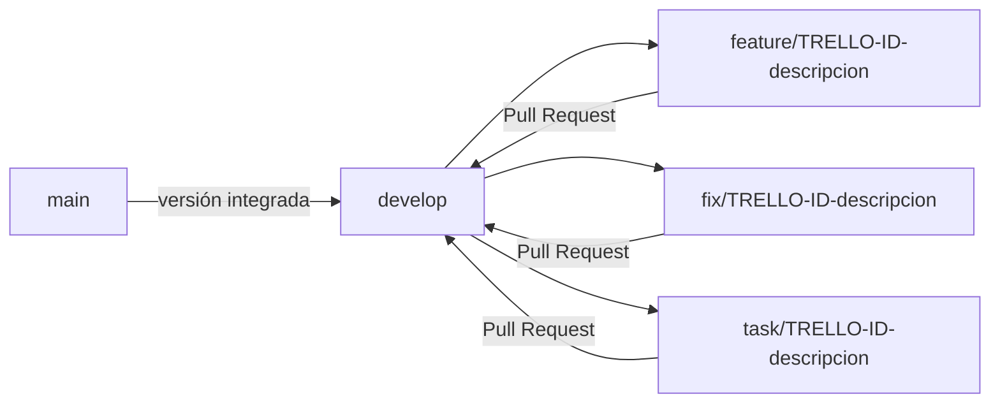

# Contribuir a VINTRA

Guía de colaboración para código, documentación e infraestructura. Mantén las instrucciones alineadas con los scripts, workflows y rutas que existen en el repositorio.

## Contenido

- [Antes de empezar](#antes-de-empezar)
- [Ramas y flujo de trabajo](#ramas-y-flujo-de-trabajo)
- [Commits y Pull Requests](#commits-y-pull-requests)
- [Validación local](#validación-local)
- [Checks de GitHub Actions](#checks-de-github-actions)

## Antes de empezar

Clona el repositorio e instala Docker Compose v2. Para desarrollo local usa Node.js 24 LTS y npm, como en el workflow del backend; no uses Node.js 25, que no está dentro de los rangos de versiones declarados por las dependencias.

```bash
git clone https://github.com/Univalle-P-I/VINTRA.git
cd VINTRA
```

Copia `.env.example` a `.env` para el desarrollo local. `.env` está ignorado por Git. No subas contraseñas, tokens ni credenciales reales.

## Ramas y flujo de trabajo

Las ramas de trabajo parten de `develop` y se integran mediante Pull Request:



- `feature/`: funcionalidad nueva.
- `fix/`: corrección.
- `task/`: documentación, mantenimiento o configuración.

Incluye el ID de Trello acordado por el equipo cuando exista. No inventes IDs ni asocies una tarea a una tarjeta que no corresponda.

```bash
git switch develop
git pull --ff-only origin develop
git switch -c task/TRELLO-123-descripcion-corta
```

Mantén el cambio enfocado. Antes del commit, revisa el estado, el diff y los errores de whitespace:

```bash
git status
git diff --check
git diff
```

Agrega solo los archivos que pertenecen a la tarea; evita `git add .` si hay archivos locales ajenos.

## Commits y Pull Requests

Usa mensajes breves con prefijo convencional:

| Prefijo | Uso |
| --- | --- |
| `feat:` | Funcionalidad nueva |
| `fix:` | Corrección |
| `docs:` | Documentación |
| `test:` | Pruebas |
| `refactor:` | Reorganización interna sin cambio funcional |
| `chore:` | Mantenimiento o configuración |

Abre el Pull Request hacia `develop` usando la [plantilla del repositorio](.github/PULL_REQUEST_TEMPLATE.md). Incluye objetivo, alcance, Issue/Trello relacionado, comandos realmente ejecutados y resultados. Adjunta capturas para cambios visuales y evidencia apropiada para backend o CI; para documentación, el diff revisado es suficiente. Asigna una persona revisora y atiende los comentarios en la misma rama.

## Validación local

### Frontend

```bash
cd frontend
npm ci
npm run lint
npm test
npm run build
```

### Backend

Las pruebas end-to-end necesitan PostgreSQL disponible con los valores configurados en `.env`:

```bash
cd backend
npm ci
npm run lint
npm test -- --runInBand
npm run test:e2e -- --runInBand
npm run build
```

### Integración Docker Compose

Desde la raíz del repositorio:

```bash
docker compose config --quiet
docker compose up --build -d
```

Comprueba <http://localhost:5174> y los endpoints `http://localhost:3002/health` y `http://localhost:3002/health/db`. Al terminar, `docker compose down` detiene los servicios y conserva el volumen de PostgreSQL. No uses `docker compose down -v` si necesitas los datos.

## Checks de GitHub Actions

En Pull Requests hacia `develop`, el workflow `ci.yml` ejecuta:

- Backend: lint, pruebas unitarias, pruebas end-to-end contra PostgreSQL y build (`backend.yml`).
- Frontend: lint y build (`frontend.yml`).
- Repositorio: `git diff --check`, markdownlint y revisión de enlaces del README.

Los workflows `sonarqube.yml` y `deploy.yml` tienen eventos y requisitos propios; consulta sus definiciones antes de asumir que se ejecutan en cada Pull Request. Un workflow definido no prueba por sí solo que el job haya pasado: revisa los checks del PR y reporta solo resultados observados.
