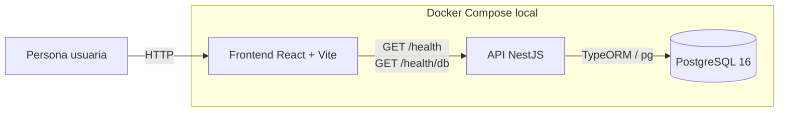

<div align="center">


### Coordinación y seguimiento de rutas de recolección para Buenaventura


[](frontend/)
[](backend/)
[](database/)

[Abrir sitio VINTRA](https://vintra.qsuene.com) · [Arquitectura](docs/ARCHITECTURE.md) · [Documentación](docs/README.md) · [Contribuir](CONTRIBUTING.md)

</div>

---

VINTRA busca hacer más visible y coordinada la operación de recolección de residuos: conecta a quienes planifican las rutas con la ciudadanía que necesita consultar el servicio y reportar novedades.

> **Estado actual:** el repositorio integra una interfaz React, una API NestJS y PostgreSQL. La versión ejecutable sirve como base de integración y comprobación de conectividad. La gestión de rutas, el tracking de vehículos, los reportes ciudadanos, la autenticación y las notificaciones aún no están implementados como funcionalidades completas.

## Inicio rápido

Requisitos: Docker con Docker Compose v2. Para ejecutar los servicios directamente en el host, recomendamos Node.js 24 LTS (el backend requiere Node.js 22.22.3+, 24.15+ o 26+ según las dependencias fijadas) y npm. Evita Node.js 25, que no está dentro de los rangos declarados por los paquetes.

```powershell
Copy-Item .env.example .env
docker compose up --build -d
```

Abre <http://localhost:5174>. La sección **Estado del entorno** comprueba la API y PostgreSQL. También puedes verificar los endpoints desde PowerShell:

```powershell
Invoke-RestMethod http://localhost:3002/health
Invoke-RestMethod http://localhost:3002/health/db
```

Para detener los contenedores y conservar los datos locales:

```powershell
docker compose down
```

La contraseña de `.env.example` es únicamente para desarrollo local. Cámbiala en cualquier entorno compartido y nunca publiques `.env` ni secretos.

## Qué funciona hoy

| Área | Implementado en este repositorio | Pendiente |
| --- | --- | --- |
| Interfaz | Aplicación React/Vite; consulta y muestra el estado de la API y de la conexión a PostgreSQL. | Flujos completos de operador y ciudadanía. |
| API | NestJS con `GET /health` y `GET /health/db`. | Módulos funcionales de rutas, vehículos, asignaciones y reportes. |
| Persistencia | PostgreSQL 16 en Docker Compose; TypeORM comprueba la conexión. | Migraciones y modelo desplegado; no hay entidades de negocio cargadas aún. |
| Entorno local | Docker Compose y ejecución independiente de frontend/API. | Configuración de producción y despliegue VPS verificable. |

El diagrama muestra únicamente las conexiones que están implementadas ahora:



## Ejecutar en modo desarrollo

Desde la raíz del repositorio, prepara el entorno y arranca PostgreSQL:

```powershell
Copy-Item .env.example .env
docker compose up -d postgres
```

En una terminal, inicia la API:

```powershell
Set-Location backend
npm ci
npm run start:dev
```

En otra terminal, inicia Vite:

```powershell
Set-Location frontend
npm ci
npm run dev
```

El frontend estará en <http://localhost:5173>; la API en <http://localhost:3002>. Los comandos de `npm` posteriores a `Set-Location` se ejecutan desde la carpeta indicada.

## Configuración

`.env.example` documenta las variables para ejecución local desde el host. Docker Compose define los valores de red propios de los contenedores, por lo que la API usa `postgres:5432` dentro de Compose y `localhost:5433` desde el host.

| Variable | Uso | Valor de ejemplo local |
| --- | --- | --- |
| `POSTGRES_DB` | Nombre de la base de datos | `vintra` |
| `POSTGRES_USER` | Usuario PostgreSQL | `vintra_user` |
| `POSTGRES_PASSWORD` | Contraseña local de PostgreSQL | `vintra_password` |
| `POSTGRES_PORT` | Puerto publicado del contenedor PostgreSQL | `5433` |
| `DB_HOST`, `DB_PORT` | Conexión de la API ejecutada en el host | `localhost`, `5433` |
| `PORT` | Puerto HTTP de la API en el host | `3002` |
| `CORS_ORIGIN` | Origen permitido para la API en modo host | `http://localhost:5173` |
| `VITE_API_URL` | URL de API que compila el frontend | `http://localhost:3002` |

En Docker Compose, `DB_HOST`, `DB_PORT`, `PORT` y `CORS_ORIGIN` se configuran en el servicio `backend`; no cambies el host `postgres` por `localhost` dentro de la red de contenedores. `VITE_API_URL` se incorpora durante el build de la imagen frontend.

En producción, `VITE_API_URL_PRODUCTION` (variable opcional de Actions) toma por defecto `https://vintra.qsuene.com/api`; en staging, `VITE_API_URL_STAGING` toma `http://vintra.qsuene.com:8080/api`. Los workflows verifican `/health` y `/health/db` antes de publicar. El backend debe permitir el origen del sitio mediante `CORS_ORIGIN`. Consulta [la guía de despliegue](docs/infraestructura/VPS.md).

## Validaciones

Los checks de GitHub Actions ejecutan las validaciones de backend y frontend en Pull Requests. También puedes correrlas localmente:

```powershell
# API (requiere PostgreSQL disponible para las pruebas e2e)
Set-Location backend
npm ci
npm run lint
npm test -- --runInBand
npm run test:e2e -- --runInBand
npm run build
```

```powershell
# Interfaz
Set-Location frontend
npm ci
npm run lint
npm test
npm run build
```

Para validar la configuración de contenedores sin arrancarlos: `docker compose config --quiet`.

## Documentación

- [Índice y estado de la documentación](docs/README.md)
- [Arquitectura implementada y límites actuales](docs/ARCHITECTURE.md)
- [Contratos propuestos para la API](docs/API_SPECIFICATION.md) — propuesta, no refleja endpoints de negocio ya implementados.
- [Diseño de datos](docs/DATABASE_DESIGN.md) — referencia del equipo de Base de Datos; aún no hay migraciones ejecutables.
- [Operación del VPS](docs/infraestructura/VPS.md) — validar antes de usar como runbook de producción.
- [Contribuir y abrir Pull Requests](CONTRIBUTING.md)
- [Propuesta académica del proyecto](VINTRA.pdf)

## Estructura

```text
.
├── .github/       # Workflows y plantillas de Issues/Pull Requests
├── backend/       # API NestJS y pruebas
├── frontend/      # Interfaz React/Vite
├── database/      # Destino para migraciones y scripts (pendientes)
├── infrastructure/# Documentación de infraestructura
├── docs/          # Arquitectura, contratos y documentación por área
├── scripts/       # Comprobaciones reutilizables de despliegue
├── docker-compose.yml
└── README.md
```

## Licencia

Este proyecto se distribuye bajo [Apache License 2.0](LICENSE).
