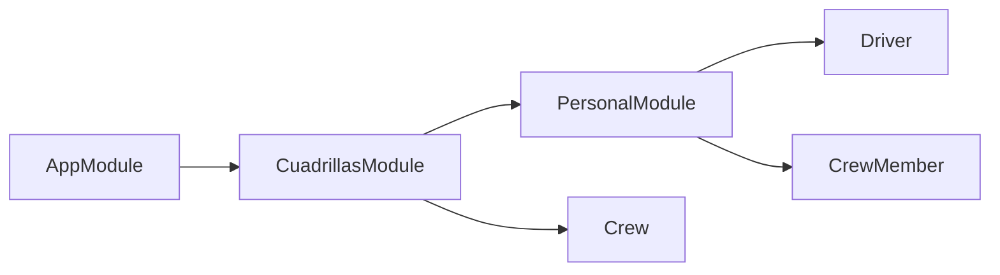

# Módulo Cuadrillas

Estructura inicial del módulo de cuadrillas de VINTRA (tarjeta #127). Define
la entidad de la cuadrilla y su dependencia respecto al personal operativo.

**Estado:** estructura sin endpoints ni lógica de negocio. La composición de
cuadrillas y la disponibilidad se implementan en VIN-024 (#76).

## Estructura

```text
cuadrillas/
├── dto/
│   ├── create-crew.dto.ts
│   └── update-crew.dto.ts
├── entities/
│   └── crew.entity.ts
├── cuadrillas.controller.ts
├── cuadrillas.module.spec.ts
├── cuadrillas.module.ts
└── cuadrillas.service.ts
```

## Dependencias entre módulos



| Módulo | Relación | Detalle |
| --- | --- | --- |
| `AppModule` | Importa `CuadrillasModule` | Registro del módulo en la aplicación. |
| `CuadrillasModule` | Importa `PersonalModule` | Dependencia de Cuadrillas respecto al personal operativo. |
| `CuadrillasService` | Inyecta `PersonalService` | Se usará para componer cuadrillas en VIN-024. |

## Correspondencia con las tablas

| Entidad | Tabla | Migración de referencia |
| --- | --- | --- |
| `Crew` | `crew` | `014_create_crew.sql` |

Columnas de `crew`: `id`, `name`, `is_active`, `created_at` y `updated_at`.

`created_at` y `updated_at` los asigna la base de datos (valor por defecto
`now()` y trigger de `updated_at`), por lo que la entidad los declara con
`insert: false` y `update: false`.

## Relaciones provisionales

Las relaciones están marcadas como `PROVISIONAL` en el código mientras la
PR #115 no esté aprobada.

| Relación | Tipo | Observación |
| --- | --- | --- |
| `Crew` → `CrewMember` | Uno a muchos | La FK vive en `crew_member.crew_id`. |
| `Crew` → `Driver` | Uno a muchos | La FK vive en `driver.crew_id`. |

## Alcance de esta tarjeta

Incluye:

- Módulo, controlador, servicio, entidad y DTO registrados.
- Importación de `PersonalModule` desde `CuadrillasModule`.
- Pruebas de carga del módulo, de la dependencia con Personal y de
  correspondencia con la tabla.

No incluye (queda para VIN-024, #76):

- CRUD de cuadrillas.
- Validaciones de los DTO.
- Asignar o quitar miembros de una cuadrilla.
- Disponibilidad del personal.

## Verificación

Desde la carpeta `backend`:

```bash
npm run build
npm run lint
npm test -- --runInBand
```