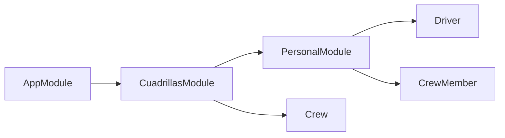

# Módulo Cuadrillas

Módulo de cuadrillas de VINTRA. Estructura inicial en la tarjeta #127 y CRUD
en la tarjeta #76 (VIN-024). Define la entidad de la cuadrilla y su
dependencia respecto al personal operativo.

**Estado:** CRUD de cuadrillas. La composición de cuadrillas y la
disponibilidad se implementan en PR posteriores.

## Estructura

```text
cuadrillas/
├── dto/
│   ├── create-crew.dto.ts
│   ├── list-crews-query.dto.ts
│   └── update-crew.dto.ts
├── entities/
│   └── crew.entity.ts
├── cuadrillas.controller.spec.ts
├── cuadrillas.controller.ts
├── cuadrillas.module.spec.ts
├── cuadrillas.module.ts
└── cuadrillas.service.ts
```

## Dependencias entre módulos



| Módulo | Relación | Detalle |
| --- | --- | --- |
| `AppModule` | Importa `CuadrillasModule` | Registro del módulo en la aplicación. |
| `CuadrillasModule` | Importa `PersonalModule` | Dependencia de Cuadrillas respecto al personal operativo. |
| `CuadrillasService` | Inyecta `PersonalService` | Se usará para componer cuadrillas en un PR posterior de #76. |

## Endpoints

Rutas bajo el prefijo `/cuadrillas`. Las respuestas devuelven la entidad con
sus campos en `camelCase` (`id`, `name`, `isActive`, `createdAt`, etc.). No
incluyen a los integrantes: se consultan en `/personal/crew-members?crewId=`
y `/personal/drivers?crewId=`.

| Método | Ruta | Descripción | Respuestas |
| --- | --- | --- | --- |
| `POST` | `/cuadrillas` | Crea una cuadrilla | `201`, `400` |
| `GET` | `/cuadrillas` | Lista cuadrillas (filtro `isActive`) | `200`, `400` |
| `GET` | `/cuadrillas/:id` | Consulta una cuadrilla | `200`, `400`, `404` |
| `PATCH` | `/cuadrillas/:id` | Actualiza nombre o estado | `200`, `400`, `404` |
| `DELETE` | `/cuadrillas/:id` | Baja lógica de la cuadrilla | `200`, `400`, `404` |

## Reglas del CRUD

| Tema | Comportamiento |
| --- | --- |
| Baja | `DELETE` pone `is_active` en `false` y devuelve el registro. No hay borrado físico, porque las claves foráneas de `driver` y `crew_member` usan `ON DELETE CASCADE`. |
| Restaurar | `PATCH` con `{ "isActive": true }`. |
| Listados | Solo cuadrillas activas por defecto; `?isActive=false` devuelve las inactivas. Orden estable por `created_at` e `id`. Sin paginación hasta que #66 la defina. |
| Validación | Se rechazan propiedades desconocidas en el cuerpo y en los filtros. `name` es obligatorio, admite hasta 100 caracteres y se recortan los espacios. En la actualización, `null` se rechaza. |
| Errores | Id inexistente: `404`. Datos inválidos: `400`. El formato común de errores queda pendiente de #66, así que se usan las respuestas por defecto de NestJS. |
| Seguridad | Sin autenticación ni permisos hasta que se aprueben #54, #70 y #71. |

## Contrato de entrada

Todos los campos de las solicitudes se validan con `class-validator`. Se
rechaza cualquier propiedad que no figure en las tablas.

### Crear cuadrilla

| Campo | Tipo | Obligatorio | Regla |
| --- | --- | --- | --- |
| `name` | `string` | Sí | No vacío, hasta 100 caracteres. Se recortan los espacios. |

### Actualizar cuadrilla

Todos los campos son opcionales: omitir uno lo deja sin cambios. Ningún campo
admite `null`.

| Campo | Tipo | Regla |
| --- | --- | --- |
| `name` | `string` | No vacío, hasta 100 caracteres. Se recortan los espacios. No admite `null`. |
| `isActive` | `boolean` | `false` da de baja y `true` restaura. No admite `null`. |

### Filtros del listado

| Parámetro | Tipo | Regla |
| --- | --- | --- |
| `isActive` | `true` o `false` | Sin este parámetro solo se listan las cuadrillas activas. |

## Ejemplos

Los valores son ilustrativos.

### Ejemplo: crear una cuadrilla

```http
POST /cuadrillas
Content-Type: application/json
```

```json
{
  "name": "Cuadrilla Norte"
}
```

Respuesta `201`:

```json
{
  "id": "9a8b7c6d-5e4f-4a3b-8c2d-1e0f9a8b7c6d",
  "name": "Cuadrilla Norte",
  "isActive": true,
  "createdAt": "2026-11-19T14:30:00.000Z",
  "updatedAt": "2026-11-19T14:30:00.000Z"
}
```

### Ejemplo: dar de baja y restaurar

```http
DELETE /cuadrillas/9a8b7c6d-5e4f-4a3b-8c2d-1e0f9a8b7c6d
```

```http
PATCH /cuadrillas/9a8b7c6d-5e4f-4a3b-8c2d-1e0f9a8b7c6d
Content-Type: application/json
```

```json
{
  "isActive": true
}
```

### Ejemplo: respuestas de error

Cuerpo inválido (`400`):

```json
{
  "message": ["name should not be empty"],
  "error": "Bad Request",
  "statusCode": 400
}
```

Recurso inexistente (`404`):

```json
{
  "message": "La cuadrilla no existe.",
  "error": "Not Found",
  "statusCode": 404
}
```

## Correspondencia con las tablas

| Entidad | Tabla | Migración de referencia |
| --- | --- | --- |
| `Crew` | `crew` | `014_create_crew.sql` |

Columnas de `crew`: `id`, `name`, `is_active`, `created_at` y `updated_at`.

`created_at` y `updated_at` los asigna la base de datos (valor por defecto
`now()` y trigger de `updated_at`), por lo que la entidad los declara con
`insert: false` y `update: false`.

## Relaciones provisionales

Las relaciones están marcadas como `PROVISIONAL` en el código mientras el
esquema de la PR #115 no esté fusionado en `develop`.

| Relación | Tipo | Observación |
| --- | --- | --- |
| `Crew` → `CrewMember` | Uno a muchos | La FK vive en `crew_member.crew_id`. |
| `Crew` → `Driver` | Uno a muchos | La FK vive en `driver.crew_id`. |

## Alcance

Incluye:

- CRUD de cuadrillas con baja lógica.
- Validación de los DTO.
- Pruebas HTTP de los endpoints con repositorios en memoria.

No incluye (queda para PR posteriores de #76):

- Composición de cuadrillas con reglas (asignar y quitar personal).
- Turnos y disponibilidad.
- Autenticación y permisos.

## Verificación

Desde la carpeta `backend`:

```bash
npm run build
npm run lint
npm test -- --runInBand
```