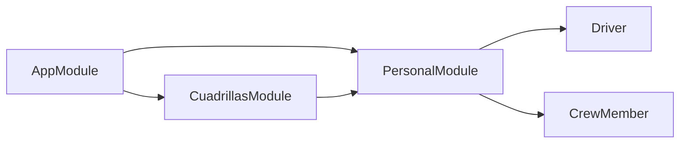

# Módulo Personal

Estructura inicial del módulo de personal operativo de VINTRA (tarjeta #127).
Agrupa las entidades de conductores y miembros de cuadrilla, y es la
dependencia de la que parte el módulo de Cuadrillas.

**Estado:** estructura sin endpoints ni lógica de negocio. El CRUD y la
disponibilidad se implementan en VIN-024 (#76).

## Estructura

```text
personal/
├── dto/
│   ├── create-crew-member.dto.ts
│   ├── create-driver.dto.ts
│   ├── update-crew-member.dto.ts
│   └── update-driver.dto.ts
├── entities/
│   ├── crew-member.entity.ts
│   └── driver.entity.ts
├── personal.controller.ts
├── personal.module.spec.ts
├── personal.module.ts
└── personal.service.ts
```

## Dependencias entre módulos



| Módulo | Relación | Detalle |
| --- | --- | --- |
| `AppModule` | Importa `PersonalModule` | Registro del módulo en la aplicación. |
| `CuadrillasModule` | Importa `PersonalModule` | Cuadrillas depende del personal operativo. |
| `PersonalModule` | Exporta `PersonalService` y `TypeOrmModule` | Permite que Cuadrillas reutilice el servicio y los repositorios. |

## Correspondencia con las tablas

| Entidad | Tabla | Migración de referencia |
| --- | --- | --- |
| `Driver` | `driver` | `016_create_driver.sql` |
| `CrewMember` | `crew_member` | `015_create_crew_member.sql` |

Columnas de `driver`: `id`, `user_account_id`, `crew_id`, `started_at`,
`ended_at`, `is_active`, `created_at` y `updated_at`.

Columnas de `crew_member`: `id`, `crew_id`, `full_name`, `is_active`,
`created_at` y `updated_at`.

`created_at` y `updated_at` los asigna la base de datos (valor por defecto
`now()` y trigger de `updated_at`), por lo que las entidades los declaran con
`insert: false` y `update: false`.

## Relaciones provisionales

Las relaciones están marcadas como `PROVISIONAL` en el código mientras la
PR #115 no esté aprobada.

| Relación | Tipo | Observación |
| --- | --- | --- |
| `Driver` → `Crew` | Muchos a uno, opcional | FK `crew_id`, con `ON DELETE CASCADE` según la propuesta. |
| `CrewMember` → `Crew` | Muchos a uno, opcional | FK `crew_id`, con `ON DELETE CASCADE` según la propuesta. |
| `Driver` → cuenta de usuario | Pendiente | Se declara como relación cuando exista la entidad del módulo Usuarios y Perfiles (#125). |

## Alcance de esta tarjeta

Incluye:

- Módulo, controlador, servicio, entidades y DTO registrados.
- Prueba de carga del módulo y de correspondencia con las tablas.
No incluye (queda para VIN-024, #76):

- CRUD de conductores y miembros.
- Validaciones de los DTO.
- Composición de cuadrillas y disponibilidad.
## Verificación

Desde la carpeta `backend`:

```bash
npm run build
npm run lint
npm test -- --runInBand
```
