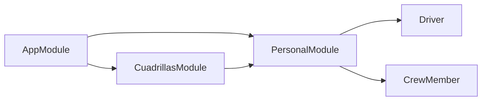

# Módulo Personal

Módulo del personal operativo de VINTRA: conductores y miembros de cuadrilla.
Estructura inicial en la tarjeta #127 y CRUD en la tarjeta #76 (VIN-024).

**Estado:** CRUD de conductores y de miembros de cuadrilla. La composición de
cuadrillas, los turnos y la disponibilidad se implementan en PR posteriores.

## Estructura

```text
personal/
├── dto/
│   ├── create-crew-member.dto.ts
│   ├── create-driver.dto.ts
│   ├── list-crew-members-query.dto.ts
│   ├── list-drivers-query.dto.ts
│   ├── update-crew-member.dto.ts
│   └── update-driver.dto.ts
├── entities/
│   ├── crew-member.entity.ts
│   └── driver.entity.ts
├── database-errors.ts
├── personal.controller.spec.ts
├── personal.controller.ts
├── personal.module.spec.ts
├── personal.module.ts
└── personal.service.ts
```

## Dependencias entre módulos



| Módulo | Relación | Detalle |
| --- | --- | --- |
| `AppModule` | Importa `PersonalModule` | Registro del módulo en la aplicación. |
| `CuadrillasModule` | Importa `PersonalModule` | Cuadrillas depende del personal operativo. |
| `PersonalModule` | Exporta `PersonalService` y `TypeOrmModule` | Permite que Cuadrillas reutilice el servicio y los repositorios. |

## Endpoints

Rutas bajo el prefijo `/personal`. Las respuestas devuelven la entidad con sus
campos en `camelCase` (`id`, `crewId`, `isActive`, `createdAt`, etc.).

| Método | Ruta | Descripción | Respuestas |
| --- | --- | --- | --- |
| `POST` | `/personal/drivers` | Registra un conductor | `201`, `400` |
| `GET` | `/personal/drivers` | Lista conductores (filtros `isActive` y `crewId`) | `200`, `400` |
| `GET` | `/personal/drivers/:id` | Consulta un conductor | `200`, `400`, `404` |
| `PATCH` | `/personal/drivers/:id` | Actualiza cuadrilla, fechas o estado | `200`, `400`, `404` |
| `DELETE` | `/personal/drivers/:id` | Baja lógica del conductor | `200`, `400`, `404` |
| `POST` | `/personal/crew-members` | Registra un miembro de cuadrilla | `201`, `400` |
| `GET` | `/personal/crew-members` | Lista miembros (filtros `isActive` y `crewId`) | `200`, `400` |
| `GET` | `/personal/crew-members/:id` | Consulta un miembro | `200`, `400`, `404` |
| `PATCH` | `/personal/crew-members/:id` | Actualiza nombre, cuadrilla o estado | `200`, `400`, `404` |
| `DELETE` | `/personal/crew-members/:id` | Baja lógica del miembro | `200`, `400`, `404` |

## Reglas del CRUD

| Tema | Comportamiento |
| --- | --- |
| Baja | `DELETE` pone `is_active` en `false` y devuelve el registro. No hay borrado físico, porque las claves foráneas usan `ON DELETE CASCADE`. |
| Restaurar | `PATCH` con `{ "isActive": true }`. |
| Listados | Solo registros activos por defecto; `?isActive=false` devuelve los inactivos. Orden estable por `created_at` e `id`. Sin paginación hasta que #66 la defina. |
| Validación | Se rechazan propiedades desconocidas en el cuerpo y en los filtros. Los identificadores deben ser UUID y las fechas ISO 8601. `fullName` admite hasta 120 caracteres y se recortan los espacios. |
| Fechas del conductor | `endedAt` no puede ser anterior a `startedAt`. |
| Errores | Id inexistente: `404`. Cuadrilla o cuenta de usuario inexistente (clave foránea) y fechas inválidas: `400`. El formato común de errores queda pendiente de #66, así que se usan las respuestas por defecto de NestJS. |
| Seguridad | Sin autenticación ni permisos hasta que se aprueben #54, #70 y #71. |

## Contrato de entrada

Todos los campos de las solicitudes se validan con `class-validator`. Se
rechaza cualquier propiedad que no figure en las tablas.

### Crear conductor

| Campo | Tipo | Obligatorio | Regla |
| --- | --- | --- | --- |
| `userAccountId` | `string` | Sí | UUID de la cuenta de usuario. |
| `crewId` | `string` | No | UUID de la cuadrilla. |
| `startedAt` | `string` | No | Fecha ISO 8601. Si se omite, la base de datos usa la fecha actual. |

### Actualizar conductor

Todos los campos son opcionales. No se puede cambiar la cuenta de usuario.

| Campo | Tipo | Regla |
| --- | --- | --- |
| `crewId` | `string` o `null` | UUID de la cuadrilla. `null` quita al conductor de su cuadrilla. |
| `startedAt` | `string` | Fecha ISO 8601. |
| `endedAt` | `string` o `null` | Fecha ISO 8601, no anterior a `startedAt`. `null` limpia el valor. |
| `isActive` | `boolean` | `false` da de baja y `true` restaura. |

### Crear miembro de cuadrilla

| Campo | Tipo | Obligatorio | Regla |
| --- | --- | --- | --- |
| `fullName` | `string` | Sí | No vacío, hasta 120 caracteres. Se recortan los espacios. |
| `crewId` | `string` | No | UUID de la cuadrilla. |

### Actualizar miembro de cuadrilla

Todos los campos son opcionales.

| Campo | Tipo | Regla |
| --- | --- | --- |
| `fullName` | `string` | No vacío, hasta 120 caracteres. Se recortan los espacios. |
| `crewId` | `string` o `null` | UUID de la cuadrilla. `null` saca al miembro de su cuadrilla. |
| `isActive` | `boolean` | `false` da de baja y `true` restaura. |

### Filtros de los listados

Aplican a `GET /personal/drivers` y a `GET /personal/crew-members`.

| Parámetro | Tipo | Regla |
| --- | --- | --- |
| `isActive` | `true` o `false` | Sin este parámetro solo se listan los activos. |
| `crewId` | UUID | Devuelve solo el personal de esa cuadrilla. |

## Ejemplos

Los valores son ilustrativos.

### Ejemplo: registrar un conductor

```http
POST /personal/drivers
Content-Type: application/json
```

```json
{
  "userAccountId": "3f1c2d4e-5a6b-4c7d-8e9f-0a1b2c3d4e5f",
  "crewId": "9a8b7c6d-5e4f-4a3b-8c2d-1e0f9a8b7c6d"
}
```

Respuesta `201`:

```json
{
  "id": "c0a80101-7b2e-4d5f-9a3c-2b1d4e6f8a90",
  "userAccountId": "3f1c2d4e-5a6b-4c7d-8e9f-0a1b2c3d4e5f",
  "crewId": "9a8b7c6d-5e4f-4a3b-8c2d-1e0f9a8b7c6d",
  "startedAt": "2026-11-19T14:30:00.000Z",
  "endedAt": null,
  "isActive": true,
  "createdAt": "2026-11-19T14:30:00.000Z",
  "updatedAt": "2026-11-19T14:30:00.000Z"
}
```

### Ejemplo: quitar la cuadrilla y dar de baja

```http
PATCH /personal/drivers/c0a80101-7b2e-4d5f-9a3c-2b1d4e6f8a90
Content-Type: application/json
```

```json
{
  "crewId": null
}
```

```http
DELETE /personal/drivers/c0a80101-7b2e-4d5f-9a3c-2b1d4e6f8a90
```

### Ejemplo: respuestas de error

Cuerpo inválido (`400`):

```json
{
  "message": ["userAccountId must be a UUID"],
  "error": "Bad Request",
  "statusCode": 400
}
```

Recurso inexistente (`404`):

```json
{
  "message": "El conductor no existe.",
  "error": "Not Found",
  "statusCode": 404
}
```

## Correspondencia con las tablas

| Entidad | Tabla | Migración de referencia |
| --- | --- | --- |
| `Driver` | `driver` | `016_create_driver.sql` |
| `CrewMember` | `crew_member` | `015_create_crew_member.sql` |

Columnas de `driver`: `id`, `user_account_id`, `crew_id`, `started_at`,
`ended_at`, `is_active`, `created_at` y `updated_at`.

Columnas de `crew_member`: `id`, `crew_id`, `full_name`, `is_active`,
`created_at` y `updated_at`.

`created_at` y `updated_at` los asigna la base de datos (valor por defecto
`now()` y trigger de `updated_at`), por lo que las entidades los declaran con
`insert: false` y `update: false`.

## Relaciones provisionales

Las relaciones están marcadas como `PROVISIONAL` en el código mientras el
esquema de la PR #115 no esté fusionado en `develop`.

| Relación | Tipo | Observación |
| --- | --- | --- |
| `Driver` → `Crew` | Muchos a uno, opcional | FK `crew_id`, con `ON DELETE CASCADE`. |
| `CrewMember` → `Crew` | Muchos a uno, opcional | FK `crew_id`, con `ON DELETE CASCADE`. |
| `Driver` → cuenta de usuario | Pendiente | `user_account_id` es una columna `uuid`; se declara como relación cuando exista la entidad del módulo Usuarios y Perfiles (#125). |

## Alcance

Incluye:

- CRUD de conductores y de miembros de cuadrilla con baja lógica.
- Validación de los DTO y traducción de errores de base de datos a `400`.
- Pruebas HTTP de los endpoints con repositorios en memoria.

No incluye (queda para PR posteriores de #76):

- Composición de cuadrillas con reglas (asignar y quitar personal).
- Turnos y disponibilidad.
- Autenticación y permisos.

## Verificación

Desde la carpeta `backend`:

```bash
npm run build
npm run lint
npm test -- --runInBand
```