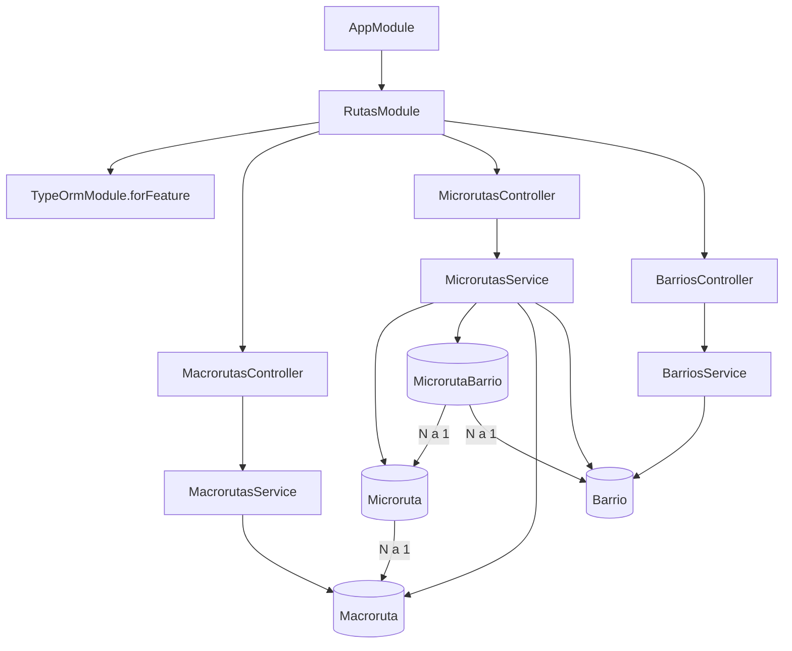

# Módulo de Rutas

Módulo de Rutas del backend: creación y consulta de macrorutas, microrutas y
barrios, y asociación de barrios a una microruta. Implementa
[#79 (VIN-027)](https://github.com/Univalle-P-I/VINTRA/issues/79).

> **Modelo de datos provisional.** Las entidades siguen el diccionario de
> `docs/DATABASE_DESIGN.md` y pueden cambiar hasta que se apruebe la
> [PR #115](https://github.com/Univalle-P-I/VINTRA/pull/115). Las columnas
> geométricas (`geom`, PostGIS) no están mapeadas: la API no las acepta ni las
> guarda.

## Estructura

```text
rutas/
├── rutas.module.ts
├── rutas.module.spec.ts
├── macrorutas/   controller, service, entities/macroruta, dto/
├── microrutas/   controller, service (+ spec), entities/microruta + microruta-barrio, dto/
└── barrios/      controller, service, entities/barrios, dto/
```

## Dependencias entre componentes



| Componente | Depende de |
| --- | --- |
| `MacrorutasController` | `MacrorutasService` |
| `MicrorutasController` | `MicrorutasService` |
| `BarriosController` | `BarriosService` |
| `MacrorutasService` | Repositorio de `Macroruta` |
| `MicrorutasService` | Repositorios de `Microruta`, `MicrorutaBarrio`, `Macroruta` y `Barrio` |
| `BarriosService` | Repositorio de `Barrio` |

Reglas del diseño:

- Cada servicio inyecta repositorios, no otros servicios; no hay dependencias
  entre servicios, así se evitan ciclos. `MicrorutasService` inyecta además los
  repositorios de `Macroruta` y `Barrio` para validar la macroruta padre y los
  barrios asociados.
- Relaciones: `Macroruta 1 — N Microruta`; `Microruta N — M Barrio` mediante
  `MicrorutaBarrio` (con `order_visit`).
- `RutasModule` exporta los tres servicios; no exporta `TypeOrmModule`.
- `AppModule` carga las entidades con `autoLoadEntities: true` y
  `synchronize: false`: este módulo no crea tablas.

## Endpoints

Prefijo global `/api/v1` (excepto `/health`). La documentación OpenAPI se
publica en `/api/docs`.

| Método y ruta | Descripción | Respuestas |
| --- | --- | --- |
| `POST /macrorutas` | Crea una macroruta | 201, 400 |
| `GET /macrorutas` | Lista macrorutas | 200 |
| `GET /macrorutas/:id` | Detalle de una macroruta | 200, 404 |
| `POST /microrutas` | Crea una microruta; exige una macroruta existente | 201, 400, 404 |
| `GET /microrutas` | Lista microrutas | 200 |
| `GET /microrutas/:id` | Detalle con macroruta y barrios ordenados por `ordenVisita` | 200, 404 |
| `POST /microrutas/:id/barrios` | Asocia barrios a una microruta y devuelve el detalle | 201, 400, 404, 409 |
| `GET /barrios` | Lista barrios (solo lectura) | 200 |
| `GET /barrios/:id` | Detalle de un barrio | 200, 404 |

Reglas de negocio:

- Una microruta requiere una macroruta existente; si no existe, responde `404`
  y no se guarda nada.
- Al asociar barrios, deben existir la microruta y todos los barrios; si falta
  alguno, responde `404` y no se guarda nada.
- Un barrio repetido en la solicitud responde `400`, y uno ya asociado responde
  `409`; en ambos casos no se guarda nada.
- Las entradas se validan con DTO: se rechazan propiedades desconocidas (por
  ejemplo, `geom`) y valores inválidos con `400`.
- Los errores usan el formato `statusCode`, `code`, `message`, `details` y
  `requestId`.

### Errores al asociar barrios

Cuerpo de la solicitud (`POST /microrutas/:id/barrios`):

```json
{
  "barrios": [
    { "barrioId": "uuid-del-barrio-1", "ordenVisita": 1 },
    { "barrioId": "uuid-del-barrio-2", "ordenVisita": 2 }
  ]
}
```

`400`: el mismo `barrioId` aparece más de una vez en la solicitud.

```json
{
  "statusCode": 400,
  "code": "VALIDATION_ERROR",
  "message": "La solicitud contiene campos no válidos.",
  "details": [
    {
      "field": "barrios",
      "reason": "No se puede repetir un barrio en la misma solicitud."
    }
  ],
  "requestId": "..."
}
```

`409`: algún barrio ya está asociado a la microruta. Se rechaza la solicitud
completa; no se guarda ninguno de los barrios enviados.

```json
{
  "statusCode": 409,
  "code": "CONFLICT",
  "message": "Uno o más barrios ya están asociados a la microruta.",
  "details": [],
  "requestId": "..."
}
```

## Correspondencia con el diccionario de BD

| Entidad | Tabla |
| --- | --- |
| `Macroruta` | `macroroute` |
| `Microruta` | `microroute` |
| `Barrio` | `btura_neighborhood` |
| `MicrorutaBarrio` | `microroute_neighborhood` |

## Pruebas

Requieren Node.js 24, la misma versión que usan el CI y el `Dockerfile`; con
otra versión las suites pueden fallar al cargar los módulos ESM de NestJS.

Las pruebas unitarias usan repositorios simulados y no requieren base de datos:

```bash
cd backend
npm test -- --runInBand
```

Las pruebas e2e se ejecutan contra PostgreSQL (`docker compose up -d` desde la
raíz del repositorio) y, por ahora, no cubren los endpoints de rutas:

```bash
cd backend
npm run test:e2e -- --runInBand
```

## Pendientes

- Aprobar PR #115 y ajustar entidades (nombres, unicidades, tipos).
- Migraciones y semillas, a la espera del esquema aprobado (#115).
- Prueba de integración contra PostgreSQL cuando exista el esquema.
- Restricción única en BD para (microruta, barrio): hoy la unicidad solo se
  valida en el servicio.
- Decidir PostGIS y geometrías (#54); `geom` no se acepta ni se guarda.
- Formato definitivo de errores y paginación (#66).
- Horarios (`schedule`, `microroute_schedule`) quedan fuera de este alcance.