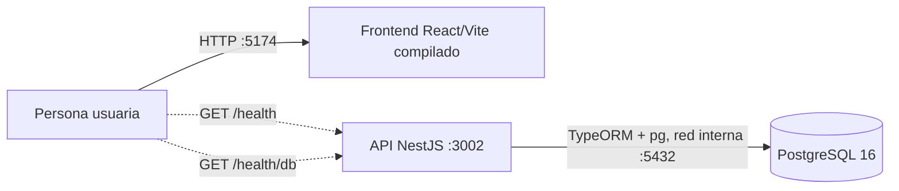
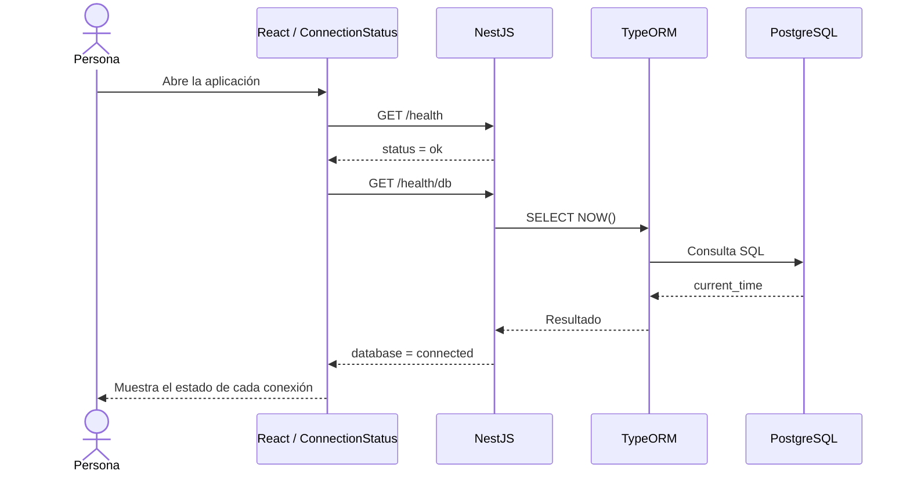

# Arquitectura de VINTRA

Este documento describe lo que está cableado en el repositorio. Para las capacidades funcionales aún propuestas, consulta [la especificación de API](API_SPECIFICATION.md) y el [diseño de datos](DATABASE_DESIGN.md); esos documentos no equivalen a implementación.

## Estado y componentes

| Componente | Implementación actual | Estado |
| --- | --- | --- |
| Interfaz | React y Vite; Axios consulta dos endpoints de salud y representa su resultado. | Funciona como interfaz de integración, no como dashboard operativo completo. |
| API | NestJS; `GET /health` y `GET /health/db`. | API base; sin módulos de negocio implementados. |
| Persistencia | PostgreSQL 16 y conexión TypeORM con el driver `pg`. | Comprueba conectividad; no se cargan entidades de negocio ni migraciones. |
| Orquestación local | Docker Compose con PostgreSQL, API y frontend servido por Nginx. | Entorno de desarrollo/demostración. |

## Diagrama de ejecución local

En modo desarrollo local, Vite sirve la interfaz en `http://localhost:5173` y NestJS en `http://localhost:3002`. El navegador llama directamente a la API según `VITE_API_URL`; CORS permite el origen configurado por `CORS_ORIGIN`.

## Endpoints implementados

| Método y ruta | Comportamiento |
| --- | --- |
| `GET /health` | Devuelve `status: ok` cuando responde el proceso NestJS. No prueba PostgreSQL. |
| `GET /health/db` | Ejecuta `SELECT NOW()` a través de TypeORM. Devuelve estado HTTP 500 si la consulta falla. |

La API no publica actualmente rutas para usuarios, vehículos, asignaciones, tracking ni reportes. Sus contratos candidatos se mantienen en [API_SPECIFICATION.md](API_SPECIFICATION.md).

## Variables y conexión

- La API ejecutada en el host lee `../.env` y usa `DB_HOST`, `DB_PORT`, `POSTGRES_DB`, `POSTGRES_USER`, `POSTGRES_PASSWORD`, `PORT` y `CORS_ORIGIN`.
- Compose configura el backend en su red: `DB_HOST=postgres`, `DB_PORT=5432`, `PORT=3002` y `CORS_ORIGIN=http://localhost:5174`.
- El puerto PostgreSQL del host lo controla `POSTGRES_PORT` (ejemplo local `5433`).
- `VITE_API_URL` se suministra al build del contenedor frontend. La imagen espera que el navegador del usuario alcance esa URL.
- TypeORM usa `synchronize: false`; al añadir entidades será necesario acordar y versionar migraciones antes de cambiar el esquema.

En producción, Apache expone NestJS bajo `/api`, por lo que el frontend usa `https://vintra.qsuene.com/api`. En staging, el equipo indicó que la API se expone en `http://vintra.qsuene.com:8080/api`. Los workflows usan las variables opcionales `VITE_API_URL_PRODUCTION` y `VITE_API_URL_STAGING`, respectivamente, y verifican `/health` y `/health/db` antes de publicar. Staging usa HTTP: limítalo a pruebas; producción debe conservar HTTPS. Los workflows publican solo los archivos estáticos del frontend; no instalan ni despliegan la API o la base de datos.

## Flujo de comprobación

## Capacidades por construir

Gestión de rutas y vehículos, asignaciones, seguimiento geográfico, reportes ciudadanos, autenticación, notificaciones y publicación operativa son parte del alcance propuesto; no están conectados en esta base funcional. Los artefactos previos de arquitectura se conservaron en [informe-stack-historico.md](arquitectura/informe-stack-historico.md), identificados como material de planificación, no como contrato del código actual.
