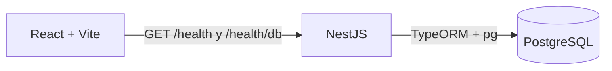

# Decisiones de arquitectura de VINTRA

Este registro refleja el código y workflows presentes en la rama actual. Una tecnología conectada para la comprobación de salud no implica que estén listos los módulos de negocio.

## Decisiones y estado actual

| Tema | Estado en el repositorio | Límite actual |
| --- | --- | --- |
| Backend | NestJS implementado en `backend/`. | Solo API base y endpoints de salud. |
| Persistencia | PostgreSQL 16 con TypeORM y `pg`. | La API consulta la DB; no hay entidades de negocio ni migraciones. |
| API | REST con `GET /health` y `GET /health/db`. | Sin OpenAPI ni endpoints de negocio publicados. |
| Arquitectura de módulos | Propuesta de monolito modular. | No hay módulos de rutas, flota, asignación, usuarios o reportes. |
| Autenticación y permisos | Pendiente de diseño e implementación. | No hay flujo de login ni control de acceso. |
| GIS y tracking | Pendiente de alcance técnico y de producto. | Sin PostGIS, proveedor de mapas ni posiciones GPS. |
| Configuración | `.env.example`, Docker Compose y variables de Actions. | Los secretos de producción se configuran fuera del repositorio. |
| Cambios de esquema | `synchronize: false`. | Crear y probar migraciones antes de añadir entidades persistentes. |
| Calidad | Workflows de lint, pruebas, build y SonarQube configurados. | Verifica los checks reales de cada ejecución; Sonar requiere `SONAR_TOKEN` y `SONAR_PROJECT_KEY`. |
| Despliegue | Actions publican frontend estático por SCP. | El backend y PostgreSQL no se despliegan desde esos workflows. |

## Integración actualmente implementada

La [arquitectura vigente](ARCHITECTURE.md) detalla el flujo, los puertos y las variables. La [especificación de API](API_SPECIFICATION.md) y el [diseño de datos](DATABASE_DESIGN.md) describen trabajo propuesto; no reemplazan los contratos implementados.

## Decisiones pendientes

1. Aprobar historias y reglas operativas de rutas, vehículos, asignaciones y reportes.
2. Aprobar el modelo relacional y las entidades antes de crear migraciones.
3. Definir autenticación, autorización, datos personales y permisos.
4. Determinar alcance GIS/tracking, retención y despliegue de la API en VPS.
5. Verificar en el servidor `VITE_API_URL`, CORS, TLS, base de datos y reversión antes de considerar el producto desplegado.

Los estados de tareas y debates anteriores se conservan en [registro-decisiones-historico.md](arquitectura/registro-decisiones-historico.md). Verifica GitHub y Trello antes de reutilizar sus IDs o estados.
