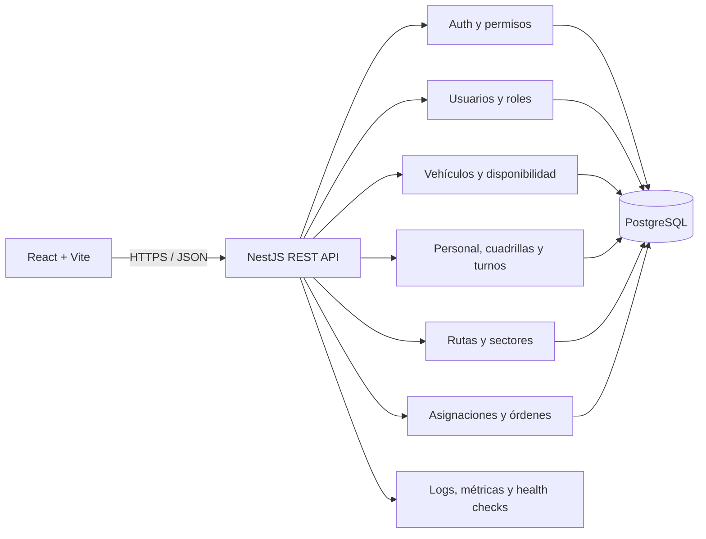

# Arquitectura backend de VINTRA

## Estado y alcance

Este documento propone cómo organizar el backend para el MVP de coordinación de rutas de recolección. Se basa en `develop`, documentación del repositorio, las HUs 1–12, issues #53–#93 y tarjetas visibles del tablero. Las PR #47, #49 y #50 siguen abiertas al momento de este diseño: se consideran como cambios esperados una vez corregidas y fusionadas, no como código ya integrado.

La aplicación actual de `develop` todavía contiene el backend .NET. La PR #47 propone sustituirlo por NestJS y PostgreSQL; NestJS es la decisión expresada por el equipo. La PR #47 configura TypeORM, mientras la documentación de la PR #49 menciona acceso directo con `pg`. El ORM debe resolverse en el issue #54 antes de fijar la implementación. Este diseño mantiene el acceso a datos detrás de repositorios para que la decisión no invada los módulos.

No se consideran implementadas las funciones solo descritas en planes. El MVP se centra en administración de usuarios/roles, vehículos, personal/cuadrillas/disponibilidad, rutas y asignación/seguimiento de operaciones cuando lo aprueben las HUs. GPS en vivo, ETA, mapa ciudadano, notificaciones, reportes avanzados y servicios externos requieren decisión y no se incluyen como alcance confirmado.

## Criterios de diseño

- Monolito modular en NestJS: un despliegue y una API, con módulos separados por dominio. No hay evidencia que justifique microservicios.
- API REST con contratos OpenAPI. Los módulos se comunican mediante servicios de aplicación y puertos internos; no se conectan directamente a tablas de otros módulos.
- PostgreSQL como base relacional, según los documentos y el entorno propuesto. Extensión geográfica no confirmada: no crear dependencia de PostGIS hasta que issue #54 y reglas #58 lo aprueben.
- Persistencia desacoplada de la lógica. TypeORM es lo que implementa la PR #47; falta aprobarlo formalmente frente a `pg` (#54). Migraciones versionadas; no crear esquema automáticamente en producción.
- Configuración externa y validada al arrancar. Hosts, puertos, URLs, CORS, credenciales y claves provienen del entorno/secret manager. No fijar valores operativos ni secretos en código, imágenes, documentación de ejemplo o workflows.
- Las reglas con cifras, estados, horarios, compatibilidades y límites solo se incorporan después de la aprobación de producto/dominio (#53, #58, #64).

## Vista de componentes

El dibujo representa módulos propuestos, no funcionalidades ya entregadas. Los nombres y límites finales dependen de la depuración de HUs (#55) y del modelo aprobado (#63).

## Módulos y responsabilidades

| Módulo | Responsabilidad del MVP | Dependencias principales |
| --- | --- | --- |
| `health` | Liveness del proceso y readiness de la base de datos en rutas distintas. | Conexión de base de datos |
| `auth` | Autenticar según mecanismo aprobado y aplicar autorización común. | Usuarios, configuración de seguridad |
| `users` | Identidad y estado de las cuentas que el MVP requiera. | Roles; definición de alcance #53, matriz #70 |
| `roles` | Roles y permisos explícitos por acción. | Matriz aprobada #70 |
| `vehicles` | Registro, consulta, estado operativo y disponibilidad de vehículos. | Reglas de dominio #58 |
| `staff` | Personal, conductores, cuadrillas, turnos y disponibilidad. | Reglas #58; no inventar datos personales |
| `routes` | Sectores, rutas y orden/paradas solo según alcance y modelo aprobado. | HUs depuradas, geografía aprobada |
| `assignments` | Asignar recursos a una operación con validación de conflictos y transacción. | Vehículos, personal, ruta y reglas aprobadas |
| `work-orders` | Representar y consultar la orden derivada de una asignación si HU85/alcance lo confirma. | Asignaciones |
| `audit` | Registrar quién cambió una asignación, cuándo y valores anterior/nuevo. | Autorización, asignaciones (#84) |

`tracking`, mapas públicos, notificaciones e indicadores quedan fuera hasta que haya historias aprobadas con criterios verificables. El nombre “seguimiento” del producto no basta para asumir telemetría GPS.

## Flujo interno de una asignación

1. El controlador valida el contrato HTTP; DTOs validan forma, tipos y campos admitidos.
2. La capa de aplicación verifica identidad/permisos y carga los recursos necesarios por interfaces de repositorio.
3. El servicio de dominio aplica reglas aprobadas: disponibilidad, compatibilidad, conflictos de horario/estado y demás límites confirmados.
4. Un único límite transaccional guarda la asignación y su auditoría. Las restricciones únicas/índices de la base complementan las comprobaciones para evitar carreras concurrentes.
5. La API devuelve el recurso creado o un error de dominio estable. No devuelve SQL, stack traces ni secretos.

Reglas de capacidad, segundo viaje, jornada, duración y estados se mantienen pendientes hasta que sean verificadas (#58, #83, #93); no deben aparecer como constantes arbitrarias.

## Configuración, errores y trazabilidad

- Leer configuración por un módulo único de configuración; fallar al iniciar si falta una variable obligatoria o tiene formato inválido. Mantener `.env.example` solo con nombres y marcadores inocuos, jamás contraseñas reutilizables.
- Diferenciar health del proceso (`/health`) de readiness/dependencia de base (`/health/db` o contrato final acordado en #66). No exponer cadena de conexión ni detalles internos.
- Respuesta de error uniforme: código estable, mensaje legible, detalles de validación seguros y `requestId`. No filtrar datos personales.
- Logs estructurados a stdout con nivel configurable; enmascarar credenciales/tokens y evitar cuerpos con datos sensibles. Registrar auditoría de cambios de negocio aparte de logs técnicos.
- No añadir colas, caché, servicios GIS ni proveedores externos sin requisito y decisión explícitos.

## Desarrollo, CI y despliegue

La PR #47 propone el esqueleto NestJS, Compose, conexión PostgreSQL y health checks. Sus cambios siguen en revisión. La guía de VPS y los workflows describen SSH/SCP para publicar frontend; no se encontró un pipeline de despliegue backend confirmado. El backend debe integrarse al mecanismo existente tras validar issue #90, sin declarar completado un despliegue que no existe.

El pipeline debe instalar dependencias de forma reproducible, compilar, ejecutar lint y pruebas, medir cobertura y ejecutar el análisis SonarQube existente. La integración de backend en CI está pendiente (#69): el workflow backend actual es marcador de posición; Sonar no sustituye pruebas ni el quality gate. Tokens de Sonar y despliegue deben venir de secretos de GitHub. No imprimirlos en logs.

Antes de producción: validar configuración por entorno, migraciones revisadas y reversibles, readiness, logs, backups/restauración y procedimiento de rollback. Evitar `synchronize` automático de ORM en producción.

## Dependencias y orden de implementación

1. Aprobar alcance/actores y depurar HUs (#53, #55).
2. Aprobar stack y ORM, mecanismo de autenticación y datos (#54, #70).
3. Validar reglas del dominio (#58); cerrar modelo, diccionario y contratos (#63, #64, #66).
4. Migraciones y configuración reproducible (#65, #68).
5. CI/quality gate y despliegue de staging (#69, #90).
6. Funcionalidades por dependencia: usuarios/permisos, vehículos, personal/cuadrillas, rutas, asignaciones, órdenes y auditoría (#71–#85, #93).

Los detalles y criterios de aceptación se documentan en BACKEND_TASKS.md. Las decisiones que requieren aprobación se registran en ARCHITECTURE_DECISIONS.md; ambos documentos se proponen en PR separadas para mantener cambios pequeños.

## Fuentes y límites

Fuentes revisadas: `README.md`, `CONTRIBUTING.md`, `docs/ARCHITECTURE.md`, `docs/backend/README.md`, `docs/modelado/README.md`, `docs/SONARQUBE.md`, `docs/infraestructura/VPS.md`, PR #47/#49/#50, issues #53–#93 y tablero Trello (HUs, sprints, tarjetas de modelo, decisiones, skeleton y DevOps). Hay discrepancias entre estos materiales; los issues de validación anteriores son el criterio para resolverlas. No se pudo comprobar en ejecución el estado real del VPS ni la aceptación final de todas las HUs.
