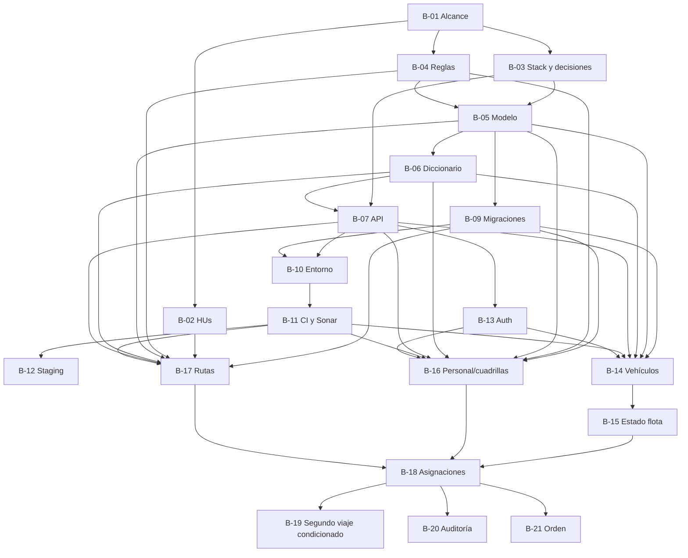

# Plan de trabajo backend de VINTRA

## Cómo leer este plan

El plan separa lo confirmado de lo condicionado. Se asume que las PR #47, #49 y #50 se corregirán y fusionarán, como indicó el equipo; a la fecha de esta revisión siguen abiertas. #47 aporta el esqueleto NestJS/PostgreSQL/TypeORM/health/Compose/Sonar propuesto; #49 debe alinear su documentación, porque menciona `pg` y hoy no refleja todo lo implementado en la rama; #50 aporta modelado del MVP y deja pendiente validar reglas como el segundo viaje y el máximo por jornada. Ninguno de esos cambios se cuenta todavía como parte real de `develop`.

No se fijan hosts, puertos, credenciales, límites, estados o reglas operativas dentro del código por conveniencia. La configuración de entorno debe ser externa y validada. Los parámetros de negocio solo se codifican después de su aprobación y se documentan como regla con fuente y criterio verificable.

Las prioridades P0/P1/P2 reflejan el orden de dependencia del MVP y las tarjetas/issues, no una nueva priorización acordada. “Complejidad” es una estimación relativa (S/M/L), a confirmar por el equipo.

## Fase 0 — Preparación y decisiones

| ID | Tarea | Historia relacionada | Prioridad | Dependencias | Criterios de aceptación | Complejidad | Módulo |
| --- | --- | --- | --- | --- | --- | --- | --- |
| B-00 | Confirmar baseline backend después de PRs #47/#49/#50 | HU técnica transversal | P0 | Correcciones/revisión y merge de esas PR | `develop` contiene NestJS acordado; compose, endpoint UI, análisis Sonar y docs usan la misma configuración/stack; se listan pendientes reales sin declarar funciones no implementadas. | S | Integración |
| B-01 | Confirmar alcance, actores y glosario MVP (#53) | HUs 1–12 | P0 | — | Responsable aprueba actores, términos, HUs incluidas/pospuestas y fuente de cada regla. | M | Producto/Scrum |
| B-02 | Depurar HUs, prioridades y dependencias (#55) | HUs 1–12 | P0 | B-01 | Cada HU tiene criterios verificables, prioridad, dependencias y relación única con issue/tarjeta; se retiran duplicados o alcance implícito. | M | Producto/Scrum |
| B-03 | Aprobar stack, persistencia, auth y geografía (#54) | Transversal | P0 | B-01 | ADR aprobada; NestJS confirmado; decisión TypeORM vs `pg`; PostgreSQL/extensiones; auth; versiones soportadas y contratos de integración. | M | Arquitectura |
| B-04 | Validar reglas operativas (#58) | HUs de flota, personal, rutas y asignación | P0 | B-01 | Cada regla (estado, disponibilidad, compatibilidad, horarios, capacidad, segundo viaje) tiene definición, fuente, aprobador y ejemplo válido/inválido. | L | Dominio/Operaciones |

## Fase 1 — Contratos y modelo

| ID | Tarea | Historia relacionada | Prioridad | Dependencias | Criterios de aceptación | Complejidad | Módulo |
| --- | --- | --- | --- | --- | --- | --- | --- |
| B-05 | Aprobar modelo ER y límites de contexto (#63) | HUs aprobadas | P0 | B-01, B-03, B-04 | ERD con cardinalidades, PK/FK, estados, datos personales mínimos y decisión geo; revisión de backend, BD y producto. | L | Datos/Dominio |
| B-06 | Publicar diccionario y validaciones (#64) | HUs aprobadas | P0 | B-04, B-05 | Cada campo tiene tipo, requerido, ejemplo ficticio, fuente, unidad, catálogo, validación y reglas; no quedan límites inventados. | M | Datos/QA |
| B-07 | Cerrar OpenAPI y errores comunes (#66) | HUs aprobadas | P0 | B-03, B-05, B-06 | Contratos request/response, códigos, auth/permisos, validación, paginación si aplica y ejemplos; UI/backend revisan OpenAPI. | L | API |
| B-08 | Trazabilidad repo–HU–issue–PR–tarjeta (#67) | Transversal | P1 | B-02 | Cada entrega tiene referencia a HU/tarjeta e issue y las PR enlazan a `develop` según CONTRIBUTING. | S | Scrum/DevOps |

## Fase 2 — Base técnica reproducible

| ID | Tarea | Historia relacionada | Prioridad | Dependencias | Criterios de aceptación | Complejidad | Módulo |
| --- | --- | --- | --- | --- | --- | --- | --- |
| B-09 | Migración inicial y constraints (#65) | HUs de persistencia | P0 | B-03, B-05, B-06 | DB vacía migra desde cero; restricciones/índices reflejan reglas aprobadas; migraciones revisables y reversión documentada; semillas solo ficticias. | M | Persistencia |
| B-10 | Entorno local y health checks (#68) | HU técnica transversal | P0 | B-03, B-07, B-09 | Levantamiento documentado; configuración leída de env sin secretos/URLs fijas; DB readiness separada de proceso; compose espera DB saludable. | M | DevEx |
| B-11 | CI backend, pruebas y Sonar (#69) | HU técnica transversal | P0 | B-03, B-08, B-10 | CI instala reproducible, compila, lint, corre pruebas disponibles, publica cobertura y falla ante errores/quality gate; secretos protegidos; sin credenciales en logs. | M | DevOps/Calidad |
| B-12 | Runbook staging y despliegue backend (#90) | HU técnica transversal | P1 | B-03, B-09, B-10, B-11 | SSH/SCP actual se valida para backend; configuración/secretos por ambiente, migración, readiness, logs, backup y rollback documentados y verificados. | L | DevOps |

## Fase 3 — Capacidades del MVP

| ID | Tarea | Historia relacionada | Prioridad | Dependencias | Criterios de aceptación | Complejidad | Módulo |
| --- | --- | --- | --- | --- | --- | --- | --- |
| B-13 | Roles, permisos y autenticación (#70/#71) | HU1 | P0 | B-03, B-05, B-07, B-09, B-11 | Matriz role×action aplicada en backend; credenciales/sesiones seguras según mecanismo aprobado; tests de autorizado/denegado; sin rutas administrativas abiertas. | L | Auth/Usuarios |
| B-14 | Registro y consulta de vehículos (#72) | HU2/HU3 | P0 | B-05–B-07, B-09, B-11, B-13 | CRUD acordado valida identidad/tipo/capacidad; duplicado y dato inválido dan error de contrato; API protegida por permisos. | M | Flota |
| B-15 | Estado y disponibilidad de vehículos (#75) | HU2/HU3 | P1 | B-04, B-14 | Estados/reglas aprobados bloquean asignación cuando corresponda; historial y transiciones probados. | M | Flota |
| B-16 | Personal, cuadrillas, turnos y disponibilidad (#76) | HU4/HU5/HU6 | P0 | B-04–B-07, B-09, B-11, B-13 | Datos mínimos; relaciones y vigencias consistentes; prevención de solapamiento conforme regla aprobada; consultas protegidas. | L | Personal |
| B-17 | Modelo y API de rutas (#78/#79) | HU7/HU8/HU9 | P0 | B-02, B-04–B-07, B-09, B-11 | CRUD de rutas/sectores/paradas solo para alcance confirmado; orden y geometría validados si existen; no crear PostGIS sin aprobación. | L | Rutas |
| B-18 | Asignación transaccional (#81/#93) | HU10 | P0 | B-04–B-07, B-09, B-11, B-13–B-17 | Una transacción verifica referencias, disponibilidad, compatibilidad y conflicto; concurrencia no produce doble asignación inválida; error identifica causa. | L | Operaciones |
| B-19 | Segundo viaje/jornada (#83) | HU11 | P1 | Regla expresa en B-04; B-18 | Solo se habilita si producto valida capacidad, jornada, conflictos y criterio de aceptación; si no se aprueba, no se expone como comportamiento. | M | Operaciones |
| B-20 | Auditoría de cambios (#84) | HU12 | P1 | B-13, B-18 | Actor, instante, acción y valores anteriores/nuevos quedan trazados; rutas normales no permiten alterar auditoría; lectura autorizada. | M | Auditoría |
| B-21 | Orden de trabajo (#85) | HU de orden si queda en alcance | P1 | B-18, decisión de alcance | Se crea/consulta desde asignación aprobada; unicidad y estado definidos; impresión sigue P2 hasta priorización. | M | Operaciones |

## Fase 4 — Decisiones que no deben anticiparse

| ID | Trabajo | Estado/condición |
| --- | --- | --- |
| B-22 | GPS en vivo, ETA, mapa ciudadano o reportes geográficos (#91) | Hacer spike de decisión; estático, en vivo y ciudadanía son casos diferentes. Sin integración hasta seleccionar necesidad, datos, precisión, frecuencia y proveedor. |
| B-23 | Notificaciones, indicadores y reportes futuros (#92) | Evaluar HUs y prioridad; no añadir proveedor, cola ni servicio externo por inferencia. |
| B-24 | Extensión PostgreSQL/PostGIS | Depende de B-03/B-04 y necesidad de consultas espaciales demostrada. |

## Trabajo coordinado con Base de Datos a partir del diccionario

El equipo de BD compartió un diccionario que propone cuentas/perfiles/sesiones, vehículos, cuadrillas, asignaciones, macrorutas/microrutas/barrios/horarios y posiciones GPS. El modelo de tablas es de su equipo; las tareas de backend consisten en integrar el esquema aprobado en los contratos y reglas de la API.

| ID | Tarea de integración backend | Dependencias | Criterios de aceptación | Responsable |
| --- | --- | --- | --- | --- |
| B-25 | Alinear DTOs y respuestas de la API con el diccionario aprobado | B-05–B-07 y confirmación del equipo de BD | Vehículo, cuadrilla, ruta y asignación usan los campos aprobados; datos personales y hashes no se exponen; OpenAPI coincide con implementación. | Backend + BD |
| B-26 | Resolver diferencias de reglas antes de implementar asignaciones y rutas | B-04, B-05, HU11 y #91 | Producto/BD resuelven unicidad microruta-fecha frente a segundo viaje, horarios de asignación, conductor/perfiles y alcance GPS/PostGIS; cada decisión tiene criterio verificable. | Producto + BD + Backend |
| B-27 | Implementar autenticación según el esquema aprobado | B-03, B-09, B-13 | Solo después de acordar flujo HTTP, vida de sesiones, restablecimiento, bloqueo, permisos y parámetros criptográficos; sin secretos ni límites operativos hardcodeados. | Backend + Seguridad |

La hoja recibida es fuente de análisis para estas dependencias, pero no reemplaza aprobación de alcance ni el PR de Base de Datos que publique el esquema final. No corresponde al backend redefinir tablas sin coordinar con su equipo.

## Dependencias y paralelismo

B-01 puede avanzar junto con auditoría de código/documentos. B-02, B-03 y B-04 pueden trabajarse en paralelo después de identificar responsables; B-05 requiere sus resultados. Luego datos, API y entorno pueden desarrollarse parcialmente en paralelo sobre contratos revisados; las funciones de rutas, flota y personal se pueden implementar en ramas paralelas tras B-05–B-11. La asignación depende de que los tres dominios publiquen contratos estables.

## Fuentes y mantenimiento

Issues #53–#93 (en particular #54–#55, #58, #63–#72, #75–#85, #90–#93), tarjetas Trello #3/#6/#7/#8/#9/#14 y HUs 1–12. Actualizar estados cuando producto cierre decisiones y cuando una PR se fusione; el backlog de GitHub es referencia operativa más actual que algunos README antiguos.
