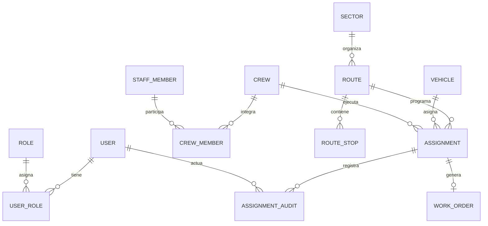

# Diseño de base de datos de VINTRA

## Estado del diseño

Es un modelo lógico inicial del MVP, no un DDL listo para producción. Debe revisarse con el ERD y diccionario del equipo (#63–#64) y con alcance/reglas aprobadas (#53, #58). Las PR #47, #49 y #50 se encuentran abiertas en el momento de redactarlo y se toman como baseline futuro condicionado a que se corrijan y fusionen. La tarjeta Trello #7 menciona PostgreSQL/PostGIS, pero la extensión geográfica continúa condicionada a la aprobación de stack y requisitos (#54, #58).

PostgreSQL es la base objetivo según los documentos y el Compose de la PR #47. TypeORM aparece en el código de esa PR y `pg` directo en la documentación de la PR #49; la herramienta se debe resolver en #54. El modelo conceptual no depende de esa elección.

## Entidades iniciales

| Entidad | Atributos conceptuales | Notas de integridad |
| --- | --- | --- |
| `user` | id, identificador de acceso, hash de credencial si aplica, estado, timestamps | El identificador único y mecanismo de acceso dependen del alcance y decisión de autenticación. Nunca guardar contraseña en texto plano. |
| `role` | id, nombre, descripción | Catálogo controlado; nombres y alcance salen de la matriz #70. |
| `user_role` | user_id, role_id | PK compuesta o id más `UNIQUE(user_id, role_id)`; FKs restrictivas. |
| `permission` / `role_permission` | clave de acción/recurso; role_id, permission_id | Solo si la matriz exige permisos configurables; si es fija, evitar tablas innecesarias y mapear política en el módulo. Decidir en #70. |
| `vehicle` | id, identificador institucional/placa, tipo, capacidad, estado | Identificador único normalizado; unidad de capacidad debe quedar definida en diccionario; no asumir valores válidos de tipo/estado (#58, #64). |
| `staff_member` | id, identificador, nombre y datos mínimos requeridos, estado | Minimizar datos personales; definir identificación/retención en alcance. |
| `crew` | id, nombre/código, estado | Código único si el negocio lo requiere. |
| `crew_member` | crew_id, staff_member_id, vigencia desde/hasta, función si aplica | Permite cambios de integrantes en el tiempo; no usar una lista duplicada en `crew`. |
| `shift` | id, fecha/ventana temporal, estado o jornada aprobada | Horas, zona horaria y estados deben ser definidos por producto. |
| `availability` | recurso (vehículo/persona/cuadrilla), intervalo, motivo/estado | Alternativa relacional con tablas separadas por tipo de recurso para conservar FKs; diseño físico pendiente de #63–#64. |
| `sector` | id, nombre/código, descripción, geometría opcional | Geometría solo con requisito y extensión aprobados; guardar referencia textual/catálogo mientras tanto. |
| `route` | id, sector_id, nombre/código, tipo/estado | Definir macro/micro/ruta y cardinalidad en #58/#63. Código único dentro del ámbito que defina dominio. |
| `route_stop` | id, route_id, orden, sector/dirección/ubicación opcional | Solo si HU y operación requieren paradas ordenadas; no inventar coordenadas. `UNIQUE(route_id, orden)`. |
| `assignment` | id, route_id, fecha/intervalo, vehicle_id, crew_id/driver_id, estado, created_by, timestamps | FKs; intervalos y recursos no deben entrar en conflicto según reglas aprobadas. Añadir actor explícito si conductor difiere de cuadrilla. |
| `assignment_audit` | id, assignment_id, actor_user_id, occurred_at, operation, previous_value, new_value | Registro append-only; datos serializados con esquema/versionado o columnas estructuradas revisadas. Proteger datos sensibles. |
| `work_order` | id, assignment_id, reference, status, created_at | Solo si HU85 se confirma; `UNIQUE(assignment_id)` cuando sea una orden por asignación. |

La lista `availability` es deliberadamente conceptual: se recomienda evitar FKs polimórficas sin integridad. El ERD final puede materializar `vehicle_unavailability` y `staff_unavailability` por separado.

## Relaciones y cardinalidades



La cardinalidad `sector–route`, uso de conductor independiente, turnos y paradas está por confirmar con el dominio. Una asignación puede requerir más de un recurso o viaje; no se fija el diseño para segundo viaje hasta validar RN-05/RN-06 en PR #50 y las reglas #58/#83.

## Claves, restricciones e índices

- PK sustituta estable para cada entidad, salvo tablas de unión pequeñas donde una PK compuesta simplifica unicidad.
- FKs explícitas; `ON DELETE RESTRICT` como opción inicial para registros operativos/históricos. Borrado lógico solo si existe requisito de auditoría y política aprobada.
- `NOT NULL`, `CHECK`, `UNIQUE` solo para reglas confirmadas: por ejemplo capacidad positiva y rango de intervalo coherente, una vez unidad/rangos estén aprobados.
- Índices en FKs usadas por consultas, identificadores únicos normalizados, fecha/estado de asignación y claves de búsqueda confirmadas por casos de uso. Evitar índices especulativos.
- Restricciones de no solapamiento de intervalos requieren decidir granularidad y política de concurrencia; considerar exclusion constraints PostgreSQL si el issue #58 lo valida. No se afirma que un `UNIQUE` simple resuelva solapamientos.
- No almacenar datos calculables o duplicados (p. ej., nombre de sector en cada parada si hay FK a sector), excepto snapshot justificado para trazabilidad.

## Geografía

El requisito puede variar entre mapa estático de rutas, coordenadas de paradas y rastreo en vivo. Issue #91 solicita separar esos casos y decidir si se requieren; no asumir GPS, ETA, geocodificación ni PostGIS. Si se aprueba geometría, definir SRID, tipo geométrico, precisión, consultas e índice espacial antes de migrar. Las coordenadas no deben ser valores ficticios en producción.

## Migraciones y datos semilla

1. Resolver stack/ORM en #54 y modelo/diccionario en #63–#64.
2. Crear migración inicial versionada, determinista y revisable; usar transacción si la operación lo soporta.
3. Agregar índices/constraints junto con la entidad y documentar la intención.
4. Mantener semillas solo para catálogos y entornos de desarrollo; identificarlas como datos no productivos y evitar usuarios/contraseñas reutilizables.
5. Validar creación desde una base vacía, aplicación de migraciones, consistencia y reversión en un entorno desechable (#65).
6. En producción, ejecutar migraciones como paso explícito de despliegue con respaldo/rollback; no permitir que el servidor altere el esquema al arrancar.

## Ejemplo de estructura relacional (conceptual)

```text
user(id PK, login UNIQUE?, credential_hash?, status, created_at, updated_at)
role(id PK, name UNIQUE)
user_role(user_id FK, role_id FK, PRIMARY KEY(user_id, role_id))
vehicle(id PK, normalized_identifier UNIQUE, type, capacity, status)
staff_member(id PK, normalized_identifier UNIQUE?, status, ...)
crew(id PK, code UNIQUE?, status)
crew_member(crew_id FK, staff_member_id FK, valid_from, valid_to, ...)
sector(id PK, code UNIQUE?, name, geometry? )
route(id PK, sector_id FK?, code, status)
assignment(id PK, route_id FK, vehicle_id FK, crew_id FK?, starts_at, ends_at, status, created_by FK)
assignment_audit(id PK, assignment_id FK, actor_user_id FK, occurred_at, operation, before, after)
```

Los signos `?` indican decisiones pendientes, no columnas confirmadas. El ejemplo no establece el DDL final ni contrato de autenticación.

## Decisiones pendientes

| Pregunta | Fuente | Cierre requerido |
| --- | --- | --- |
| ORM: TypeORM o `pg` directo | PR #47 vs #49, issue #54 | Comparación y aprobación técnica |
| Identificador, estado y datos mínimos de usuarios/personal | #53, #63–#64, #70 | Producto/seguridad |
| Modelo exacto ruta/sector/parada y geografía | #58, #63, #91 | Dominio y stack GIS |
| Cardinalidad de recursos y segundo viaje | PR #50 RN-05/RN-06, #58, #83, #93 | Producto/operaciones |
| Retención, soft-delete, auditoría y datos personales | #70, #84 | Seguridad/operaciones |

## Fuentes

`docs/modelado/README.md`; PR #50 (HUs y RN del MVP, capacidad/segundo viaje pendientes); PR #47 (PostgreSQL, TypeORM en implementación propuesta); PR #49 (mención a `pg`); Trello #3/#6/#7; issues #53, #54, #58, #63–#65, #70, #78, #81, #83, #84, #91 y #93. El contenido es diseño propuesto, no evidencia de tablas ya implementadas.
