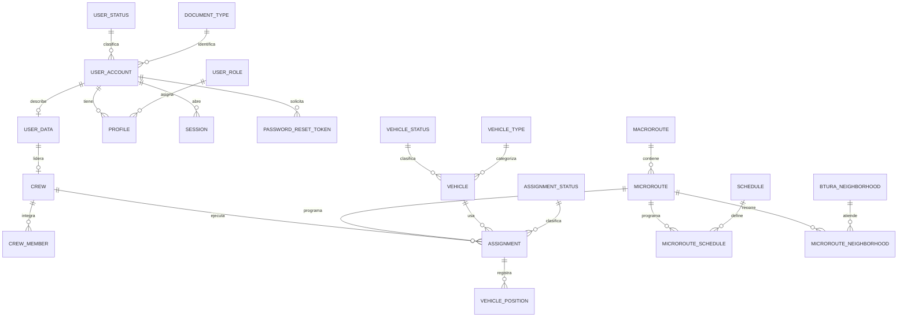

# Diseño de datos de VINTRA

## Propósito y fuente

Este documento resume el diccionario de datos remitido por el equipo de Base de Datos. Describe una propuesta de esquema PostgreSQL para cuentas, flota, cuadrillas, rutas y asignaciones. No reemplaza el archivo del equipo ni convierte automáticamente sus propuestas en decisiones aprobadas.

El diseño físico, sus migraciones y cambios de tablas corresponden al equipo de BD. Backend debe consumir el esquema que ese equipo apruebe y coordinar con él los contratos y las reglas que la API necesita. El ORM de NestJS sigue pendiente de la decisión técnica #54.

El libro describe 23 entidades. Los campos siguientes reflejan lo especificado en las hojas; `N/A` significa que el diccionario no asigna longitud. Los ejemplos de roles, estados y catálogos no son una lista definitiva de valores.

## Entidades del diccionario

| Entidad | Campos y tipos descritos | Relaciones y notas |
| --- | --- | --- |
| `user_role` | `id UUID`, `code VARCHAR(30)`, `name VARCHAR(100)`, `is_active BOOLEAN`, `created_at TIMESTAMPTZ` | Catálogo de roles. `code` es único. La descripción menciona administración, jefe de operaciones y conductor; confirmar alcance. |
| `user_status` | `id UUID`, `code VARCHAR(30)`, `name VARCHAR(100)`, `is_active BOOLEAN`, `created_at TIMESTAMPTZ` | Catálogo de estados de cuenta; `code` único. |
| `document_type` | `id UUID`, `code VARCHAR(30)`, `name VARCHAR(50)`, `is_active BOOLEAN`, `created_at TIMESTAMPTZ` | Catálogo de tipos de documento. El diccionario marca `code` y `name` únicos. |
| `user_account` | `id UUID`, `user_status_id UUID`, `document_type_id UUID`, `document_id CHAR(20)`, `pwd_hash TEXT`, `failed_attempts SMALLINT`, `locked_until TIMESTAMPTZ`, `last_login_at TIMESTAMPTZ`, `password_changed_at TIMESTAMPTZ`, `updated_at TIMESTAMPTZ`, `created_at TIMESTAMPTZ` | FKs a estado y tipo de documento. Unicidad compuesta indicada para tipo + documento. Contiene datos personales sensibles y hash de contraseña Argon2id. |
| `user_data` | `id UUID`, `first_name VARCHAR(80)`, `last_name VARCHAR(80)`, `email VARCHAR(254)`, `phone VARCHAR(10)`, `updated_at TIMESTAMPTZ`, `created_at TIMESTAMPTZ` | `id` es PK y FK a `user_account(id)`; el documento describe relación 1:1. |
| `profile` | `id UUID`, `user_role_id UUID`, `user_account_id UUID`, `is_active BOOLEAN`, `created_at TIMESTAMPTZ` | FKs a rol y cuenta; unicidad compuesta indicada para cuenta + rol. Una cuenta puede tener varios perfiles. |
| `session` | `id UUID`, `user_account_id UUID`, `token_hash CHAR(64)`, `request_ip INET`, `revoked_at TIMESTAMPTZ`, `last_used_at TIMESTAMPTZ`, `expires_at TIMESTAMPTZ`, `created_at TIMESTAMPTZ` | FK a cuenta. Token guardado como hash SHA-256 hexadecimal; el token en claro no se almacena. |
| `password_reset_token` | `id UUID`, `user_account_id UUID`, `token_hash CHAR(64)`, `request_ip INET`, `used_at TIMESTAMPTZ`, `expires_at TIMESTAMPTZ`, `created_at TIMESTAMPTZ` | FK a cuenta. Token de un solo uso, almacenado como hash SHA-256 hexadecimal. |
| `audit_log` | `id UUID`, `actor TEXT`, `action ENUM`, `entity VARCHAR(50)`, `entity_id UUID`, `old_values JSONB`, `new_values JSONB`, `request_ip INET`, `created_at TIMESTAMPTZ` | El diccionario indica solo inserción/consulta. `actor` y `entity_id` son polimórficos/textuales y no tienen FK formal. No guardar credenciales ni hashes. |
| `crew` | `id UUID`, `user_data_id UUID`, `name VARCHAR(100)`, `is_active BOOLEAN`, `updated_at TIMESTAMPTZ`, `created_at TIMESTAMPTZ` | FK al conductor que representa la cuadrilla; `user_data_id` único según la hoja. El rol de conductor se valida en la aplicación. |
| `crew_member` | `id UUID`, `crew_id UUID`, `full_name VARCHAR(120)`, `is_active BOOLEAN`, `created_at TIMESTAMPTZ` | FK a cuadrilla. La hoja guarda el nombre del integrante, no una FK a `user_data`. |
| `vehicle_status` | `id UUID`, `code VARCHAR(30)`, `name VARCHAR(100)`, `is_active BOOLEAN`, `created_at TIMESTAMPTZ` | Catálogo; `code` único. |
| `vehicle_type` | `id UUID`, `code VARCHAR(30)`, `name VARCHAR(100)`, `is_active BOOLEAN`, `created_at TIMESTAMPTZ` | Catálogo; `code` único. |
| `vehicle` | `id UUID`, `vehicle_status_id UUID`, `vehicle_type_id UUID`, `plate CHAR(6)`, `capacity_kg FLOAT`, `capacity_yd3 FLOAT`, `is_active BOOLEAN`, `updated_at TIMESTAMPTZ`, `created_at TIMESTAMPTZ` | FKs a estado y tipo; placa única. Unidades kg y yd³ especificadas en campos separados. |
| `assignment_status` | `id UUID`, `code VARCHAR(30)`, `name VARCHAR(100)`, `is_active BOOLEAN`, `created_at TIMESTAMPTZ` | Catálogo; `code` único. Los códigos citados son ejemplos, no estados aprobados por esta revisión. |
| `assignment` | `id UUID`, `crew_id UUID`, `microroute_id UUID`, `vehicle_id UUID`, `assignment_status_id UUID`, `scheduled_date DATE`, `started_at TIMESTAMPTZ`, `ended_at TIMESTAMPTZ`, `updated_at TIMESTAMPTZ`, `created_at TIMESTAMPTZ` | FKs a cuadrilla, microruta, vehículo y estado. La hoja propone unicidad de microruta + fecha. |
| `vehicle_position` | `id UUID`, `assignment_id UUID`, `geom POINT`, `recorded_at TIMESTAMPTZ`, `created_at TIMESTAMPTZ` | FK a asignación; geometría PostGIS. La hoja permite registrar posición solo durante asignaciones en curso mediante regla de aplicación. |
| `macroroute` | `id UUID`, `name VARCHAR(100)`, `geom MULTIPOLYGON`, `is_active BOOLEAN`, `updated_at TIMESTAMPTZ`, `created_at TIMESTAMPTZ` | Área que agrupa microrutas; geometría PostGIS. |
| `microroute` | `id UUID`, `macroroute_id UUID`, `name VARCHAR(100)`, `geom MULTILINESTRING`, `is_active BOOLEAN`, `updated_at TIMESTAMPTZ`, `created_at TIMESTAMPTZ` | FK a macroruta; geometría PostGIS. |
| `schedule` | `id UUID`, `name VARCHAR(100)`, `start_time TIME`, `end_time TIME`, `is_active BOOLEAN`, `updated_at TIMESTAMPTZ`, `created_at TIMESTAMPTZ` | Horario reutilizable por microrutas. |
| `microroute_schedule` | `id UUID`, `microroute_id UUID`, `schedule_id UUID`, `day_of_week SMALLINT`, `is_active BOOLEAN`, `updated_at TIMESTAMPTZ`, `created_at TIMESTAMPTZ` | FKs a microruta y horario; día descrito en escala ISO 1–7. Unicidad compuesta por microruta + horario + día. |
| `btura_neighborhood` | `id UUID`, `commune VARCHAR(100)`, `name VARCHAR(150)`, `geom MULTIPOLYGON`, `created_at TIMESTAMPTZ` | Barrio con comuna y geometría PostGIS. |
| `microroute_neighborhood` | `id UUID`, `neighborhood_id UUID`, `microroute_id UUID`, `order_visit INT` | FKs a barrio y microruta; especifica orden de visita y unicidades compuestas, pero debe aclararse qué pares exactos son únicos. |

Los campos con `DEFAULT` en el diccionario incluyen `is_active = TRUE`, `created_at = now()` y `failed_attempts = 0` en las tablas indicadas. Deben implementarse mediante migraciones de BD aprobadas y consistentes por entorno, no como valores repetidos arbitrariamente en lógica de backend.

## Relaciones

`audit_log` no tiene relaciones con FKs formales según el diccionario. La relación 1:1 cuenta-datos personales está implementada con FK desde `user_data` hacia `user_account`; esa FK asegura que los datos personales no tengan cuenta inexistente y que no haya más de una fila por cuenta, pero no obliga por sí sola a que cada cuenta tenga su fila `user_data`.

## Restricciones e integridad descritas

- PK UUID en todas las entidades descritas.
- Unicidad explícita para códigos de catálogos, placa, hashes de token, documento + tipo de documento y las claves compuestas descritas.
- FKs desde cuentas, perfiles, sesiones, cuadrillas, vehículos, asignaciones, posiciones, rutas y relaciones de agenda/visita.
- Timestamps guardados como `TIMESTAMPTZ`; las descripciones indican UTC. `scheduled_date` es `DATE`, y `schedule` usa horas `TIME` sin zona.
- Catálogos incluyen `is_active`; estados y transiciones deben basarse en reglas de negocio aprobadas.
- `audit_log` se plantea append-only y sus JSON deben excluir contraseñas y hashes.

## Puntos que BD y producto deben cerrar

| Punto | Por qué necesita decisión |
| --- | --- |
| Roles y perfiles | El diccionario nombra administrador, jefe de operaciones y conductor; confirmar frente al alcance actual de roles administrativos (#70). |
| Segundo viaje | `UNIQUE(microroute_id, scheduled_date)` permitiría solo una ejecución por microruta al día; revisar contra HU11/RN-05 y la regla aprobada (#58/#83). |
| Conflictos de horario | `assignment` no referencia `microroute_schedule` ni un horario concreto. Acordar cómo backend valida disponibilidad y conflictos temporales (#93). |
| Geografía y GPS | Hay geometrías para macro/microrutas, barrios y posiciones. Aprobar alcance, SRID, formato, permisos, frecuencia y retención antes de activar PostGIS/seguimiento (#54/#58/#91). |
| Integrantes de cuadrilla | `crew_member` guarda nombre, sin identificador de persona/cuenta; decidir si se requiere vínculo para disponibilidad y auditoría (#76). |
| Unicidad de barrios/orden | La hoja marca unicidad compuesta en `microroute_neighborhood` pero no especifica claramente la composición. BD debe precisar las restricciones antes del DDL. |
| Datos personales | Documento, nombre, correo, teléfono e IP requieren finalidad, acceso, conservación y enmascaramiento acordados. |
| Auditoría | `actor` textual y `entity_id` polimórfico no tienen FK. Definir formato estable, integridad, retención y quién puede consultar. |
| Precisión numérica | `capacity_kg` y `capacity_yd3` aparecen como `FLOAT`. Confirmar precisión y validaciones con BD, manteniendo unidades explícitas. |

## Migraciones y responsabilidad

Este documento no crea ni reemplaza migraciones. El equipo de BD debe versionar el esquema aprobado, las extensiones necesarias, los índices, constraints, seeds y política de reversión. Backend debe coordinar su mapeo de entidades/repositorios, DTOs, validaciones y transacciones con ese esquema. No usar sincronización automática de ORM en producción.

## Fuentes

Fuente principal: diccionario.xlsx remitido por el equipo de Base de Datos, hojas `user_role`, `user_status`, `document_type`, `user_account`, `user_data`, `profile`, `session`, `password_reset_token`, `audit_log`, `crew`, `crew_member`, `vehicle_status`, `vehicle_type`, `vehicle`, `assignment_status`, `assignment`, `vehicle_position`, `macroroute`, `microroute`, `schedule`, `microroute_schedule`, `btura_neighborhood` y `microroute_neighborhood`. Contrastar decisiones y alcance con issues #54, #58, #63–#66, #70, #76, #78, #81, #83, #84, #91 y #93, y con las HUs aprobadas.