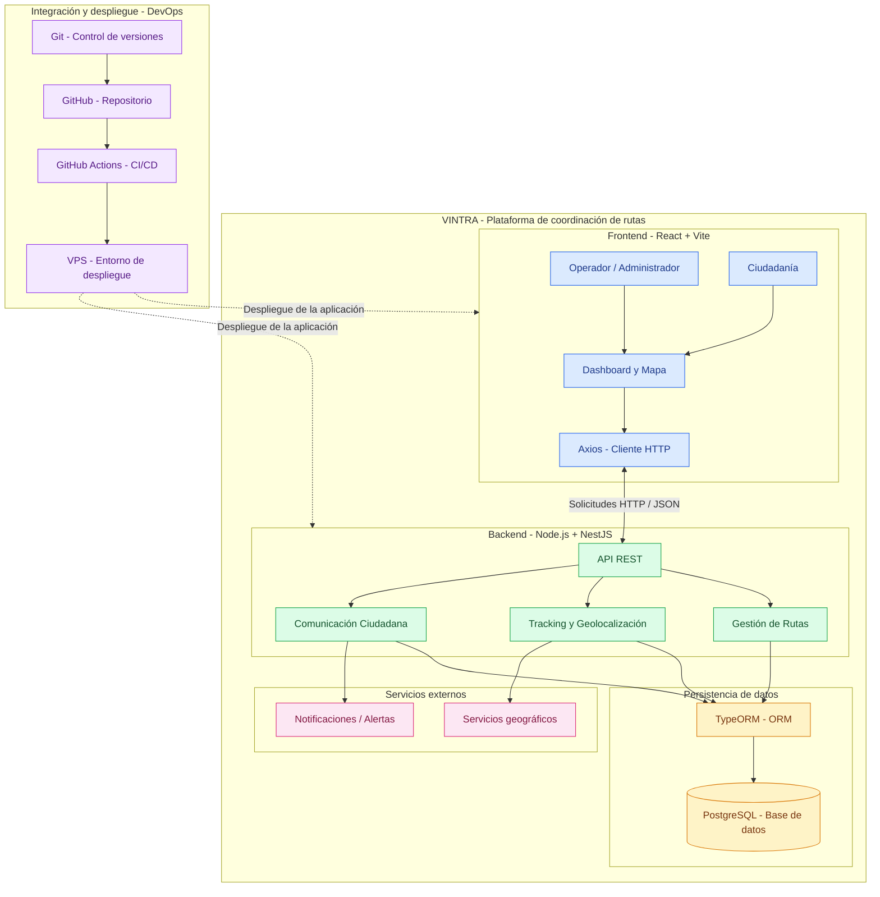

# Arquitectura de VINTRA

Este documento es la referencia técnica para los componentes del sistema VINTRA, sus relaciones y las decisiones arquitectónicas que afectan a más de un área. Complementa la visión general del [README raíz](../../README.md).

## Estado

- **Estado:** En revisión.
- **Responsable:** Célula de Frontend, según el informe de organización y tareas, con aportes de las células involucradas.
- **Fuente anterior:** `docs/` — Informe "Stack Tecnológico, Herramientas y Configuración del Entorno" (Proyecto Integrador).
- **Universidad:** Universidad del Valle — Seccional Pacífico.
- **Programa:** Tecnología en Desarrollo de Software.
- **Año:** 2026.
- **Equipo:** Jose Luis Mosquera Largacha · Lucio Lopez Gonzalo Andres (equipo de cinco integrantes).

## Resumen

VINTRA es una plataforma web compuesta por un backend con API REST, una base de datos relacional, servicios de geolocalización y notificaciones, y un frontend con dos vistas principales: un dashboard para el operador o administrador y una vista de consulta para la ciudadanía.

El diagnóstico que originó el proyecto, relacionado con la falta de planificación, coordinación y comunicación en la recolección de residuos, define el alcance funcional del sistema: gestión de rutas, seguimiento de vehículos y comunicación ciudadana.

**Stack tecnológico definido por el equipo:** PostgreSQL como sistema gestor de base de datos, Node.js como entorno de ejecución, NestJS como framework backend, TypeORM como herramienta ORM para la gestión de datos, React con Vite para el frontend, Axios para las solicitudes HTTP hacia la API REST y Git para el control de versiones.

La arquitectura lógica separa la interfaz de usuario, la API y la persistencia de datos. El frontend no se conecta directamente a PostgreSQL: todas las operaciones de información pasan por el backend, que recibe las solicitudes, valida los datos, aplica las reglas de negocio y utiliza TypeORM para interactuar con la base de datos.

**Objetivo del informe de stack:** definir y documentar las tecnologías, la arquitectura lógica, la distribución de responsabilidades y el plan de configuración del entorno de desarrollo, para preparar una integración controlada entre frontend, backend y base de datos.

**Objetivos específicos:**

1. Identificar las tecnologías y herramientas previstas para cada componente del sistema.
2. Justificar la selección de las tecnologías según su función dentro de la arquitectura.
3. Establecer una secuencia de configuración que considere las dependencias entre componentes.
4. Definir criterios verificables para comprobar el funcionamiento del entorno.
5. Documentar prácticas iniciales de seguridad, control de versiones y manejo de configuración.

## Stack tecnológico definido

| Componente | Tecnología | Responsabilidad | Estado documental |
|---|---|---|---|
| Base de datos | PostgreSQL | Almacenar y organizar la información del sistema. | Definido; instalación pendiente. |
| Runtime backend | Node.js | Proporcionar el entorno de ejecución del servidor. | Definido; versión pendiente. |
| Framework backend | NestJS | Organizar módulos, controladores, servicios y API REST. | Definido; configuración pendiente. |
| Lenguaje backend | TypeScript | Implementar la lógica del backend mediante tipado estático. | Definido. |
| Acceso a datos | TypeORM | Gestionar entidades, repositorios y operaciones con PostgreSQL. | Definido; integración pendiente. |
| Frontend | React + Vite | Construir y ejecutar la interfaz web. | Definido; configuración pendiente. |
| Comunicación HTTP | API REST + Axios | Permitir que el frontend consuma los endpoints del backend. | Definido; integración pendiente. |
| Control de versiones | Git | Registrar cambios y facilitar el trabajo colaborativo. | En proceso de adopción. |
| Pruebas de API | Cliente HTTP de pruebas (por definir) | Enviar solicitudes y verificar respuestas de los endpoints. | Herramienta por seleccionar. |

## Justificación de las herramientas

**Node.js** — Entorno de ejecución de JavaScript que permite ejecutar el backend fuera del navegador. Proporciona la base necesaria para ejecutar NestJS y sus dependencias.

**NestJS** — Framework de Node.js para construir servicios backend y APIs escalables. Organiza la lógica de negocio mediante módulos, controladores y providers, facilitando la separación de responsabilidades, el mantenimiento y la ampliación del sistema. Utiliza TypeScript como lenguaje de desarrollo.

**TypeScript** — Lenguaje basado en JavaScript que incorpora tipado estático. Facilita la detección de errores durante el desarrollo y mejora la organización del código en aplicaciones de mayor tamaño.

**PostgreSQL** — Sistema gestor de bases de datos relacional que permite estructurar la información mediante tablas, restricciones y relaciones. Es adecuado cuando se requiere consistencia, integridad de datos y consultas SQL.

**TypeORM** — ORM (Object-Relational Mapping) utilizado junto con NestJS para gestionar la conexión y las operaciones con la base de datos PostgreSQL. Permite trabajar con entidades, repositorios y consultas utilizando TypeScript, reduciendo la necesidad de escribir consultas SQL directamente.

Para establecer la conexión con PostgreSQL, TypeORM utiliza el controlador correspondiente de Node.js. El paquete `pg` (node-postgres) puede actuar como dependencia de dicho controlador, pero la gestión de las entidades y las operaciones de acceso a datos se realiza mediante TypeORM.

Las credenciales de conexión, como el host, puerto, nombre de la base de datos, usuario y contraseña, deben configurarse mediante variables de entorno y no quedar escritas directamente en el código fuente.

**React** — Biblioteca para construir interfaces de usuario mediante componentes reutilizables. Permite separar la interfaz en unidades que pueden mantenerse y ampliarse conforme crezca el sistema.

**Vite** — Herramienta de desarrollo y compilación para el frontend. Proporciona un servidor de desarrollo ágil y un proceso de construcción para preparar los archivos de la aplicación.

**Axios** — Cliente HTTP que facilita el envío de solicitudes desde React hacia los endpoints de la API REST. Permite gestionar respuestas, configurar encabezados y tratar errores de comunicación.

**Git** — Sistema de control de versiones que permite registrar cambios, revisar contribuciones y reducir conflictos al trabajar entre varios integrantes.

## Alcance funcional

### MVP (mínimo producto viable)

- Gestión y visualización de rutas de recolección.
- Asignación de vehículos y conductores.
- Seguimiento del estado de los vehículos.
- Reporte y consulta de acumulación de residuos.

### Funcionalidades posteriores

- Notificaciones push o SMS al ciudadano.
- Seguimiento geolocalizado interactivo en tiempo real.
- Indicadores avanzados y visualización geográfica.
- Modo ciudadano para consultar rutas y realizar reportes mediante una interfaz dedicada.

## Diagrama de arquitectura VINTRA

El siguiente diagrama representa la separación entre las capas principales del sistema y sus relaciones de comunicación. El frontend consume la API REST del backend, mientras que NestJS utiliza TypeORM para acceder a PostgreSQL. Los servicios geográficos y de notificaciones son gestionados desde el backend.

## Consideraciones de seguridad y configuración

- Las credenciales de PostgreSQL deben almacenarse en variables de entorno.
- El archivo `.env` no debe subirse al repositorio.
- Se debe mantener un archivo `.env.example` sin credenciales reales para documentar las variables necesarias.
- El backend debe validar las solicitudes recibidas desde el frontend.
- La comunicación entre frontend y backend debe realizarse mediante los endpoints definidos de la API REST.
- Las operaciones sobre la base de datos deben gestionarse desde el backend mediante TypeORM.
- Las modificaciones del código deben registrarse mediante Git y organizarse en ramas de trabajo.

## Consideraciones finales

La arquitectura propuesta establece una separación de responsabilidades entre la interfaz de usuario, la lógica de negocio, la persistencia de información y los procesos de despliegue.

La utilización de NestJS con TypeORM permite centralizar el acceso a PostgreSQL desde el backend, mientras que React, Vite y Axios facilitan la construcción y comunicación de la interfaz web con la API REST.

La implementación definitiva de cada componente, sus integraciones y los servicios externos deberá verificarse con el código fuente y la configuración real del proyecto VINTRA.
