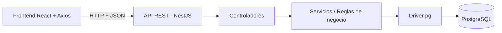

# Backend

Guía para documentar la API y las reglas de negocio de VINTRA.

## Framework, versión y requisitos de ejecución

- **Plataforma:** Node.js (v18.x o superior recomendado).
- **Framework:** NestJS (arquitectura modular sobre Node.js).
- **Lenguaje:** JavaScript / TypeScript.
- **Gestor de paquetes:** npm.
- **Base de datos:** PostgreSQL.
- **Conexión a base de datos:** driver `pg` (node-postgres).
- **Comunicación con el frontend:** API REST + Axios.

## Módulos y responsabilidades

NestJS organiza el backend en módulos. Los módulos previstos a partir del dominio de VINTRA son:

- Rutas (macrorrutas y microrutas).
- Vehículos y personal (conductores).
- Operación (recorridos, asignaciones, monitoreo).
- Reportes ciudadanos e indicadores.
- Autenticación y autorización por rol.

Cada módulo agrupa su controlador (endpoints REST), sus servicios (reglas de negocio) y su acceso a datos.

## Reglas de negocio

Las reglas de negocio de rutas, *tracking*, reportes e indicadores se documentarán junto con cada módulo. El modelo de tablas se mantiene en `base-de-datos/`; aquí solo se describe el uso que hace la API.

## Integración con la base de datos

El backend se conecta a PostgreSQL mediante el driver `pg` con un *pool* de conexiones configurado por variables de entorno (sin credenciales en el código).



## Validación y manejo de errores

- Validación de entradas con los *pipes* y DTOs de NestJS.
- Manejo centralizado de errores y códigos HTTP consistentes.
- CORS habilitado para permitir las peticiones del frontend.

## Comandos para instalar, ejecutar y probar

Desde la carpeta `backend/`:

```bash
npm install            # instala dependencias
npm run start:dev      # levanta el servidor en modo desarrollo
npm run build          # compila el proyecto
npm run start:prod     # ejecuta la versión compilada
```

## Estado

- Estado: `Borrador`
- Responsable: Célula Backend / Frontend
- Pendiente: definir contratos iniciales de API por recurso.
