# Base de Datos 

 

En esta guía se expone la documentación de la base de datos de VINTRA, su arquitectura y evolución.

## Índice

- [Base de Datos](#base-de-datos)
  - [Índice](#índice)
  - [Estado](#estado)
  - [1. Motor y Versión Soportada](#1-motor-y-versión-soportada)
  - [2. Modelo de Datos](#2-modelo-de-datos)
    - [2.1. Diagrama Entidad-Relación](#21-diagrama-entidad-relación)
    - [2.2. Del Dominio a las Tablas](#22-del-dominio-a-las-tablas)
    - [2.3. Relaciones y Reglas](#23-relaciones-y-reglas)
    - [2.4. Diccionario de Datos](#24-diccionario-de-datos)
  - [3. Migraciones, Seeders y Orden de Ejecución](#3-migraciones-seeders-y-orden-de-ejecución)
    - [3.1. Convenciones de Archivos](#31-convenciones-de-archivos)
    - [3.2. Orden de Ejecución](#32-orden-de-ejecución)
      - [3.2.1. Migraciones](#321-migraciones)
      - [3.2.2. Seeders](#322-seeders)
      - [3.2.3. Triggers](#323-triggers)
    - [3.3. Reglas de Migraciones y Seeders](#33-reglas-de-migraciones-y-seeders)
    - [3.4. Índices Mínimos](#34-índices-mínimos)
  - [4. Auditoría y Trazabilidad](#4-auditoría-y-trazabilidad)
    - [4.1. Alcance](#41-alcance)
    - [4.2. Funcionamiento](#42-funcionamiento)
    - [4.3. Borrado Lógico](#43-borrado-lógico)
    - [4.4. Trigger de `updated_at`](#44-trigger-de-updated_at)
  - [5. Configuración Local](#5-configuración-local)
    - [5.1. Archivo `.env.example`](#51-archivo-envexample)
    - [5.2. `docker-compose.yml` (en la raíz del repositorio)](#52-docker-composeyml-en-la-raíz-del-repositorio)
    - [5.3. Puesta en Marcha](#53-puesta-en-marcha)
    - [5.4. Comandos Útiles](#54-comandos-útiles)
  - [6. Respaldo y Restauración](#6-respaldo-y-restauración)
    - [6.1. Política de Respaldo](#61-política-de-respaldo)
    - [6.2. Política de Restauración](#62-política-de-restauración)
  - [7. Datos Sensibles y Depuración](#7-datos-sensibles-y-depuración)
    - [7.1. Clasificación](#71-clasificación)
    - [7.2. Reglas de Tratamiento](#72-reglas-de-tratamiento)
    - [7.3. Depuración](#73-depuración)

## Estado

- Estado: `En revisión`
- Responsable: Ricardo Farid Cuero
- Ultima fecha de modificación: **15/11/2026**

---

## 1. Motor y Versión Soportada

El motor de la base de datos es  (versión 16) en conjunto con la extensión  (versión 3.6.x o superior por compatibilidad). La extensión `pgcrypto` también se habilita en [`000_create_extensions.sql`](#31-convenciones-de-archivos).

## 2. Modelo de Datos

### 2.1. Diagrama Entidad-Relación

El der cuenta con `38 tablas`: 19 del modelo de datos y las 19 restantes tablas de auditoría (`*_log`, ver [sección 4](#4-auditoría-y-trazabilidad)). No se incluye la tabla de sistema `spatial_ref_sys` que instala PostGIS. Las características y restricciones de cada atributo están en el [diccionario de datos](#24-diccionario-de-datos); las reglas de cada relación, en la [sección 2.3](#23-relaciones-y-reglas).

> Aclaración: cada tabla `*_log` tiene una FK hacia su entidad (objeto modificado) y una segunda FK hacia `user_account(id)` (actor que realiza la modificación). Todas comparten la misma estructura y se llenan automáticamente mediante triggers.

```mermaid
%%{init: {'theme': 'forest'}}%%
erDiagram

    user_account {
        UUID id
        ENUM user_status
        ENUM document_type
        VARCHAR document_id
        TEXT pwd_hash
        VARCHAR first_name
        VARCHAR last_name
        VARCHAR email
        VARCHAR phone
        SMALLINT failed_attempts
        BOOLEAN is_active
        TIMESTAMPTZ locked_until
        TIMESTAMPTZ last_login_at
        TIMESTAMPTZ email_verified_at
        TIMESTAMPTZ password_changed_at
        TIMESTAMPTZ updated_at
        TIMESTAMPTZ created_at
    }

    profile {
        UUID id
        UUID user_account_id
        ENUM user_role
        BOOLEAN is_active
        TIMESTAMPTZ created_at
    }

    session {
        UUID id
        UUID user_account_id
        CHAR token_hash
        INET request_ip
        BOOLEAN is_active
        TIMESTAMPTZ revoked_at
        TIMESTAMPTZ last_used_at
        TIMESTAMPTZ expires_at
        TIMESTAMPTZ created_at
    }

    password_reset_token {
        UUID id
        UUID user_account_id
        CHAR token_hash
        INET request_ip
        BOOLEAN is_active
        TIMESTAMPTZ used_at
        TIMESTAMPTZ expires_at
        TIMESTAMPTZ created_at
    }

    email_validation_token {
        UUID id
        UUID user_data_id
        VARCHAR email
        CHAR token_hash
        INET request_ip
        BOOLEAN is_active
        TIMESTAMPTZ used_at
        TIMESTAMPTZ expires_at
        TIMESTAMPTZ created_at
    }

    vehicle_type {
        UUID id
        VARCHAR code
        VARCHAR name
        BOOLEAN is_active
        TIMESTAMPTZ created_at
    }

    vehicle {
        UUID id
        UUID vehicle_type_id
        ENUM vehicle_status
        CHAR plate
        NUMERIC capacity_kg
        NUMERIC capacity_yd3
        BOOLEAN is_active
        TIMESTAMPTZ updated_at
        TIMESTAMPTZ created_at
    }

    macroroute {
        UUID id
        VARCHAR code
        VARCHAR name
        MULTILINESTRING geom
        BOOLEAN is_active
        TIMESTAMPTZ updated_at
        TIMESTAMPTZ created_at
    }

    microroute {
        UUID id
        UUID macroroute_id
        VARCHAR code
        VARCHAR name
        MULTILINESTRING geom
        BOOLEAN is_active
        TIMESTAMPTZ updated_at
        TIMESTAMPTZ created_at
    }

    btura_neighborhood {
        UUID id
        VARCHAR commune
        VARCHAR name
        MULTIPOLYGON geom
        BOOLEAN is_active
        TIMESTAMPTZ updated_at
        TIMESTAMPTZ created_at
    }

    schedule {
        UUID id
        VARCHAR name
        TIME start_time
        TIME end_time
        BOOLEAN is_active
        TIMESTAMPTZ updated_at
        TIMESTAMPTZ created_at
    }

    microroute_schedule {
        UUID id
        UUID microroute_id
        UUID schedule_id
        SMALLINT day_of_week
        BOOLEAN is_active
        TIMESTAMPTZ updated_at
        TIMESTAMPTZ created_at
    }

    microroute_neighborhood {
        UUID id
        UUID microroute_id
        UUID neighborhood_id
        INT order_visit
        BOOLEAN is_active
    }

    crew {
        UUID id
        VARCHAR name
        BOOLEAN is_active
        TIMESTAMPTZ updated_at
        TIMESTAMPTZ created_at
    }

    crew_member {
        UUID id
        UUID crew_id
        VARCHAR full_name
        BOOLEAN is_active
        TIMESTAMPTZ updated_at
        TIMESTAMPTZ created_at
    }

    driver {
        UUID id
        UUID user_data_id
        UUID crew_id
        TIMESTAMPTZ started_at
        TIMESTAMPTZ ended_at
        BOOLEAN is_active
        TIMESTAMPTZ updated_at
        TIMESTAMPTZ created_at
    }

    assignment {
        UUID id
        UUID driver_id
        UUID microroute_schedule_id
        UUID vehicle_id
        ENUM assignment_status
        TIMESTAMPTZ scheduled_start_at
        TIMESTAMPTZ scheduled_end_at
        TIMESTAMPTZ started_at
        TIMESTAMPTZ ended_at
        BOOLEAN is_active
        TIMESTAMPTZ updated_at
        TIMESTAMPTZ created_at
    }

    vehicle_position {
        UUID id
        UUID assignment_id
        POINT geom
        BOOLEAN is_active
        TIMESTAMPTZ recorded_at
        TIMESTAMPTZ created_at
    }

    user_account_log {
        UUID id
        UUID entity_id
        UUID actor_id
        ENUM action
        JSONB old
        JSONB new
        INET request_ip
        BOOLEAN is_active
        TIMESTAMPTZ created_at
    }

    user_data_log {
        UUID id
        UUID entity_id
        UUID actor_id
        ENUM action
        JSONB old
        JSONB new
        INET request_ip
        BOOLEAN is_active
        TIMESTAMPTZ created_at
    }

    profile_log {
        UUID id
        UUID entity_id
        UUID actor_id
        ENUM action
        JSONB old
        JSONB new
        INET request_ip
        BOOLEAN is_active
        TIMESTAMPTZ created_at
    }

    crew_log {
        UUID id
        UUID entity_id
        UUID actor_id
        ENUM action
        JSONB old
        JSONB new
        INET request_ip
        BOOLEAN is_active
        TIMESTAMPTZ created_at
    }

    crew_member_log {
        UUID id
        UUID entity_id
        UUID actor_id
        ENUM action
        JSONB old
        JSONB new
        INET request_ip
        BOOLEAN is_active
        TIMESTAMPTZ created_at
    }

    driver_log {
        UUID id
        UUID entity_id
        UUID actor_id
        ENUM action
        JSONB old
        JSONB new
        INET request_ip
        BOOLEAN is_active
        TIMESTAMPTZ created_at
    }

    macroroute_log {
        UUID id
        UUID entity_id
        UUID actor_id
        ENUM action
        JSONB old
        JSONB new
        INET request_ip
        BOOLEAN is_active
        TIMESTAMPTZ created_at
    }

    microroute_log {
        UUID id
        UUID entity_id
        UUID actor_id
        ENUM action
        JSONB old
        JSONB new
        INET request_ip
        BOOLEAN is_active
        TIMESTAMPTZ created_at
    }

    assignment_log {
        UUID id
        UUID entity_id
        UUID actor_id
        ENUM action
        JSONB old
        JSONB new
        INET request_ip
        BOOLEAN is_active
        TIMESTAMPTZ created_at
    }

    vehicle_log {
        UUID id
        UUID entity_id
        UUID actor_id
        ENUM action
        JSONB old
        JSONB new
        INET request_ip
        BOOLEAN is_active
        TIMESTAMPTZ created_at
    }

    session_log {
        UUID id
        UUID entity_id
        UUID actor_id
        ENUM action
        JSONB old
        JSONB new
        INET request_ip
        BOOLEAN is_active
        TIMESTAMPTZ created_at
    }

    password_reset_token_log {
        UUID id
        UUID entity_id
        UUID actor_id
        ENUM action
        JSONB old
        JSONB new
        INET request_ip
        BOOLEAN is_active
        TIMESTAMPTZ created_at
    }

    email_validation_token_log {
        UUID id
        UUID entity_id
        UUID actor_id
        ENUM action
        JSONB old
        JSONB new
        INET request_ip
        BOOLEAN is_active
        TIMESTAMPTZ created_at
    }

    vehicle_type_log {
        UUID id
        UUID entity_id
        UUID actor_id
        ENUM action
        JSONB old
        JSONB new
        INET request_ip
        BOOLEAN is_active
        TIMESTAMPTZ created_at
    }

    btura_neighborhood_log {
        UUID id
        UUID entity_id
        UUID actor_id
        ENUM action
        JSONB old
        JSONB new
        INET request_ip
        BOOLEAN is_active
        TIMESTAMPTZ created_at
    }

    schedule_log {
        UUID id
        UUID entity_id
        UUID actor_id
        ENUM action
        JSONB old
        JSONB new
        INET request_ip
        BOOLEAN is_active
        TIMESTAMPTZ created_at
    }

    microroute_schedule_log {
        UUID id
        UUID entity_id
        UUID actor_id
        ENUM action
        JSONB old
        JSONB new
        INET request_ip
        BOOLEAN is_active
        TIMESTAMPTZ created_at
    }

    microroute_neighborhood_log {
        UUID id
        UUID entity_id
        UUID actor_id
        ENUM action
        JSONB old
        JSONB new
        INET request_ip
        BOOLEAN is_active
        TIMESTAMPTZ created_at
    }

    vehicle_position_log {
        UUID id
        UUID entity_id
        UUID actor_id
        ENUM action
        JSONB old
        JSONB new
        INET request_ip
        BOOLEAN is_active
        TIMESTAMPTZ created_at
    }

    user_account ||--o{ profile : "tiene"
    user_account ||--o{ session : "abre"
    user_account ||--o{ password_reset_token : "genera"
    user_account ||--o{ email_validation_token : "genera"
    user_account ||--o{ driver : "pertenece"
    crew ||--o{ driver : "tiene"
    crew ||--o{ crew_member : "tiene"
    driver ||--o{ assignment : "realiza"
    microroute_schedule ||--o{ assignment : "hace"
    vehicle ||--o{ assignment : "utiliza"
    assignment ||--o{ vehicle_position : "reporta"
    macroroute ||--o{ microroute : "contiene"
    microroute ||--o{ microroute_schedule : "tiene"
    schedule ||--o{ microroute_schedule : "programa"
    btura_neighborhood ||--o{ microroute_neighborhood : "atiende"
    microroute ||--o{ microroute_neighborhood : "pasa por"
    vehicle_type ||--o{ vehicle : "tiene"
    user_account ||--o{ user_account_log : "genera"
    profile ||--o{ profile_log : "genera"
    session ||--o{ session_log : "genera"
    password_reset_token ||--o{ password_reset_token_log : "genera"
    email_validation_token ||--o{ email_validation_token_log : "genera"
    vehicle_type ||--o{ vehicle_type_log : "genera"
    vehicle ||--o{ vehicle_log : "genera"
    macroroute ||--o{ macroroute_log : "genera"
    microroute ||--o{ microroute_log : "genera"
    btura_neighborhood ||--o{ btura_neighborhood_log : "genera"
    schedule ||--o{ schedule_log : "genera"
    microroute_schedule ||--o{ microroute_schedule_log : "genera"
    microroute_neighborhood ||--o{ microroute_neighborhood_log : "genera"
    crew ||--o{ crew_log : "genera"
    crew_member ||--o{ crew_member_log : "genera"
    driver ||--o{ driver_log : "genera"
    assignment ||--o{ assignment_log : "genera"
    vehicle_position ||--o{ vehicle_position_log : "genera"
```



### 2.2. Del Dominio a las Tablas

| Concepto de dominio | Tabla | Observaciones |
| --- | --- | --- |
| Usuario del sistema | `user_account` | Credenciales y datos personales |
| Rol del perfil | `profile.user_role` | Se almacena como ENUM; una cuenta no puede repetir el mismo rol |
| Cuadrilla de recolección | `crew`, `crew_member` | La cuadrilla agrupa integrantes y conductores |
| Conductor | `driver` | Vincula los datos personales del conductor con su cuadrilla |
| Vehículo recolector | `vehicle`, `vehicle_type` | El estado se almacena como ENUM `vehicle_status` |
| Macrorruta (zona general) | `macroroute` | Trazado geográfico (multilínea) |
| Microrruta (zona específica) | `microroute` | Trazado (multilínea) dentro de una macrorruta |
| Barrio | `btura_neighborhood` | Límites de los barrios de Buenaventura |
| Horario de recolección | `schedule`, `microroute_schedule` | Franja horaria por microruta y día de la semana |
| Recorridos | `assignment` | Conductor, programación de microruta y vehículo |
| Seguimiento en tiempo real | `vehicle_position` | Puntos GPS de una asignación |
| Auditoría | `*_log` | Ver [sección 4](#4-auditoría-y-trazabilidad) |
| Autenticación | `session`, `password_reset_token`, `email_validation_token` | Solo se almacenan hashes de los tokens (ver [sección 7.2](#72-reglas-de-tratamiento)) |

### 2.3. Relaciones y Reglas

La cardinalidad de todas las relaciones se lee directamente en el [DER](#21-diagrama-entidad-relación). Aquí solo se documentan las reglas que el diagrama no expresa:

| Relación | Cardinalidad | Regla |
| --- | --- | --- |
| `user_account` → `profile` | 1 a N | El par (`user_account_id`, `user_role`) es único |
| `user_account` → `session` | 1 a N | Sesión revocable y con vencimiento |
| `user_account` → `password_reset_token` | 1 a N | Token de un solo uso |
| `user_account` → `email_validation_token` | 1 a N | Token de validación del correo |
| `user_account` → `driver` | 1 a N | Un conductor corresponde a unos datos personales |
| `microroute_schedule` → `assignment` | 1 a N | Una programación de microruta se asigna a varias ejecuciones |
| `schedule` → `microroute_schedule` | 1 a N | Un horario se reutiliza en varias microrrutas |
| `btura_neighborhood` ↔ `microroute` (vía `microroute_neighborhood`) | N a M | Un barrio puede ser atendido por varias microrrutas y una microrruta pasa por varios barrios; `order_visit` define el orden |
| Cada entidad auditada → su `*_log` | 1 a N | Ver [sección 4](#4-auditoría-y-trazabilidad) |

El resto de relaciones (`crew` → `driver`, `crew` → `crew_member`, `driver` → `assignment`, `vehicle` → `assignment`, `assignment` → `vehicle_position`, `macroroute` → `microroute`, `microroute` → `microroute_schedule`, `vehicle_type` → `vehicle`) son 1 a N simples, sin reglas adicionales.

### 2.4. Diccionario de Datos

El [Diccionario de Datos](diccionario-de-datos.md) (Ver [`docs/base-de-datos/diccionario-de-datos.md`](diccionario-de-datos.md)) contiene la descripción de cada atributo de las tablas, incluyendo las restricciones (`PK`, `FK`, `UNIQUE`, `CHECK`) y la relación doble de las tablas `*_log`.

## 3. Migraciones, Seeders y Orden de Ejecución

Las [migraciones](../../database/migrations/) crean las tablas, los [seeders](../../database/seeders/) insertan datos de ejemplo y los [triggers](../../database/triggers/) crean los disparadores de auditoría (ver [sección 4](#4-auditoría-y-trazabilidad)).

### 3.1. Convenciones de Archivos

| Tipo | Ubicación | Convención | Ejemplo |
| --- | --- | --- | --- |
| Migración | `database/migrations/` | `NNN_create_<tabla>.sql` | `001_create_user_account.sql` |
| Inserción | `database/seeders/` | `NNN_insert_<tabla>.sql` | `001_insert_user_account.sql` |
| Disparador | `database/triggers/` | `NNN_trigger_<tabla>.sql` | `001_trigger_user_account.sql` |

- `NNN` es un número de tres dígitos que indica el orden de ejecución. En los triggers de auditoría coincide con el número de la migración de la tabla auditada; el archivo `100_function_updated_at.sql` es especial.
- `create`: crea una tabla u objeto de base de datos. `insert`: inserta datos iniciales. `function`: crea una función compartida. `trigger`: crea disparadores sobre una tabla.
- `<tabla>` es el nombre de la tabla afectada.

Archivos especiales (no corresponden a una tabla):

| Archivo | Qué hace |
| --- | --- |
| `000_create_extensions.sql` | Habilita las extensiones `postgis` y `pgcrypto` |
| `000_function_audit_log.sql` | Crea la función compartida `fn_audit_log()` ([sección 4.2](#42-funcionamiento)) |
| `100_function_updated_at.sql` | Crea `fn_set_updated_at()` y los triggers `trg_<tabla>_updated_at` ([sección 4.4](#44-trigger-de-updated_at)); se ejecuta con los triggers |

### 3.2. Orden de Ejecución

El orden estandarizado es: **migraciones -> seeders -> triggers**. Dentro de cada carpeta, los archivos se ejecutan en orden numérico ascendente. El script que lo automatiza está en la [sección 5.3](#53-puesta-en-marcha).

#### 3.2.1. Migraciones

El orden respeta las dependencias entre tablas: primero las entidades base, después las que las referencian y al final las transaccionales y de auditoría. Por eso una migración con número mayor puede depender de una anterior y no debe ejecutarse de forma aislada. Cada archivo está envuelto en `BEGIN`/`COMMIT` para que su ejecución sea atómica.

| # | Migración | Dependencia |
| --- | --- | --- |
| 000 | `000_create_extensions.sql` | PostgreSQL 16 |
| 001 | `001_create_user_account.sql` | — |
| 003 | `003_create_profile.sql` | `user_account` |
| 004 | `004_create_session.sql` | `user_account` |
| 005 | `005_create_password_reset_token.sql` | `user_account` |
| 006 | `006_create_email_validation_token.sql` | `user_account` |
| 007 | `007_create_vehicle_type.sql` | — |
| 008 | `008_create_vehicle.sql` | `vehicle_type` |
| 009 | `009_create_macroroute.sql` | PostGIS 3.6 |
| 010 | `010_create_microroute.sql` | `macroroute` |
| 011 | `011_create_btura_neighborhood.sql` | PostGIS 3.6 |
| 012 | `012_create_schedule.sql` | — |
| 013 | `013_create_microroute_schedule.sql` | `microroute`, `schedule` |
| 014 | `014_create_microroute_neighborhood.sql` | `microroute`, `btura_neighborhood` |
| 015 | `015_create_crew.sql` | — |
| 016 | `016_create_crew_member.sql` | `crew` |
| 017 | `017_create_driver.sql` | `user_account`, `crew` |
| 018 | `018_create_assignment.sql` | `driver`, `microroute_schedule`, `vehicle` |
| 019 | `019_create_vehicle_position.sql` | `assignment`, PostGIS 3.6 |
| 020 | `020_create_user_account_log.sql` | `user_account` (doble relación, ver [diccionario](diccionario-de-datos.md)) |
| 022 | `022_create_profile_log.sql` | `profile`, `user_account` |
| 023 | `023_create_crew_log.sql` | `crew`, `user_account` |
| 024 | `024_create_crew_member_log.sql` | `crew_member`, `user_account` |
| 025 | `025_create_driver_log.sql` | `driver`, `user_account` |
| 026 | `026_create_macroroute_log.sql` | `macroroute`, `user_account` |
| 027 | `027_create_microroute_log.sql` | `microroute`, `user_account` |
| 028 | `028_create_assignment_log.sql` | `assignment`, `user_account` |
| 029 | `029_create_vehicle_log.sql` | `vehicle`, `user_account` |
| 031 | `031_create_session_log.sql` | `session`, `user_account` |
| 032 | `032_create_password_reset_token_log.sql` | `password_reset_token`, `user_account` |
| 033 | `033_create_email_validation_token_log.sql` | `email_validation_token`, `user_account` |
| 034 | `034_create_vehicle_type_log.sql` | `vehicle_type`, `user_account` |
| 035 | `035_create_btura_neighborhood_log.sql` | `btura_neighborhood`, `user_account` |
| 036 | `036_create_schedule_log.sql` | `schedule`, `user_account` |
| 037 | `037_create_microroute_schedule_log.sql` | `microroute_schedule`, `user_account` |
| 038 | `038_create_microroute_neighborhood_log.sql` | `microroute_neighborhood`, `user_account` |
| 039 | `039_create_vehicle_position_log.sql` | `vehicle_position`, `user_account` |

#### 3.2.2. Seeders

| # | Inserción | Dependencia |
| --- | --- | --- |
| 001 | `001_insert_user_account.sql` | — |
| 003 | `003_insert_profile.sql` | `user_account` |
| 007 | `007_insert_vehicle_type.sql` | — |
| 015 | `015_insert_crew.sql` | — |
| 016 | `016_insert_crew_member.sql` | `crew` |
| 017 | `017_insert_driver.sql` | `user_data`, `crew` |

#### 3.2.3. Triggers

Se ejecutan después de las migraciones `000` a `039` y de los seeders. Como se instalan al final, los datos insertados por los seeders no generan registros de auditoría. Cada trigger de auditoría escribe en la tabla `<tabla>_log` correspondiente; su comportamiento se describe en la [sección 4](#4-auditoría-y-trazabilidad).

| # | Trigger | Tabla auditada |
| --- | --- | --- |
| 000 | `000_function_audit_log.sql` | — (función compartida `fn_audit_log()`) |
| 001 | `001_trigger_user_account.sql` | `user_account` |
| 003 | `003_trigger_profile.sql` | `profile` |
| 004 | `004_trigger_session.sql` | `session` |
| 005 | `005_trigger_password_reset_token.sql` | `password_reset_token` |
| 006 | `006_trigger_email_validation_token.sql` | `email_validation_token` |
| 007 | `007_trigger_vehicle_type.sql` | `vehicle_type` |
| 008 | `008_trigger_vehicle.sql` | `vehicle` |
| 009 | `009_trigger_macroroute.sql` | `macroroute` |
| 010 | `010_trigger_microroute.sql` | `microroute` |
| 011 | `011_trigger_btura_neighborhood.sql` | `btura_neighborhood` |
| 012 | `012_trigger_schedule.sql` | `schedule` |
| 013 | `013_trigger_microroute_schedule.sql` | `microroute_schedule` |
| 014 | `014_trigger_microroute_neighborhood.sql` | `microroute_neighborhood` |
| 015 | `015_trigger_crew.sql` | `crew` |
| 016 | `016_trigger_crew_member.sql` | `crew_member` |
| 017 | `017_trigger_driver.sql` | `driver` |
| 018 | `018_trigger_assignment.sql` | `assignment` |
| 019 | `019_trigger_vehicle_position.sql` | `vehicle_position` |
| 100 | `100_function_updated_at.sql` | — (función `fn_set_updated_at()` y triggers `trg_<tabla>_updated_at`) |

Los triggers `001` a `019` son de auditoría; el archivo `100` instala los triggers `BEFORE UPDATE` de `updated_at` ([sección 4.4](#44-trigger-de-updated_at)).

### 3.3. Reglas de Migraciones y Seeders

- Las migraciones crean cada tabla con sus restricciones (`PK`, `FK`, `UNIQUE`, `CHECK`) y los [índices mínimos](#34-índices-mínimos).
- Los seeders insertan datos mínimos y ficticios (`user_account`, `user_data`, `vehicle_type`, entre otras tablas). Usan `ON CONFLICT DO NOTHING` para poder ejecutarse más de una vez sin duplicar registros.
- Los seeders solo se ejecutan en desarrollo y pruebas; nunca en producción, porque incluyen cuentas de usuario de ejemplo (ver [sección 7.2](#72-reglas-de-tratamiento)).

### 3.4. Índices Mínimos

- `GIST (geom)` en `macroroute`, `microroute`, `btura_neighborhood` y `vehicle_position`.
- `(assignment_id, recorded_at)` en `vehicle_position`.
- `(scheduled_start_at)` en `assignment`.
- `(entity_id)`, `(actor_id)` y `(created_at)` en cada tabla `*_log`.

## 4. Auditoría y Trazabilidad

El modelo registra cada cambio en las entidades auditadas mediante triggers. Esta sección es la referencia única de su comportamiento; el orden y los archivos están en la [sección 3.2.3](#323-triggers) y la estructura de las tablas `*_log` en el [DER](#21-diagrama-entidad-relación).

### 4.1. Alcance

- Hay **19 triggers de auditoría**, uno por entidad auditada, y una función compartida `fn_audit_log()` que escribe en la tabla `<tabla>_log` correspondiente.
- Se disparan con `AFTER INSERT OR UPDATE OR DELETE`.
- Todas las tablas `*_log` comparten la misma estructura: `id` (PK), `entity_id` (FK hacia la entidad auditada), `actor_id` (FK hacia `user_account`), `action` (`audit_action`), `old` y `new` (JSONB), `request_ip` (INET) y `created_at` (TIMESTAMPTZ). Tienen índices por `entity_id`, `actor_id` y `created_at`.
- Cada `*_log` guarda `entity_id` (FK hacia la tabla auditada) y `actor_id` (FK hacia `user_account`), por lo que no se puede borrar de manera física una fila auditada (ver [4.3](#43-borrado-lógico)).

### 4.2. Funcionamiento

| Operación | `action` | `old` | `new` |
| --- | --- | --- | --- |
| `INSERT` | `CREATE` | `NULL` | registro nuevo |
| `UPDATE` sin cambio de `is_active` | `UPDATE` | registro anterior | registro nuevo |
| `UPDATE` con `is_active` de `TRUE` a `FALSE` | `SOFT_DELETE` | registro anterior | registro con `is_active = FALSE` |
| `UPDATE` con `is_active` de `FALSE` a `TRUE` | `RESTORE` | registro anterior | registro con `is_active = TRUE` |
| `DELETE` físico | `DELETE` | registro anterior | `NULL` |

- El ENUM `audit_action` se define en la [migración `020`](../../database/migrations/020_create_user_account_log.sql) con los cinco valores `CREATE`, `UPDATE`, `SOFT_DELETE`, `DELETE` y `RESTORE`.
- `SOFT_DELETE` y `RESTORE` solo aplican a entidades con columna `is_active`; en las demás, un `UPDATE` se registra como `UPDATE`.
- `old` y `new` guardan la fila completa en JSON. Solo se excluyen `user_account.pwd_hash` y `user_account.document_id`; el resto, incluidos los datos personales, se registra (clasificación en la [sección 7.1](#71-clasificación)).
- `actor_id` se toma de la variable de sesión `app.current_user_id` y `request_ip` de `app.request_ip`. Si no están definidas, se guardan como `NULL`.
- La aplicación debe definirlas en cada transacción:

```sql
SELECT set_config('app.current_user_id', '<uuid_del_usuario>', true);
SELECT set_config('app.request_ip', '<ip_del_cliente>', true);
```

- Si una variable tiene un valor que no es un UUID o una IP válidos, el trigger falla y la operación original también.
- La rama `DELETE` existe en la función, pero el `DELETE` físico no es viable mientras `*_log.entity_id` tenga una FK hacia la entidad auditada. Para habilitarlo habría que eliminar o hacer diferible esa FK; el borrado operativo es el lógico.

### 4.3. Borrado Lógico

El borrado operativo es lógico (`is_active = FALSE`) y se audita como `SOFT_DELETE`; la reactivación se audita como `RESTORE`. Todas las entidades cuentan operativamente con el atributo `is_active`, menos `user_data` quien está asociada a `user_account`.

No se debería ejecutar `DELETE` físico directamente sobre entidades con historial de auditoría. Además de la pérdida de trazabilidad, la FK de `*_log.entity_id` lo impide.

### 4.4. Trigger de `updated_at`

Aparte de la auditoría, [`database/triggers/100_function_updated_at.sql`](../../database/triggers/100_function_updated_at.sql) crea `fn_set_updated_at()` y los triggers `trg_<tabla>_updated_at` (`BEFORE UPDATE`), que actualizan `updated_at` en cada `UPDATE` de las 12 tablas que tienen esa columna: `user_account`, `user_data`, `vehicle`, `macroroute`, `microroute`, `btura_neighborhood`, `schedule`, `microroute_schedule`, `crew`, `crew_member`, `driver` y `assignment`.

## 5. Configuración Local

> Requisitos: Docker, Docker compose y archivo .env de prueba.

### 5.1. Archivo `.env.example`

```env
POSTGRES_DB=vintra
POSTGRES_USER=vintra_app
POSTGRES_PASSWORD=cambia_esta_contraseña
POSTGRES_PORT=5432
```

Copiarlo a `.env` (que debe estar en `.gitignore`) y cambiar la contraseña.

### 5.2. `docker-compose.yml` (en la raíz del repositorio)

```yaml
services:
  database:
    build:
      context: ./database
      dockerfile: Dockerfile
    environment:
      POSTGRES_DB: ${POSTGRES_DB}
      POSTGRES_USER: ${POSTGRES_USER}
      POSTGRES_PASSWORD: ${POSTGRES_PASSWORD}
    ports:
      - "${POSTGRES_PORT}:5432"
    volumes:
      - postgres_data:/var/lib/postgresql/data
    healthcheck:
      test: ["CMD-SHELL", "pg_isready -U ${POSTGRES_USER} -d ${POSTGRES_DB}"]
      interval: 10s
      timeout: 5s
      retries: 5

volumes:
  postgres_data:
```

### 5.3. Puesta en Marcha

Los comandos se ejecutan desde la raíz del repositorio, en Git Bash o WSL. Aplican el [orden de ejecución](#32-orden-de-ejecución): migraciones, seeders y triggers.

```bash
cp .env.example .env          # editar la contraseña
docker compose up -d          # levantar la base
docker compose ps             # verificar estado "healthy"

for dir in migrations seeders triggers; do
  for f in database/$dir/*.sql; do
    docker compose exec -T database psql -v ON_ERROR_STOP=1 -U vintra_app -d vintra < "$f"
  done
done
```

En PowerShell, la redirección `<` no existe. La alternativa es:

```powershell
foreach ($dir in "migrations","seeders","triggers") {
  Get-ChildItem "database\$dir\*.sql" | Sort-Object Name | ForEach-Object {
    Get-Content $_.FullName -Raw -Encoding UTF8 | docker compose exec -T database psql -v ON_ERROR_STOP=1 -U vintra_app -d vintra
  }
}
```

Si se cambia `POSTGRES_USER` o `POSTGRES_DB` en el `.env`, hay que usar los mismos valores en los comandos.

Este procedimiento es también la **reconstrucción sin respaldo** (desarrollo y pruebas) a la que remite la [sección 6.2](#62-política-de-restauración).

### 5.4. Comandos Útiles

```bash
# Entrar a la consola SQL
docker compose exec database psql -U vintra_app -d vintra

# Verificar PostGIS
docker compose exec database psql -U vintra_app -d vintra -c "SELECT postgis_full_version();"

# Reiniciar desde cero (borra todos los datos locales)
docker compose down -v && docker compose up -d
```

## 6. Respaldo y Restauración

Las frecuencias y retenciones son una propuesta inicial.

### 6.1. Política de Respaldo

| Tipo | Herramienta | Contenido | Frecuencia | Retención |
| --- | --- | --- | --- | --- |
| Lógico completo | `pg_dump -Fc` | Esquema y datos (incluye geometrías PostGIS) | Diario | 14 días |
| Lógico completo | `pg_dump -Fc` | Esquema y datos | Semanal | 8 semanas |
| Esquema | Migraciones del repositorio ([sección 3](#3-migraciones-seeders-y-orden-de-ejecución)) | Estructura y tipos ENUM | En cada cambio | Control de versiones |

Reglas:

- Los respaldos se almacenan cifrados y fuera del servidor de la base de datos.
- Los respaldos contienen datos personales ([sección 7.1](#71-clasificación)), por lo que tienen el mismo nivel de protección que la base de producción.
- Cada respaldo se verifica al terminar con `pg_restore --list`.
- Los respaldos vencidos se eliminan de forma segura.

```bash
pg_dump -h <host> -U <usuario> -d <base_de_datos> -Fc -f backup_$(date +%Y%m%d_%H%M).dump
```

### 6.2. Política de Restauración

Principios:

1. No se restaura sobre producción sin antes probar el respaldo en un ambiente aparte.
2. Antes de restaurar en producción se respalda el estado actual.
3. Cada restauración queda registrada (fecha, motivo, respaldo usado y resultado).

Procedimiento:

1. Usar un servidor con PostgreSQL 16 y los paquetes de PostGIS 3.6.x o superior instalados.
2. Crear la base de datos vacía.
3. Restaurar el respaldo con `pg_restore`.
4. Validar el resultado.

```bash
createdb -h <host> -U <usuario> <base_de_datos>
pg_restore -h <host> -U <usuario> -d <base_de_datos> --no-owner --exit-on-error backup_YYYYMMDD_HHMM.dump
```

El respaldo ya incluye la creación de las extensiones `postgis` y `pgcrypto`, por lo que no se ejecuta `000_create_extensions.sql` en este caso. Sin respaldo (solo desarrollo y pruebas), se reconstruye según la [sección 5.3](#53-puesta-en-marcha).

Validación posterior:

- Existen las 38 tablas de aplicación (19 entidades + 19 `*_log`), con sus `PK`, `FK`, `UNIQUE` y `CHECK`; `spatial_ref_sys` es la tabla de sistema de PostGIS.
- Existen los [índices GIST](#34-índices-mínimos) sobre las columnas `geom`.
- El catálogo `vehicle_type` tiene su `code` estable; los estados y roles se validan con tipos ENUM.
- Las geometrías son válidas (`ST_IsValid`).

Después de restaurar en producción:

- Revocar las sesiones existentes (`session.revoked_at`).
- Invalidar los tokens pendientes de `password_reset_token` y `email_validation_token` (`used_at`).

Se recomienda una restauración de prueba mensual en un ambiente aislado.

## 7. Datos Sensibles y Depuración

Define cómo se tratan los datos sensibles identificados en el [diccionario de datos](#24-diccionario-de-datos).

### 7.1. Clasificación

| Clasificación | Datos |
| --- | --- |
| Secreto (nunca se expone ni se registra) | `user_account.pwd_hash`, `session.token_hash`, `password_reset_token.token_hash`, `email_validation_token.token_hash` |
| Personal | `user_account.document_id`, `user_account.first_name`, `user_account.last_name`, `user_account.email`, `user_account.phone`, `crew_member.full_name`, `email_validation_token.email`, `*_log.old` y `*_log.new` |
| Rastreo de actividad | `request_ip` (`session`, `password_reset_token`, `email_validation_token`, `*_log`), `*_log.actor_id`, `vehicle_position` (`geom`, `recorded_at`) |

### 7.2. Reglas de Tratamiento

| Dato | Regla |
| --- | --- |
| Contraseña | Solo se almacena el hash Argon2id (incluye sal y parámetros) |
| Tokens (sesión, restablecimiento, validación de correo) | Solo se almacena el hash SHA-256; el token en claro nunca se guarda |
| `*_log.old` / `*_log.new` | Nunca deben contener contraseñas, hashes ni `document_id`; el trigger excluye `pwd_hash`, `document_id`, y `token_hash` de las tablas de autenticación ([sección 4.2](#42-funcionamiento)) |
| `document_id` | Se muestra enmascarado y no se escribe en logs |
| Datos personales | No se usan datos reales en desarrollo ni pruebas; los seeders contienen datos ficticios ([sección 3.3](#33-reglas-de-migraciones-y-seeders)) |
| Posiciones GPS | Solo de asignaciones en curso (regla de la aplicación) |
| Credenciales de conexión | En variables de entorno o gestor de secretos; nunca en el repositorio |

### 7.3. Depuración

| Tabla | Política propuesta |
| --- | --- |
| `session` | Eliminar las vencidas o revocadas con más de 30 días |
| `password_reset_token`, `email_validation_token` | Eliminar las usadas o vencidas con más de 30 días |
| `vehicle_position` | Definir un periodo de conservación (es la tabla de mayor crecimiento) |
| Cuentas dadas de baja | Deshabilitar con `user_account.is_active = FALSE` (estado operativo prioritario); `user_status` conserva el estado administrativo. Anonimizar `user_data` si se requiere |
| Tablas `*_log` | Definir un periodo de retención de auditoría; no eliminar sin aprobación |
