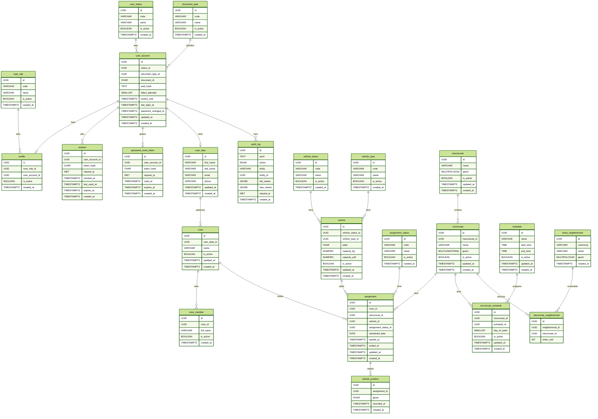

# Base de datos 

En esta guía se expone la documentación de la base de datos de VINTRA, su arquitectura y evolución.

## Índice

1. [Motor y Versión Soportadas](#1-motor-y-version-soportada)
2. [Diagrama Entidad-Relación](#2-diagramado-er)
3. [Diccionario de Datos](#3-diccionario-de-datos)
4. [Traducción de Relaciones](#4-relaciones-con-el-modelo-de-dominio)
5. [Migraciones, Datos Iniciales y Orden de Ejecución](#5-migraciones-datos-iniciales-y-orden-de-ejecucción)
6. [Politicas para Respaldo, Restauración y Datos Sensibles](#6-políticas-restauración-y-datos-sensibles)
7. [Configuración Local](#7-configuración-local)

## Estado

- Estado: `En desarrollo`
- Responsable: Ricardo Farid Cuero
- Pendiente: Versión soportada seleccionada en el stack tecnológico, migraciones, politicas de respaldos y de restauración, documentación de los datos sensibles, ejemplo de configuración local.

---

## 1. Motor y Version Soportada

El motor de la Base de Datos usada es:  en conjunto con la extensión: . Usando las versiones 16 para postgreSQL. Y por compatibilidad versionado 3.6.x en adelante.

## 2. Diagramado ER:

## 3. Diccionario de Datos:

### 3.1. user_role

| atributo | descripción | tipo | longitud | mandatorio | unico | clave | restricciones |
| --- | --- | --- | --- | --- | --- | --- | --- |
| id | Identificador único del rol. | UUID | N/A | SI | SI |    |    |
| code | Identificador lógico estable del rol. | VARCHAR | 30 | SI | SI |    |    |
| name | Nombre legible para mostrar en pantalla. | VARCHAR | 100 | SI | NO |    |    |
| is_active | Indica si el registro está vigente (TRUE) o inactivo (FALSE). Por defecto TRUE. | BOOLEAN | N/A | SI | NO |    | Por defecto TRUE |
| created_at | Fecha y hora de creación del registro (UTC). Por defecto now(). | TIMESTAMPTZ | N/A | SI | NO |    | Por defecto now() |

### 3.2. user_status

| atributo | descripción | tipo | longitud | mandatorio | unico | clave | restricciones |
| --- | --- | --- | --- | --- | --- | --- | --- |
| id | Identificador único del estado. | UUID | N/A | SI | SI |    |    |
| code | Identificador lógico estable del estado. | VARCHAR | 30 | SI | SI |    |    |
| name | Nombre legible para mostrar en pantalla. | VARCHAR | 100 | SI | NO |    |    |
| is_active | Indica si el registro está vigente (TRUE) o inactivo (FALSE). Por defecto TRUE. | BOOLEAN | N/A | SI | NO |    | Por defecto TRUE |
| created_at | Fecha y hora de creación del registro (UTC). Por defecto now(). | TIMESTAMPTZ | N/A | SI | NO |    | Por defecto now() |

### 3.3. document_type

| atributo | descripción | tipo | longitud | mandatorio | unico | clave | restricciones |
| --- | --- | --- | --- | --- | --- | --- | --- |
| id | Identificador único del tipo de documento. | UUID | N/A | SI | SI |    |    |
| code | Identificador único estable para lógica del sistema. | VARCHAR | 30 | SI | SI |    |    |
| name | Nombre del tipo de documento (ej.: cédula de ciudadanía, cédula de extranjería, pasaporte). | VARCHAR | 50 | SI | SI |    |    |
| is_active | Indica si el registro está vigente (TRUE) o inactivo (FALSE). Por defecto TRUE. | BOOLEAN | N/A | SI | NO |    | Por defecto TRUE |
| created_at | Fecha y hora de creación del registro (UTC). Por defecto now(). | TIMESTAMPTZ | N/A | SI | NO |    | Por defecto now() |

### 3.4. user_account

| atributo | descripción | tipo | longitud | mandatorio | unico | clave | restricciones |
| --- | --- | --- | --- | --- | --- | --- | --- |
| id | Identificador único de la cuenta de usuario. | UUID | N/A | SI | SI |    |    |
| user_status_id | Estado administrativo de la cuenta. Determina si puede iniciar sesión. | UUID | N/A | SI | NO |    | Referencia user_status(id) |
| document_type_id | Tipo de documento de identidad del titular de la cuenta. | UUID | N/A | SI | SI (compuesto) |    | Compuesto único con document_id; referencia document_type(id) |
| document_id | Número de documento de identidad del titular. Dato personal sensible. No puede repetirse junto con document_type_id. | CHAR | 20 | SI | SI (compuesto) |    | Compuesto único con document_type_id |
| pwd_hash | Hash de la contraseña (Argon2id; incluye sal y parámetros). | TEXT | N/A | SI | NO |    |    |
| failed_attempts | Intentos fallidos consecutivos de inicio de sesión. Se reinicia al autenticarse con éxito. Por defecto 0. | SMALLINT | N/A | SI | NO |    | Por defecto 0 |
| locked_until | Fecha hasta la cual la cuenta está bloqueada temporalmente por intentos fallidos. NULL si no está bloqueada. | TIMESTAMPTZ | N/A | NO | NO |    | NULL permitido |
| last_login_at | Fecha y hora del último inicio de sesión exitoso. NULL si nunca ha ingresado. | TIMESTAMPTZ | N/A | NO | NO |    | NULL permitido |
| password_changed_at | Fecha y hora del último cambio de contraseña. NULL si no se ha cambiado desde la creación. | TIMESTAMPTZ | N/A | NO | NO |    | NULL permitido |
| updated_at | Fecha y hora de la última modificación del registro (UTC). | TIMESTAMPTZ | N/A | SI | NO |    |    |
| created_at | Fecha y hora de creación del registro (UTC). Por defecto now(). | TIMESTAMPTZ | N/A | SI | NO |    | Por defecto now() |

### 3.5. user_data

| atributo | descripción | tipo | longitud | mandatorio | unico | clave | restricciones |
| --- | --- | --- | --- | --- | --- | --- | --- |
| id | Identificador único de los datos personales. Es el mismo id de user_account (relación 1 a 1). | UUID | N/A | SI | SI |   ,    | Referencia user_account(id) |
| first_name | Nombres de la persona. Dato personal. | VARCHAR | 80 | SI | NO |    |    |
| last_name | Apellidos de la persona. Dato personal. | VARCHAR | 80 | SI | NO |    |    |
| email | Correo electrónico de la persona. Dato personal. | VARCHAR | 254 | SI | NO |    |    |
| phone | Número de teléfono de contacto. Dato personal. | VARCHAR | 10 | NO | NO |    | NULL permitido |
| updated_at | Fecha y hora de la última modificación del registro (UTC). | TIMESTAMPTZ | N/A | SI | NO |    |    |
| created_at | Fecha y hora de creación del registro (UTC). Por defecto now(). | TIMESTAMPTZ | N/A | SI | NO |    | Por defecto now() |

### 3.6. profile

| atributo | descripción | tipo | longitud | mandatorio | unico | clave | restricciones |
| --- | --- | --- | --- | --- | --- | --- | --- |
| id | Identificador único del perfil. | UUID | N/A | SI | SI |    |    |
| user_role_id | Rol que se ejerce con este perfil (ej.: conductor). Una cuenta no puede repetir el mismo rol. | UUID | N/A | SI | SI (compuesto) |    | Compuesto único con user_account_id; referencia user_role(id) |
| user_account_id | Cuenta de usuario a la que pertenece el perfil. | UUID | N/A | SI | SI (compuesto) |    | Compuesto único con user_role_id; referencia user_account(id) |
| is_active | Indica si el perfil está vigente (TRUE) o inactivo (FALSE). Por defecto TRUE. | BOOLEAN | N/A | SI | NO |    | Por defecto TRUE |
| created_at | Fecha y hora de creación del registro (UTC). Por defecto now(). | TIMESTAMPTZ | N/A | SI | NO |    | Por defecto now() |

### 3.7. session

| atributo | descripción | tipo | longitud | mandatorio | unico | clave | restricciones |
| --- | --- | --- | --- | --- | --- | --- | --- |
| id | Identificador único de la sesión. | UUID | N/A | SI | SI |    |    |
| user_account_id | Cuenta de usuario dueña de la sesión. | UUID | N/A | SI | NO |    | Referencia user_account(id) |
| token_hash | Hash SHA-256 (hexadecimal) del token de sesión. El token en claro nunca se almacena. | CHAR | 64 | SI | SI |    |    |
| request_ip | Dirección IP desde la que se abrió la sesión. | INET | N/A | NO | NO |    | NULL permitido |
| revoked_at | Fecha y hora en que la sesión fue revocada (cierre de sesión, cambio de contraseña, bloqueo). NULL si sigue vigente. | TIMESTAMPTZ | N/A | NO | NO |    | NULL permitido |
| last_used_at | Fecha y hora del último uso de la sesión. | TIMESTAMPTZ | N/A | NO | NO |    | NULL permitido |
| expires_at | Fecha y hora de vencimiento de la sesión. Pasada esta fecha deja de ser válida. | TIMESTAMPTZ | N/A | SI | NO |    |    |
| created_at | Fecha y hora de creación del registro (UTC). Por defecto now(). | TIMESTAMPTZ | N/A | SI | NO |    | Por defecto now() |

### 3.8. password_reset_token

| atributo | descripción | tipo | longitud | mandatorio | unico | clave | restricciones |
| --- | --- | --- | --- | --- | --- | --- | --- |
| id | Identificador único de la solicitud de restablecimiento. | UUID | N/A | SI | SI |    |    |
| user_account_id | Cuenta de usuario que solicitó el restablecimiento. | UUID | N/A | SI | NO |    | Referencia user_account(id) |
| token_hash | Hash SHA-256 (hexadecimal) del token enviado al usuario. El token en claro nunca se almacena. | CHAR | 64 | SI | SI |    |    |
| request_ip | Dirección IP desde la que se hizo la solicitud. | INET | N/A | NO | NO |    | NULL permitido |
| used_at | Fecha y hora en que se usó el token. NULL mientras no se haya usado (un solo uso). | TIMESTAMPTZ | N/A | NO | NO |    | NULL permitido |
| expires_at | Fecha y hora de vencimiento del token (vida corta). | TIMESTAMPTZ | N/A | SI | NO |    |    |
| created_at | Fecha y hora de creación del registro (UTC). Por defecto now(). | TIMESTAMPTZ | N/A | SI | NO |    | Por defecto now() |

### 3.9. audit_log

| atributo | descripción | tipo | longitud | mandatorio | unico | clave | restricciones |
| --- | --- | --- | --- | --- | --- | --- | --- |
| id | Identificador único del evento de auditoría. | UUID | N/A | SI | SI |    |    |
| actor | Quién realizó la acción: identificador de la cuenta de usuario o indicador de proceso automático del sistema. Se guarda como texto. | TEXT | N/A | SI | NO |    | Referencia polimórfica no formal |
| action | Acción registrada: CREATE, UPDATE o DELETE. | ENUM | N/A | SI | NO |    | Valores permitidos: CREATE, UPDATE, DELETE |
| entity | Nombre de la tabla afectada (ej.: vehicle, assignment, microroute). | VARCHAR | 50 | SI | NO |    |    |
| entity_id | Identificador del registro afectado dentro de entity. Referencia polimórfica. | UUID | N/A | SI | NO |    | Referencia polimórfica no formal |
| old_values | Valores anteriores al cambio en formato JSON. NULL en CREATE. Nunca debe contener contraseñas ni hashes. | JSONB | N/A | NO | NO |    | NULL permitido; no debe contener contraseñas ni hashes |
| new_values | Valores posteriores al cambio en formato JSON. NULL en DELETE. Nunca debe contener contraseñas ni hashes. | JSONB | N/A | NO | NO |    | NULL permitido; no debe contener contraseñas ni hashes |
| request_ip | Dirección IP desde la que se originó la acción. | INET | N/A | NO | NO |    | NULL permitido |
| created_at | Fecha y hora de creación del registro (UTC). Por defecto now(). | TIMESTAMPTZ | N/A | SI | NO |    | Por defecto now() |

### 3.10. crew

| atributo | descripción | tipo | longitud | mandatorio | unico | clave | restricciones |
| --- | --- | --- | --- | --- | --- | --- | --- |
| id | Identificador único de la cuadrilla. | UUID | N/A | SI | SI |    |    |
| user_data_id | Conductor que representa y encabeza la cuadrilla. Que la persona tenga el rol de conductor se valida en la aplicación. | UUID | N/A | SI | SI |    | Referencia user_data(id) |
| name | Nombre de la cuadrilla. | VARCHAR | 100 | SI | NO |    |    |
| is_active | Indica si la cuadrilla está vigente (TRUE) o inactiva (FALSE). Por defecto TRUE. | BOOLEAN | N/A | SI | NO |    | Por defecto TRUE |
| updated_at | Fecha y hora de la última modificación del registro (UTC). | TIMESTAMPTZ | N/A | SI | NO |    |    |
| created_at | Fecha y hora de creación del registro (UTC). Por defecto now(). | TIMESTAMPTZ | N/A | SI | NO |    | Por defecto now() |

### 3.11. crew_member

| atributo | descripción | tipo | longitud | mandatorio | unico | clave | restricciones |
| --- | --- | --- | --- | --- | --- | --- | --- |
| id | Identificador único del integrante. | UUID | N/A | SI | SI |    |    |
| crew_id | Cuadrilla a la que pertenece el integrante. | UUID | N/A | SI | NO |    | Referencia crew(id) |
| full_name | Nombre completo del integrante. Dato personal. | VARCHAR | 120 | SI | NO |    |    |
| is_active | Indica si el integrante está vigente (TRUE) o inactivo (FALSE). Por defecto TRUE. | BOOLEAN | N/A | SI | NO |    | Por defecto TRUE |
| created_at | Fecha y hora de creación del registro (UTC). Por defecto now(). | TIMESTAMPTZ | N/A | SI | NO |    | Por defecto now() |

### 3.12. vehicle_status

| atributo | descripción | tipo | longitud | mandatorio | unico | clave | restricciones |
| --- | --- | --- | --- | --- | --- | --- | --- |
| id | Identificador único del estado. | UUID | N/A | SI | SI |    |    |
| code | Código estable del estado (ej.: AVAILABLE, MAINTENANCE) que la aplicación usa en su lógica. | VARCHAR | 30 | SI | SI |    |    |
| name | Nombre legible para mostrar en pantalla. | VARCHAR | 100 | SI | NO |    |    |
| is_active | Indica si el registro está vigente (TRUE) o inactivo (FALSE). Por defecto TRUE. | BOOLEAN | N/A | SI | NO |    | Por defecto TRUE |
| created_at | Fecha y hora de creación del registro (UTC). Por defecto now(). | TIMESTAMPTZ | N/A | SI | NO |    | Por defecto now() |

### 3.13. vehicle_type

| atributo | descripción | tipo | longitud | mandatorio | unico | clave | restricciones |
| --- | --- | --- | --- | --- | --- | --- | --- |
| id | Identificador único del tipo de vehículo. | UUID | N/A | SI | SI |    |    |
| code | Código estable del tipo de vehículo que la aplicación usa en su lógica. | VARCHAR | 30 | SI | SI |    |    |
| name | Nombre legible para mostrar en pantalla. | VARCHAR | 100 | SI | NO |    |    |
| is_active | Indica si el registro está vigente (TRUE) o inactivo (FALSE). Por defecto TRUE. | BOOLEAN | N/A | SI | NO |    | Por defecto TRUE |
| created_at | Fecha y hora de creación del registro (UTC). Por defecto now(). | TIMESTAMPTZ | N/A | SI | NO |    | Por defecto now() |

### 3.14. vehicle

| atributo | descripción | tipo | longitud | mandatorio | unico | clave | restricciones |
| --- | --- | --- | --- | --- | --- | --- | --- |
| id | Identificador único del vehículo. | UUID | N/A | SI | SI |    |    |
| vehicle_status_id | Estado actual del vehículo. | UUID | N/A | SI | NO |    | Referencia vehicle_status(id) |
| vehicle_type_id | Tipo de vehículo. | UUID | N/A | SI | NO |    | Referencia vehicle_type(id) |
| plate | Placa del vehículo. No puede repetirse. | CHAR | 6 | SI | SI |    |    |
| capacity_kg | Capacidad de carga en kilogramos. | FLOAT | N/A | SI | NO |    |    |
| capacity_yd3 | Capacidad volumétrica en yardas cúbicas. | FLOAT | N/A | SI | NO |    |    |
| is_active | Indica si el vehículo está vigente (TRUE) o inactivo (FALSE). Por defecto TRUE. | BOOLEAN | N/A | SI | NO |    | Por defecto TRUE |
| updated_at | Fecha y hora de la última modificación del registro (UTC). | TIMESTAMPTZ | N/A | SI | NO |    |    |
| created_at | Fecha y hora de creación del registro (UTC). Por defecto now(). | TIMESTAMPTZ | N/A | SI | NO |    | Por defecto now() |

### 3.15. assignment_status

| atributo | descripción | tipo | longitud | mandatorio | unico | clave | restricciones |
| --- | --- | --- | --- | --- | --- | --- | --- |
| id | Identificador único del estado. | UUID | N/A | SI | SI |    |    |
| code | Código estable del estado (ej.: SCHEDULED, IN_PROGRESS, COMPLETED, CANCELLED) que la aplicación y el proceso automático usan en su lógica. | VARCHAR | 30 | SI | SI |    |    |
| name | Nombre legible para mostrar en pantalla. | VARCHAR | 100 | SI | NO |    |    |
| is_active | Indica si el registro está vigente (TRUE) o inactivo (FALSE). Por defecto TRUE. | BOOLEAN | N/A | SI | NO |    | Por defecto TRUE |
| created_at | Fecha y hora de creación del registro (UTC). Por defecto now(). | TIMESTAMPTZ | N/A | SI | NO |    | Por defecto now() |

### 3.16. assignment

| atributo | descripción | tipo | longitud | mandatorio | unico | clave | restricciones |
| --- | --- | --- | --- | --- | --- | --- | --- |
| id | Identificador único de la asignación. | UUID | N/A | SI | SI |    |    |
| crew_id | Cuadrilla que ejecuta la microruta. | UUID | N/A | SI | NO |    | Referencia crew(id) |
| microroute_id | Microruta que se ejecuta. Junto con scheduled_date no puede repetirse (una ejecución por día). | UUID | N/A | SI | SI (compuesto) |    | Compuesto único con scheduled_date; referencia microroute(id) |
| vehicle_id | Vehículo utilizado en la ejecución. | UUID | N/A | SI | NO |    | Referencia vehicle(id) |
| assignment_status_id | Estado actual de la asignación. | UUID | N/A | SI | NO |    | Referencia assignment_status(id) |
| scheduled_date | Fecha programada de ejecución de la microruta. Junto con microroute_id no puede repetirse. | DATE | N/A | SI | SI (compuesto) |    | Compuesto único con microroute_id |
| started_at | Fecha y hora reales de inicio del recorrido. NULL mientras no haya iniciado. | TIMESTAMPTZ | N/A | NO | NO |    | NULL permitido |
| ended_at | Fecha y hora reales de fin del recorrido. NULL mientras no haya terminado. | TIMESTAMPTZ | N/A | NO | NO |    | NULL permitido |
| updated_at | Fecha y hora de la última modificación del registro (UTC). | TIMESTAMPTZ | N/A | SI | NO |    |    |
| created_at | Fecha y hora de creación del registro (UTC). Por defecto now(). | TIMESTAMPTZ | N/A | SI | NO |    | Por defecto now() |

### 3.17. vehicle_position

| atributo | descripción | tipo | longitud | mandatorio | unico | clave | restricciones |
| --- | --- | --- | --- | --- | --- | --- | --- |
| id | Identificador único del reporte de posición. | UUID | N/A | SI | SI |    |    |
| assignment_id | Asignación en curso a la que pertenece la posición. Solo se aceptan posiciones de asignaciones en curso (regla de la aplicación). | UUID | N/A | SI | NO |    | Referencia assignment(id) |
| geom | Ubicación geográfica del vehículo (PostGIS, geometría de tipo punto). | POINT | N/A | SI | NO |    |    |
| recorded_at | Fecha y hora en que el dispositivo registró la posición (distinta de created_at, que es la del servidor). | TIMESTAMPTZ | N/A | SI | NO |    |    |
| created_at | Fecha y hora de creación del registro (UTC). Por defecto now(). | TIMESTAMPTZ | N/A | SI | NO |    | Por defecto now() |

### 3.18. macroroute

| atributo | descripción | tipo | longitud | mandatorio | unico | clave | restricciones |
| --- | --- | --- | --- | --- | --- | --- | --- |
| id | Identificador único de la macroruta. | UUID | N/A | SI | SI |    |    |
| name | Nombre de la macroruta. | VARCHAR | 100 | SI | NO |    |    |
| geom | Área geográfica que cubre la macroruta (PostGIS, multipolígono). | MULTIPOLYGON | N/A | SI | NO |    |    |
| is_active | Indica si la macroruta está vigente (TRUE) o inactiva (FALSE). Por defecto TRUE. | BOOLEAN | N/A | SI | NO |    | Por defecto TRUE |
| updated_at | Fecha y hora de la última modificación del registro (UTC). | TIMESTAMPTZ | N/A | SI | NO |    |    |
| created_at | Fecha y hora de creación del registro (UTC). Por defecto now(). | TIMESTAMPTZ | N/A | SI | NO |    | Por defecto now() |

### 3.19. microroute

| atributo | descripción | tipo | longitud | mandatorio | unico | clave | restricciones |
| --- | --- | --- | --- | --- | --- | --- | --- |
| id | Identificador único de la microruta. | UUID | N/A | SI | SI |    |    |
| macroroute_id | Macroruta a la que pertenece la microruta. | UUID | N/A | SI | NO |    | Referencia macroroute(id) |
| name | Nombre de la microruta. | VARCHAR | 100 | SI | NO |    |    |
| geom | Trazado geográfico de la microruta (PostGIS, multilínea). | MULTILINESTRING | N/A | SI | NO |    |    |
| is_active | Indica si la microruta está vigente (TRUE) o inactiva (FALSE). Por defecto TRUE. | BOOLEAN | N/A | SI | NO |    | Por defecto TRUE |
| updated_at | Fecha y hora de la última modificación del registro (UTC). | TIMESTAMPTZ | N/A | SI | NO |    |    |
| created_at | Fecha y hora de creación del registro (UTC). Por defecto now(). | TIMESTAMPTZ | N/A | SI | NO |    | Por defecto now() |

### 3.20. schedule

| atributo | descripción | tipo | longitud | mandatorio | unico | clave | restricciones |
| --- | --- | --- | --- | --- | --- | --- | --- |
| id | Identificador único del horario. | UUID | N/A | SI | SI |    |    |
| name | Nombre del horario (ej.: turno de la mañana). | VARCHAR | 100 | SI | NO |    |    |
| start_time | Hora de inicio del horario. | TIME | N/A | SI | NO |    |    |
| end_time | Hora de fin del horario. | TIME | N/A | SI | NO |    |    |
| is_active | Indica si el horario está vigente (TRUE) o inactivo (FALSE). Por defecto TRUE. | BOOLEAN | N/A | SI | NO |    | Por defecto TRUE |
| updated_at | Fecha y hora de la última modificación del registro (UTC). | TIMESTAMPTZ | N/A | SI | NO |    |    |
| created_at | Fecha y hora de creación del registro (UTC). Por defecto now(). | TIMESTAMPTZ | N/A | SI | NO |    | Por defecto now() |

### 3.21. microroute_schedule

| atributo | descripción | tipo | longitud | mandatorio | unico | clave | restricciones |
| --- | --- | --- | --- | --- | --- | --- | --- |
| id | Identificador único del registro. | UUID | N/A | SI | SI |    |    |
| microroute_id | Microruta a la que se asigna el horario. | UUID | N/A | SI | SI (compuesto) |    | Compuesto único con schedule_id y day_of_week; referencia microroute(id) |
| schedule_id | Horario aplicado a la microruta. | UUID | N/A | SI | SI (compuesto) |    | Compuesto único con microroute_id y day_of_week; referencia schedule(id) |
| day_of_week | Día de la semana de 1 a 7 (ISO: 1 = lunes, 7 = domingo). La combinación con microroute_id y schedule_id no puede repetirse. | SMALLINT | N/A | SI | SI (compuesto) |    | Compuesto único con microroute_id y schedule_id; rango 1–7 |
| is_active | Indica si el horario de la microruta está vigente (TRUE) o inactivo (FALSE). Por defecto TRUE. | BOOLEAN | N/A | SI | NO |    | Por defecto TRUE |
| updated_at | Fecha y hora de la última modificación del registro (UTC). | TIMESTAMPTZ | N/A | SI | NO |    |    |
| created_at | Fecha y hora de creación del registro (UTC). Por defecto now(). | TIMESTAMPTZ | N/A | SI | NO |    | Por defecto now() |

### 3.22. btura_neighborhood

| atributo | descripción | tipo | longitud | mandatorio | unico | clave | restricciones |
| --- | --- | --- | --- | --- | --- | --- | --- |
| id | Identificador único del barrio. | UUID | N/A | SI | SI |    |    |
| commune | Comuna a la que pertenece el barrio. | VARCHAR | 100 | SI | NO |    |    |
| name | Nombre del barrio. | VARCHAR | 150 | SI | NO |    |    |
| geom | Límite geográfico del barrio (PostGIS, multipolígono). | MULTIPOLYGON | N/A | SI | NO |    |    |
| created_at | Fecha y hora de creación del registro (UTC). Por defecto now(). | TIMESTAMPTZ | N/A | SI | NO |    | Por defecto now() |

### 3.23. microroute_neighborhood

| atributo | descripción | tipo | longitud | mandatorio | unico | clave | restricciones |
| --- | --- | --- | --- | --- | --- | --- | --- |
| id | Identificador único del registro. | UUID | N/A | SI | SI |    |    |
| neighborhood_id | Barrio atendido por la microruta. | UUID | N/A | SI | SI (compuesto) |    | Compuesto único con microroute_id y order_visit; referencia btura_neighborhood(id) |
| microroute_id | Microruta que atiende el barrio. | UUID | N/A | SI | SI (compuesto) |    | Compuesto único con neighborhood_id y order_visit; referencia microroute(id) |
| order_visit | Orden en que la microruta visita el barrio. No puede repetirse dentro de la misma microruta. | INT | N/A | SI | SI (compuesto) |    | Compuesto único con neighborhood_id y microroute_id |

## 4. Relaciones con el Modelo de Dominio

## 5. Migraciones, Datos Iniciales y Orden de Ejecucción
## 6. Políticas, Restauración y Datos Sensibles
## 7. Configuración Local