# Base de datos  

En esta guía se expone la documentación de la base de datos de VINTRA, su arquitectura y evolución.

## Índice

1. [Motor y Versión Soportadas](#1-motor-y-version-soportada)
2. [Diagrama Entidad-Relación](#2-diagrama-entidad-relación)
3. [Diccionario de Datos](#3-diccionario-de-datos)
4. [Traducción de Relaciones](#4-relaciones-con-el-modelo-de-dominio)
5. [Migraciones, Datos Iniciales y Orden de Ejecución](#5-migraciones-datos-iniciales-y-orden-de-ejecución)
6. [Politicas para Respaldo, Restauración y Datos Sensibles](#6-políticas-restauración-y-datos-sensibles)
7. [Configuración Local](#7-configuración-local)

## Estado

- Estado: `Completada`
- Responsable: Ricardo Farid Cuero
- Ultima fecha de modificación: **7/11/2026**

---

## 1. Motor y Version Soportada

El motor de la Base de Datos usada es:  en conjunto con la extensión: . Usando las versiones 16 para postgreSQL. Y por compatibilidad versionado 3.6.x en adelante.

## 2. Diagrama Entidad-Relación

El siguiente DER cuenta con **29 tablas**. 10 de ellas son tablas de registros (logs) y las 19 restantes pertenecen a tablas de datos, catalogos y transaccionales.
Para conocer más información acerca de las características y restricciones de cada atributo en las tablas consulte lo documentado en el diccionario de datos [`3. Diccionario de Datos`](diccionario-de-datos.md).
Para conocer más acerca de las relaciones consulte lo documentado en el titular [`4. Relaciones con el Modelo de Dominio`](#4-relaciones-con-el-modelo-de-dominio).

> Aclaración: todas las tablas de auditoría (`*_log`) cuenta con una llave foránea (FK) hacia su tabla entidad como objeto que fue modificado; sin embargo, por seguimiento conserva un segunda llave foránea (FK) hacia user_account(id), como actor. Asociando al registro el actor que realiza tal modificación.

```mermaid
%%{init: {'theme': 'forest'}}%%
erDiagram

    user_account {
        UUID id
        ENUM user_status
        ENUM document_type
        CHAR document_id
        TEXT pwd_hash
        SMALLINT failed_attempts
        TIMESTAMPTZ locked_until
        TIMESTAMPTZ last_login_at
        TIMESTAMPTZ password_changed_at
        TIMESTAMPTZ updated_at
        TIMESTAMPTZ created_at
    }

    user_data {
        UUID id
        VARCHAR first_name
        VARCHAR last_name
        VARCHAR email
        VARCHAR phone
        TIMESTAMPTZ email_verified_at
        TIMESTAMPTZ updated_at
        TIMESTAMPTZ created_at
    }

    profile {
        UUID id
        UUID user_account_id
        ENUM user_role
        BOOLEAN is_active
        TIMESTAMPTZ created_at
    }

    session {
        UUID id
        UUID user_account_id
        CHAR token_hash
        INET request_ip
        TIMESTAMPTZ revoked_at
        TIMESTAMPTZ last_used_at
        TIMESTAMPTZ expires_at
        TIMESTAMPTZ created_at
    }

    password_reset_token {
        UUID id
        UUID user_account_id
        CHAR token_hash
        INET request_ip
        TIMESTAMPTZ used_at
        TIMESTAMPTZ expires_at
        TIMESTAMPTZ created_at
    }

    email_validation_token {
        UUID id
        UUID user_data_id
        VARCHAR email
        CHAR token_hash
        INET request_ip
        TIMESTAMPTZ used_at
        TIMESTAMPTZ expires_at
        TIMESTAMPTZ created_at
    }

    vehicle_type {
        UUID id
        VARCHAR code
        VARCHAR name
        BOOLEAN is_active
        TIMESTAMPTZ created_at
    }

    vehicle {
        UUID id
        UUID vehicle_type_id
        ENUM vehicle_status
        CHAR plate
        NUMERIC capacity_kg
        NUMERIC capacity_yd3
        BOOLEAN is_active
        TIMESTAMPTZ updated_at
        TIMESTAMPTZ created_at
    }

    macroroute {
        UUID id
        VARCHAR code
        VARCHAR name
        MULTILINESTRING geom
        TIMESTAMPTZ updated_at
        TIMESTAMPTZ created_at
    }

    microroute {
        UUID id
        UUID macroroute_id
        VARCHAR code
        VARCHAR name
        MULTILINESTRING geom
        TIMESTAMPTZ updated_at
        TIMESTAMPTZ created_at
    }

    btura_neighborhood {
        UUID id
        VARCHAR commune
        VARCHAR name
        MULTIPOLYGON geom
        TIMESTAMPTZ updated_at
        TIMESTAMPTZ created_at
    }

    schedule {
        UUID id
        VARCHAR name
        TIME start_time
        TIME end_time
        BOOLEAN is_active
        TIMESTAMPTZ updated_at
        TIMESTAMPTZ created_at
    }

    microroute_schedule {
        UUID id
        UUID microroute_id
        UUID schedule_id
        SMALLINT day_of_week
        BOOLEAN is_active
        TIMESTAMPTZ updated_at
        TIMESTAMPTZ created_at
    }

    microroute_neighborhood {
        UUID id
        UUID microroute_id
        UUID neighborhood_id
        INT order_visit
    }

    crew {
        UUID id
        VARCHAR name
        BOOLEAN is_active
        TIMESTAMPTZ updated_at
        TIMESTAMPTZ created_at
    }

    crew_member {
        UUID id
        UUID crew_id
        VARCHAR full_name
        BOOLEAN is_active
        TIMESTAMPTZ updated_at
        TIMESTAMPTZ created_at
    }

    driver {
        UUID id
        UUID user_data_id
        UUID crew_id
        TIMESTAMPTZ started_at
        TIMESTAMPTZ ended_at
        BOOLEAN is_active
        TIMESTAMPTZ updated_at
        TIMESTAMPTZ created_at
    }

    assignment {
        UUID id
        UUID driver_id
        UUID microroute_schedule_id
        UUID vehicle_id
        ENUM assignment_status
        TIMESTAMPTZ scheduled_start_at
        TIMESTAMPTZ scheduled_end_at
        TIMESTAMPTZ started_at
        TIMESTAMPTZ ended_at
        BOOLEAN is_active
        TIMESTAMPTZ updated_at
        TIMESTAMPTZ created_at
    }

    vehicle_position {
        UUID id
        UUID assignment_id
        POINT geom
        TIMESTAMPTZ recorded_at
        TIMESTAMPTZ created_at
    }

    user_account_log {
        UUID id
        UUID entity_id
        UUID actor_id
        ENUM action
        JSONB old
        JSONB new
        INET request_ip
        TIMESTAMPTZ created_at
    }

    user_data_log {
        UUID id
        UUID entity_id
        UUID actor_id
        ENUM action
        JSONB old
        JSONB new
        INET request_ip
        TIMESTAMPTZ created_at
    }

    profile_log {
        UUID id
        UUID entity_id
        UUID actor_id
        ENUM action
        JSONB old
        JSONB new
        INET request_ip
        TIMESTAMPTZ created_at
    }

    crew_log {
        UUID id
        UUID entity_id
        UUID actor_id
        ENUM action
        JSONB old
        JSONB new
        INET request_ip
        TIMESTAMPTZ created_at
    }

    crew_member_log {
        UUID id
        UUID entity_id
        UUID actor_id
        ENUM action
        JSONB old
        JSONB new
        INET request_ip
        TIMESTAMPTZ created_at
    }

    driver_log {
        UUID id
        UUID entity_id
        UUID actor_id
        ENUM action
        JSONB old
        JSONB new
        INET request_ip
        TIMESTAMPTZ created_at
    }

    macroroute_log {
        UUID id
        UUID entity_id
        UUID actor_id
        ENUM action
        JSONB old
        JSONB new
        INET request_ip
        TIMESTAMPTZ created_at
    }

    microroute_log {
        UUID id
        UUID entity_id
        UUID actor_id
        ENUM action
        JSONB old
        JSONB new
        INET request_ip
        TIMESTAMPTZ created_at
    }

    assignment_log {
        UUID id
        UUID entity_id
        UUID actor_id
        ENUM action
        JSONB old
        JSONB new
        INET request_ip
        TIMESTAMPTZ created_at
    }

    vehicle_log {
        UUID id
        UUID entity_id
        UUID actor_id
        ENUM action
        JSONB old
        JSONB new
        INET request_ip
        TIMESTAMPTZ created_at
    }

    user_account ||--o| user_data : "tiene"
    user_account ||--o{ profile : "tiene"
    user_account ||--o{ session : "abre"
    user_account ||--o{ password_reset_token : "genera"
    user_data ||--o{ email_validation_token : "genera"
    user_data ||--o{ driver : "pertenece"
    crew ||--o{ driver : "tiene"
    crew ||--o{ crew_member : "tiene"
    driver ||--o{ assignment : "realiza"
    microroute_schedule ||--o{ assignment : "hace"
    vehicle ||--o{ assignment : "utiliza"
    assignment ||--o{ vehicle_position : "reporta"
    macroroute ||--o{ microroute : "contiene"
    microroute ||--o{ microroute_schedule : "tiene"
    schedule ||--o{ microroute_schedule : "programa"
    btura_neighborhood ||--o{ microroute_neighborhood : "atiende"
    microroute ||--o{ microroute_neighborhood : "pasa por"
    vehicle_type ||--o{ vehicle : "tiene"
    user_account ||--o{ user_account_log : "genera"
    user_data ||--o{ user_data_log : "genera"
    profile ||--o{ profile_log : "genera"
    crew ||--o{ crew_log : "genera"
    crew_member ||--o{ crew_member_log : "genera"
    driver ||--o{ driver_log : "genera"
    macroroute ||--o{ macroroute_log : "genera"
    microroute ||--o{ microroute_log : "genera"
    assignment ||--o{ assignment_log : "genera"
    vehicle ||--o{ vehicle_log : "genera"
```



## 3. Diccionario de Datos

El Diccionario de Datos aguarda la información descriptiva de cada atributo de las tablas de migración de la base de datos. Consulte el [`Diccionario de Datos`](diccionario-de-datos.md), para saber más información sobre cada tabla y sus atributos.

## 4. Relaciones con el Modelo de Dominio

Traducción de los conceptos del negocio a tablas de la base de datos. El modelo conceptual se mantiene en `docs/modelado/`.

### 4.1. Entidades de dominio → tablas

| Concepto de dominio | Tabla(s) | Observaciones |
| --- | --- | --- |
| Usuario del sistema | `user_account`, `user_data` | Credenciales y datos personales separados (1 a 1, mismo `id`) |
| Rol del perfil | `profile.user_role` | Se almacena como ENUM; una cuenta no puede repetir el mismo rol |
| Cuadrilla de recolección | `crew`, `crew_member` | La cuadrilla agrupa integrantes y conductores |
| Conductor | `driver` | Vincula los datos personales del conductor con su cuadrilla |
| Vehículo recolector | `vehicle`, `vehicle_type` | El estado se almacena como ENUM `vehicle_status` |
| Macrorruta (zona) | `macroroute` | Trazado geográfico (multilínea) |
| Microrruta (recorrido) | `microroute` | Trazado (multilínea) dentro de una macrorruta |
| Barrio | `btura_neighborhood` | Límites de los barrios de Buenaventura |
| Horario de recolección | `schedule`, `microroute_schedule` | Franja horaria por microruta y día de la semana |
| Asignación operativa | `assignment` | Conductor, programación de microruta y vehículo |
| Seguimiento en tiempo real | `vehicle_position` | Puntos GPS de una asignación |
| Trazabilidad | `*_log` | Registro de CREATE y UPDATE por entidad |
| Autenticación | `session`, `password_reset_token`, `email_validation_token` | Solo se almacenan hashes de los tokens |

### 4.2. Relaciones y cardinalidades

| Relación | Cardinalidad | Regla |
| --- | --- | --- |
| `user_account` → `user_data` | 1 a 1 | `user_data.id` = `user_account.id` |
| `user_account` → `profile` | 1 a N | El par (`user_account_id`, `user_role`) es único |
| `user_account` → `session` | 1 a N | Sesión revocable y con vencimiento |
| `user_account` → `password_reset_token` | 1 a N | Token de un solo uso |
| `user_data` → `email_validation_token` | 1 a N | Token de validación del correo |
| `user_data` → `driver` | 1 a N | Un conductor corresponde a unos datos personales |
| `crew` → `driver` | 1 a N | Una cuadrilla tiene varios conductores |
| `crew` → `crew_member` | 1 a N | Una cuadrilla tiene varios integrantes |
| `driver` → `assignment` | 1 a N | Un conductor realiza varias asignaciones |
| `microroute_schedule` → `assignment` | 1 a N | Una programación de microruta se asigna a varias ejecuciones |
| `vehicle` → `assignment` | 1 a N | Un vehículo se usa en varias asignaciones |
| `assignment` → `vehicle_position` | 1 a N | Puntos GPS reportados por la asignación |
| `macroroute` → `microroute` | 1 a N | Una macrorruta contiene varias microrrutas |
| `microroute` → `microroute_schedule` | 1 a N | Una microrruta tiene varias programaciones |
| `schedule` → `microroute_schedule` | 1 a N | Un horario se reutiliza en varias microrrutas |
| `btura_neighborhood` → `microroute_neighborhood` | 1 a N | Un barrio puede ser atendido por varias microrrutas |
| `microroute` → `microroute_neighborhood` | 1 a N | Una microrruta pasa por varios barrios |
| `vehicle_type` → `vehicle` | 1 a N | Tipo de vehículo |
| Cada entidad → su tabla `*_log` | 1 a N | Registra `entity_id`, `actor_id`, `action`, `old`, `new` y `request_ip` |

## 5. Migraciones, Datos Iniciales y Orden de Ejecución

Las [migraciones](../../database/migrations/) crean las tablas de la base de datos y los [datos iniciales](../../database/seeders/) insertan datos de ejemplo. Las migraciones están separadas por tabla y usan una numeración secuencial que determina el orden de ejecución. La carpeta de [funcionnes/triggers](../../database/triggers/) almacena los disparadores para las tablas de auditoría: tablas [`*_log`](#56-triggers).

### 5.1. Estructura de archivos

| Tipo | Ubicación | Convención | Ejemplo |
| --- | --- | --- | --- |
| Migración | `database/migrations/` | `NNN_create_<tabla>.sql` | `001_create_user_account.sql` |
| Inserción | `database/seeders/` | `NNN_insert_<tabla>.sql` | `001_insert_user_account.sql` |

- `NNN` es un número de tres dígitos que indica el orden de ejecución.
- `create` identifica un archivo que crea una tabla.
- `insert` identifica un archivo que inserta datos iniciales de ejemplo.
- `<tabla>` corresponde al nombre de la tabla afectada.
- `000_create_extensions.sql` habilita las extensiones `postgis` y `pgcrypto`; no crea una tabla.

### 5.2. Migraciones

Cada migración crea una tabla con sus restricciones (`PK`, `FK`, `UNIQUE`, `CHECK`) y los índices principales. Los archivos están envueltos en `BEGIN`/`COMMIT` para que la ejecución sea atómica. Los catálogos que antes eran tablas (estados, roles y tipo de documento) ahora son tipos `ENUM` definidos en la migración que los usa.

AVISO: El orden de las migraciones no es alfabético ni arbitrario: respeta las dependencias entre tablas. Primero se crean las entidades base, después las entidades que las referencian y al final las tablas transaccionales y de auditoría. Por eso una migración con número mayor puede depender de una anterior y no debe ejecutarse de forma aislada.

### 5.3. Datos iniciales

Los seeders insertan datos mínimos de ejemplo para `user_account`, `user_data`, `vehicle_type` entre otras tablas. Usan `ON CONFLICT DO NOTHING` para poder ejecutarse más de una vez sin duplicar registros.

### 5.4. Orden de ejecución

El orden completo, las dependencias de cada tabla y los comandos de ejecución con `psql` están documentados en el [orden de ejecución](../../database/schemas/README.md). La secuencia general es:

1. Ejecutar `000_create_extensions.sql`.
2. Ejecutar las migrations `001` a `029` en orden ascendente.
3. Ejecutar las seeders `001` a `029` (hasta donde lleguen las inserciones) en orden ascendente.
4. Ejecutar los triggers después de los seeders.

### 5.5. Índices mínimos

- `GIST (geom)` en `macroroute`, `microroute`, `btura_neighborhood` y `vehicle_position`.
- `(assignment_id, recorded_at)` en `vehicle_position`.
- `(scheduled_start_at)` en `assignment`.
- `(entity_id)` y `(created_at)` en cada tabla `*_log`.

### 5.6. Triggers

El modelo **si** cuenta con triggers (disparadores) por su diseño de trazabilidad y auditoría de los registros. Estos [disparadores](../../database/triggers/) se ejecutan cada vez que se presentan una de las 3 operaciones del **CRUD**, `CREATE`, `UPDATE` y `DELETE`; en los registros de las tablas. Si un `UPDATE` cambia `is_active` a `FALSE`, el trigger registra la acción como `DELETE` (borrado lógico). El borrado operativo es lógico (`is_active = FALSE`); no se debe ejecutar `DELETE` físico sobre entidades con historial de auditoría. Para conocer más información acerca de los disparadores consulte el [orden de ejecucción](../../database/schemas/README.md).

## 6. Políticas, Restauración y Datos Sensibles

Esta sección define cómo se respalda y restaura la base de datos y cómo se tratan los datos sensibles identificados en el [diccionario de datos](#3-diccionario-de-datos). Las frecuencias y retenciones son una propuesta inicial.

### 6.1. Política de Respaldo

| Tipo | Herramienta | Contenido | Frecuencia | Retención |
| --- | --- | --- | --- | --- |
| Lógico completo | `pg_dump -Fc` | Esquema y datos (incluye geometrías PostGIS) | Diario | 14 días |
| Lógico completo | `pg_dump -Fc` | Esquema y datos | Semanal | 8 semanas |
| Esquema | Migraciones del repositorio (sección 5) | Estructura y tipos ENUM | En cada cambio | Control de versiones |

Reglas:

- Los respaldos se almacenan cifrados y fuera del servidor de la base de datos.
- Los respaldos contienen datos personales [sección 6.3](#63-datos-sensibles), por lo que tienen el mismo nivel de protección que la base de producción.
- Cada respaldo se verifica al terminar con `pg_restore --list`.
- Los respaldos vencidos se eliminan de forma segura.

```bash
pg_dump -h <host> -U <usuario> -d <base_de_datos> -Fc -f backup_$(date +%Y%m%d_%H%M).dump
```

### 6.2. Política de Restauración

Principios:

1. No se restaura sobre producción sin antes probar el respaldo en un ambiente aparte.
2. Antes de restaurar en producción se respalda el estado actual.
3. Cada restauración queda registrada (fecha, motivo, respaldo usado y resultado).

Procedimiento:

1. Usar un servidor con PostgreSQL 16 y los paquetes de PostGIS 3.6.x o superior instalados.
2. Crear la base de datos vacía.
3. Restaurar el respaldo con `pg_restore`.
4. Validar el resultado.

```bash
createdb -h <host> -U <usuario> <base_de_datos>
pg_restore -h <host> -U <usuario> -d <base_de_datos> --no-owner --exit-on-error backup_YYYYMMDD_HHMM.dump
```

El respaldo ya incluye la creación de las extensiones `postgis` y `pgcrypto`, por lo que no se ejecuta `000_create_extensions.sql` en este caso.

Reconstrucción sin respaldo (desarrollo y pruebas): ejecutar `000_create_extensions.sql`, las migraciones `001` a `029` y los seeders de la sección 5.3, en orden ascendente.

Validación posterior:

- Existen las 29 tablas, con sus `PK`, `FK`, `UNIQUE` y `CHECK`.
- Existen los índices GIST sobre las columnas `geom` (`vehicle_position`, `macroroute`, `microroute`, `btura_neighborhood`).
- El catálogo `vehicle_type` tiene su `code` estable; los estados y roles se validan con tipos ENUM.
- Las geometrías son válidas (`ST_IsValid`).

Después de restaurar en producción:

- Revocar las sesiones existentes (`session.revoked_at`).
- Invalidar los tokens pendientes de `password_reset_token` y `email_validation_token` (`used_at`).

Se recomienda una restauración de prueba mensual en un ambiente aislado.

### 6.3. Datos Sensibles

#### 6.3.1. Clasificación

| Clasificación | Datos |
| --- | --- |
| Secreto (nunca se expone ni se registra) | `user_account.pwd_hash`, `session.token_hash`, `password_reset_token.token_hash`, `email_validation_token.token_hash` |
| Personal | `user_account.document_id`, `user_data.first_name`, `user_data.last_name`, `user_data.email`, `user_data.phone`, `crew_member.full_name`, `email_validation_token.email` |
| Rastreo de actividad | `request_ip` (`session`, `password_reset_token`, `email_validation_token`, `*_log`), `*_log.actor_id`, `vehicle_position` (`geom`, `recorded_at`) |

#### 6.3.2. Reglas de tratamiento

| Dato | Regla |
| --- | --- |
| Contraseña | Solo se almacena el hash Argon2id (incluye sal y parámetros) |
| Tokens (sesión, restablecimiento, validación de correo) | Solo se almacena el hash SHA-256; el token en claro nunca se guarda |
| `*_log.old` / `*_log.new` | El trigger `fn_audit_log()` excluye `pwd_hash` y `document_id` de `user_account`; nunca deben contener contraseñas, hashes ni `document_id`. |
| `document_id` | Se muestra enmascarado y no se escribe en logs; el trigger lo excluye de `user_account`. |
| Datos personales | No se usan datos reales en desarrollo ni pruebas; los seeders contienen datos ficticios |
| Posiciones GPS | Solo de asignaciones en curso (regla de la aplicación) |
| Credenciales de conexión | En variables de entorno o gestor de secretos; nunca en el repositorio |

#### 6.3.3. Depuración

| Tabla | Política propuesta |
| --- | --- |
| `session` | Eliminar las vencidas o revocadas con más de 30 días |
| `password_reset_token`, `email_validation_token` | Eliminar las usadas o vencidas con más de 30 días |
| `vehicle_position` | Definir un periodo de conservación (es la tabla de mayor crecimiento) |
| Cuentas dadas de baja | Deshabilitar con `user_account.user_status`; anonimizar `user_data` si se requiere |
| Tablas `*_log` | Definir un periodo de retención de auditoría; no eliminar sin aprobación |

## 7. Configuración Local

Requisitos: Docker y Docker Compose. No se publican secretos: cada persona crea su propio `.env`.

### 7.1. Archivo `.env.example`

```env
POSTGRES_DB=vintra
POSTGRES_USER=vintra_app
POSTGRES_PASSWORD=cambia_esta_contraseña
POSTGRES_PORT=5432
```

Copiarlo a `.env` (que debe estar en `.gitignore`) y cambiar la contraseña.

### 7.2. `docker-compose.yml` (en la raíz del repositorio)

```yaml
services:
  database:
    build:
      context: ./database
      dockerfile: Dockerfile
    environment:
      POSTGRES_DB: ${POSTGRES_DB}
      POSTGRES_USER: ${POSTGRES_USER}
      POSTGRES_PASSWORD: ${POSTGRES_PASSWORD}
    ports:
      - "${POSTGRES_PORT}:5432"
    volumes:
      - vintra_pgdata:/var/lib/postgresql/data
    healthcheck:
      test: ["CMD-SHELL", "pg_isready -U ${POSTGRES_USER} -d ${POSTGRES_DB}"]
      interval: 10s
      timeout: 5s
      retries: 5

volumes:
  vintra_pgdata:
```

### 7.3. Puesta en marcha

```bash
cp .env.example .env          # editar la contraseña
docker compose up -d          # levantar la base
docker compose ps             # verificar estado "healthy"

# Ejecutar migraciones en orden (mientras no haya herramienta definida)
for f in <RUTA RELATIVA>/database/migrations/*.sql; do
  docker exec -i vintra-db psql -v ON_ERROR_STOP=1 -U vintra_app -d vintra < "$f"
done

# Ejecutar los seeders en orden ascendente (ver sección 5.3).
```

### 7.4. Comandos útiles

```bash
# Entrar a la consola SQL
docker exec -it vintra-db psql -U vintra_app -d vintra

# Verificar PostGIS (dentro de psql)
SELECT postgis_full_version();

# Reiniciar desde cero (borra todos los datos locales)
docker compose down -v && docker compose up -d
```
