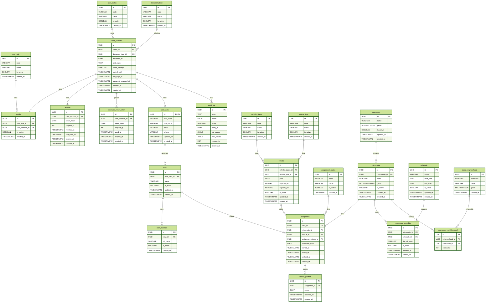

# Base de datos

Guía para documentar la persistencia de VINTRA y su evolución.

## Debe publicarse aquí

- [motor y versión soportada](#1-motor-y-version-soportada)
- [diagrama entidad-relación y diccionario de datos](#2-diagrama-entidad-relación-y-diccionario-de-datos);
- tablas, columnas, tipos, claves, restricciones e índices;
- relaciones con el modelo de dominio;
- migraciones, datos iniciales y orden de ejecución;
- políticas para respaldos, restauración y datos sensibles;
- configuración local sin publicar secretos.

El modelo conceptual y los diagramas de negocio se mantienen en `modelado/`. Las consultas o endpoints que consumen estas estructuras se enlazan desde `backend/`.

## Estado

- Estado: `Borrador`
- Responsable: Farid Cuero
- Pendiente: validación del DER como BD para PostgresSQL, migraciones y diccionario de datos.

## 1. Motor y Version Soportada
el motor de la base de datos usado es **PostgresSQL** en conjunto con la herramienta **PostGIS**. la versión soportada aún no esta definida....

## 2. Diagrama entidad-relación y diccionario de datos

