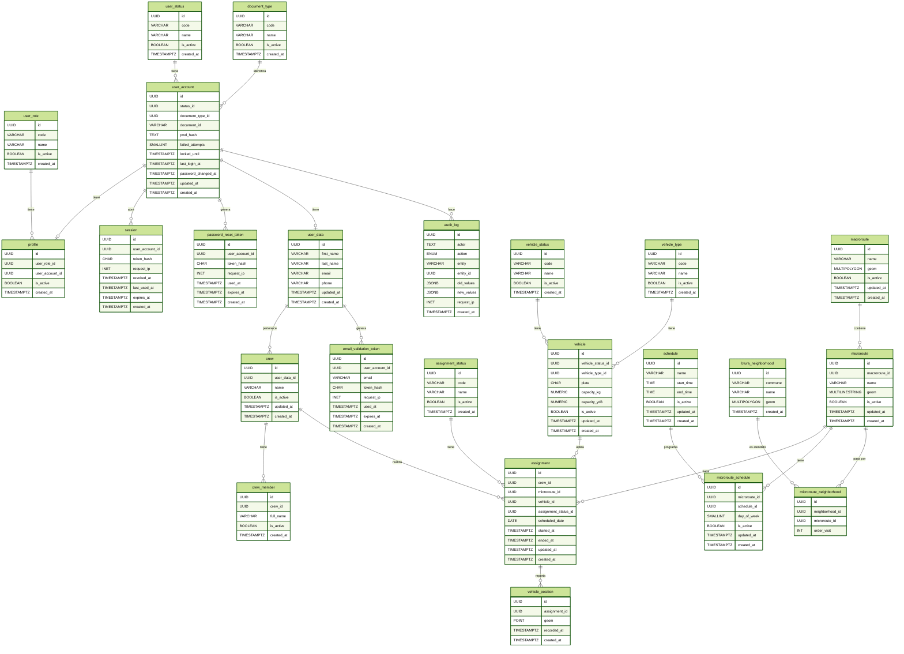

# Base de datos 

En esta guía se expone la documentación de la base de datos de VINTRA, su arquitectura y evolución.

## Índice

1. [Motor y Versión Soportadas](#1-motor-y-version-soportada)
2. [Diagrama Entidad-Relación](#2-diagramado-er)
3. [Diccionario de Datos](#3-diccionario-de-datos)
4. [Traducción de Relaciones](#4-relaciones-con-el-modelo-de-dominio)
5. [Migraciones, Datos Iniciales y Orden de Ejecución](#5-migraciones-datos-iniciales-y-orden-de-ejecución)
6. [Politicas para Respaldo, Restauración y Datos Sensibles](#6-políticas-restauración-y-datos-sensibles)
7. [Configuración Local](#7-configuración-local)

## Estado

- Estado: `En desarrollo`
- Responsable: Ricardo Farid Cuero
- Pendiente: politicas de respaldos y de restauración, documentación de los datos sensibles, ejemplo de configuración local.

---

## 1. Motor y Version Soportada

El motor de la Base de Datos usada es:  en conjunto con la extensión: . Usando las versiones 16 para postgreSQL. Y por compatibilidad versionado 3.6.x en adelante.

## 2. Diagramado ER:



## 3. Diccionario de Datos:

Documentación del diccionario de datos: [Diccionario de datos](/docs/base-de-datos/diccionario-de-datos/README.md).


## 4. Relaciones con el Modelo de Dominio

Traducción de los conceptos del negocio a tablas de la base de datos. El modelo conceptual se mantiene en `docs/modelado/`.

### 4.1. Entidades de dominio → tablas

| Concepto de dominio | Tabla(s) | Observaciones |
| --- | --- | --- |
| Usuario del sistema | `user_account`, `user_data` | Credenciales y datos personales separados (1 a 1, mismo `id`) |
| Rol (administrador, conductor, ciudadano) | `user_role`, `profile` | Una cuenta puede tener varios roles; no puede repetir el mismo rol |
| Cuadrilla de recolección | `crew`, `crew_member` | La cuadrilla la encabeza un conductor |
| Vehículo recolector | `vehicle`, `vehicle_type`, `vehicle_status` | Tipo y estado son catálogos |
| Macroruta (zona) | `macroroute` | Área geográfica (multipolígono) |
| Microruta (recorrido) | `microroute` | Trazado (multilínea) dentro de una macroruta |
| Barrio | `btura_neighborhood` | Límites de los barrios de Buenaventura |
| Horario de recolección | `schedule`, `microroute_schedule` | Franja horaria por microruta y día de la semana |
| Recorrido ejecutado | `assignment`, `assignment_status` | Una microruta, un día, una cuadrilla y un vehículo |
| Seguimiento en tiempo real | `vehicle_position` | Puntos GPS de una asignación en curso |
| Trazabilidad | `audit_log` | Registro de CREATE, UPDATE y DELETE |
| Autenticación | `session`, `password_reset_token` | Solo se almacenan hashes de los tokens |

### 4.2. Relaciones y cardinalidades

| Relación | Cardinalidad | Regla |
| --- | --- | --- |
| `user_status` → `user_account` | 1 a N | Define si la cuenta puede iniciar sesión |
| `document_type` → `user_account` | 1 a N | El par (tipo, número) de documento es único |
| `user_account` → `user_data` | 1 a 1 | `user_data.id` = `user_account.id` |
| `user_account` ↔ `user_role` (vía `profile`) | N a M | Único (`user_account_id`, `user_role_id`) |
| `user_account` → `session` | 1 a N | Sesión revocable y con vencimiento |
| `user_account` → `password_reset_token` | 1 a N | Token de un solo uso |
| `user_account` → `audit_log` | 1 a N | Referencia lógica: `actor` se guarda como texto |
| `user_data` → `crew` | 1 a N | El conductor representa la cuadrilla |
| `crew` → `crew_member` | 1 a N | Una cuadrilla tiene varios integrantes |
| `macroroute` → `microroute` | 1 a N | Una macroruta contiene varias microrutas |
| `microroute` ↔ `schedule` (vía `microroute_schedule`) | N a M | Con día de la semana (1 a 7, ISO) |
| `microroute` ↔ `btura_neighborhood` (vía `microroute_neighborhood`) | N a M | Con orden de visita |
| `microroute` → `assignment` | 1 a N | Una ejecución por microruta y día |
| `crew` → `assignment` | 1 a N | Una cuadrilla realiza varias asignaciones |
| `vehicle` → `assignment` | 1 a N | Un vehículo se usa en varias asignaciones |
| `assignment_status` → `assignment` | 1 a N | Estado actual de la asignación |
| `assignment` → `vehicle_position` | 1 a N | Solo asignaciones en curso (regla de la aplicación) |
| `vehicle_status` → `vehicle` | 1 a N | Estado actual del vehículo |
| `vehicle_type` → `vehicle` | 1 a N | Tipo de vehículo |


## 5. Migraciones, Datos Iniciales y Orden de Ejecucción

Las [migraciones](/docs/base-de-datos/database/migrations/) crean las tablas de la base de datos y los [datos iniciales](/docs/base-de-datos/database/seeds/) insertan datos y registros de ejemplo. Ambos conjuntos están separados por tabla y comparten una numeración secuencial que determina el orden de ejecución.

### 5.1. Estructura de archivos

| Tipo | Ubicación | Convención | Ejemplo |
| --- | --- | --- | --- |
| Migración | `database/migrations/` | `NNN_create_<tabla>.sql` | `001_create_macrorute.sql` |
| Dato inicial | `database/seeds/` | `NNN_insert_<tabla>.sql` | `001_insert_macrorute.sql` |

- `NNN` es un número de tres dígitos que indica el orden de ejecución.
- `create` identifica un archivo que crea una tabla.
- `insert` identifica un archivo que inserta datos iniciales.
- `<tabla>` corresponde al nombre de la tabla afectada.
- `000_create_extensions.sql` habilita las extensiones `postgis` y `pgcrypto`; no crea una tabla.

### 5.2. Migraciones

Cada migración crea una tabla con sus restricciones (`PK`, `FK`, `UNIQUE`, `CHECK`) y los índices documentados en el diccionario de datos. Los archivos están envueltos en `BEGIN`/`COMMIT` para que la ejecución sea atómica.

AVISO: El orden de las migraciones no es alfabético ni arbitrario: respeta las dependencias entre tablas. Primero se crean los catálogos, después las entidades que los referencian y al final las tablas transaccionales. Por eso una migración con número mayor puede depender de una anterior y no debe ejecutarse de forma aislada.

### 5.3. Datos iniciales

Los seeds contienen catálogos y algunos datos de demostración. Se ejecutan después de todas las migraciones y en orden numérico ascendente, porque algunos inserts referencian registros creados por seeds anteriores. Los archivos usan `ON CONFLICT DO NOTHING` para poder ejecutarse más de una vez sin duplicar registros.

### 5.4. Orden de ejecución

El orden completo, las dependencias de cada tabla y los comandos de ejecución con `psql` están documentados en el [orden de ejecución](/docs/base-de-datos/database/schema/README.md). La secuencia general es:

1. Ejecutar `000_create_extensions.sql`.
2. Ejecutar las migraciones `001` a `024` en orden ascendente.
3. Ejecutar los seeds `001` a `024` en orden ascendente.

### 5.5. Índices mínimos

- `GIST (geom)` en `macroroute`, `microroute`, `btura_neighborhood` y `vehicle_position`.
- `(assignment_id, recorded_at)` en `vehicle_position`.
- `(scheduled_date)` en `assignment`.

### 5.6. Triggers

`updated_at` se actualiza automáticamente en cada `UPDATE` de las tablas que lo tienen, con una función común:

```sql
CREATE OR REPLACE FUNCTION set_updated_at() RETURNS trigger AS $$
BEGIN
  NEW.updated_at = now();
  RETURN NEW;
END;
$$ LANGUAGE plpgsql;

-- Un trigger por tabla (ejemplo)
CREATE TRIGGER trg_vehicle_updated_at
  BEFORE UPDATE ON vehicle
  FOR EACH ROW EXECUTE FUNCTION set_updated_at();
```

## 6. Políticas, Restauración y Datos Sensibles

Esta sección define cómo se respalda y restaura la base de datos y cómo se tratan los datos sensibles identificados en el [diccionario de datos](#3-diccionario-de-datos). Las frecuencias y retenciones son una propuesta inicial.

### 6.1. Política de Respaldo

| Tipo | Herramienta | Contenido | Frecuencia | Retención |
| --- | --- | --- | --- | --- |
| Lógico completo | `pg_dump -Fc` | Esquema y datos (incluye geometrías PostGIS) | Diario | 14 días |
| Lógico completo | `pg_dump -Fc` | Esquema y datos | Semanal | 8 semanas |
| Esquema | Migraciones y seeds del repositorio (sección 5) | Estructura y catálogos | En cada cambio | Control de versiones |

Reglas:

- Los respaldos se almacenan cifrados y fuera del servidor de la base de datos.
- Los respaldos contienen datos personales (sección 6.3), por lo que tienen el mismo nivel de protección que la base de producción.
- Cada respaldo se verifica al terminar con `pg_restore --list`.
- Los respaldos vencidos se eliminan de forma segura.

```bash
pg_dump -h <host> -U <usuario> -d <base_de_datos> -Fc -f backup_$(date +%Y%m%d_%H%M).dump
```

### 6.2. Política de Restauración

Principios:

1. No se restaura sobre producción sin antes probar el respaldo en un ambiente aparte.
2. Antes de restaurar en producción se respalda el estado actual.
3. Cada restauración queda registrada (fecha, motivo, respaldo usado y resultado).

Procedimiento:

1. Usar un servidor con PostgreSQL 16 y los paquetes de PostGIS 3.6.x o superior instalados.
2. Crear la base de datos vacía.
3. Restaurar el respaldo con `pg_restore`.
4. Validar el resultado.

```bash
createdb -h <host> -U <usuario> <base_de_datos>
pg_restore -h <host> -U <usuario> -d <base_de_datos> --no-owner --exit-on-error backup_YYYYMMDD_HHMM.dump
```

El respaldo ya incluye la creación de las extensiones `postgis` y `pgcrypto`, por lo que no se ejecuta `000_create_extensions.sql` en este caso.

Reconstrucción sin respaldo (desarrollo y pruebas): ejecutar `000_create_extensions.sql`, las migraciones `001` a `024` y los seeds `001` a `024`, en orden ascendente (sección 5.4).

Validación posterior:

- Existen las 24 tablas, con sus `PK`, `FK`, `UNIQUE` y `CHECK`.
- Existen los índices GIST sobre las columnas `geom` (`vehicle_position`, `macroroute`, `microroute`, `btura_neighborhood`).
- Los catálogos (`user_role`, `user_status`, `document_type`, `vehicle_status`, `vehicle_type`, `assignment_status`) tienen sus `code` estables.
- Las geometrías son válidas (`ST_IsValid`).

Después de restaurar en producción:

- Revocar las sesiones existentes (`session.revoked_at`).
- Invalidar los tokens pendientes de `password_reset_token` y `email_validation_token` (`used_at`).

Se recomienda una restauración de prueba mensual en un ambiente aislado.

### 6.3. Datos Sensibles

#### 6.3.1. Clasificación

| Clasificación | Datos |
| --- | --- |
| Secreto (nunca se expone ni se registra) | `user_account.pwd_hash`, `session.token_hash`, `password_reset_token.token_hash`, `email_validation_token.token_hash` |
| Personal | `user_account.document_id`, `user_data.first_name`, `user_data.last_name`, `user_data.email`, `user_data.phone`, `crew_member.full_name`, `email_validation_token.email` |
| Rastreo de actividad | `request_ip` (`session`, `password_reset_token`, `email_validation_token`, `audit_log`), `audit_log.actor`, `vehicle_position` (`geom`, `recorded_at`) |

#### 6.3.2. Reglas de tratamiento

| Dato | Regla |
| --- | --- |
| Contraseña | Solo se almacena el hash Argon2id (incluye sal y parámetros) |
| Tokens (sesión, restablecimiento, validación de correo) | Solo se almacena el hash SHA-256; el token en claro nunca se guarda |
| `audit_log.old_values` y `new_values` | Nunca contienen contraseñas ni hashes; la aplicación los filtra antes de insertar |
| `document_id` | Se muestra enmascarado y no se escribe en logs |
| Datos personales | No se usan datos reales en desarrollo ni pruebas; los seeds contienen datos ficticios |
| Posiciones GPS | Solo de asignaciones en curso (regla de la aplicación) |
| Credenciales de conexión | En variables de entorno o gestor de secretos; nunca en el repositorio |

#### 6.3.3. Depuración

| Tabla | Política propuesta |
| --- | --- |
| `session` | Eliminar las vencidas o revocadas con más de 30 días |
| `password_reset_token`, `email_validation_token` | Eliminar las usadas o vencidas con más de 30 días |
| `vehicle_position` | Definir un periodo de conservación (es la tabla de mayor crecimiento) |
| Cuentas dadas de baja | Deshabilitar con `user_status`; anonimizar `user_data` si se requiere |

## 7. Configuración Local
Requisitos: Docker y Docker Compose. No se publican secretos: cada persona crea su propio `.env`.

### 7.1. Archivo `.env.example`

```env
POSTGRES_DB=vintra
POSTGRES_USER=vintra_app
POSTGRES_PASSWORD=cambia_esta_contraseña
POSTGRES_PORT=5432
```

Copiarlo a `.env` (que debe estar en `.gitignore`) y cambiar la contraseña.

### 7.2. `docker-compose.yml` (en `database/`)

```yaml
services:
  db:
    image: postgis/postgis:16-3.4
    container_name: vintra-db
    environment:
      POSTGRES_DB: ${POSTGRES_DB}
      POSTGRES_USER: ${POSTGRES_USER}
      POSTGRES_PASSWORD: ${POSTGRES_PASSWORD}
    ports:
      - "${POSTGRES_PORT}:5432"
    volumes:
      - vintra_pgdata:/var/lib/postgresql/data
    healthcheck:
      test: ["CMD-SHELL", "pg_isready -U ${POSTGRES_USER} -d ${POSTGRES_DB}"]
      interval: 10s
      timeout: 5s
      retries: 5

volumes:
  vintra_pgdata:
```

### 7.3. Puesta en marcha

```bash
cd database
cp .env.example .env          # editar la contraseña
docker compose up -d          # levantar la base
docker compose ps             # verificar estado "healthy"

# Ejecutar migraciones en orden (mientras no haya herramienta definida)
for f in migrations/V*.sql; do
  docker exec -i vintra-db psql -v ON_ERROR_STOP=1 -U vintra_app -d vintra < "$f"
done

# Cargar datos iniciales
for f in seeds/*.sql; do
  docker exec -i vintra-db psql -v ON_ERROR_STOP=1 -U vintra_app -d vintra < "$f"
done
```

### 7.4. Comandos útiles

```bash
# Entrar a la consola SQL
docker exec -it vintra-db psql -U vintra_app -d vintra

# Verificar PostGIS (dentro de psql)
SELECT postgis_full_version();

# Reiniciar desde cero (borra todos los datos locales)
docker compose down -v && docker compose up -d
```

