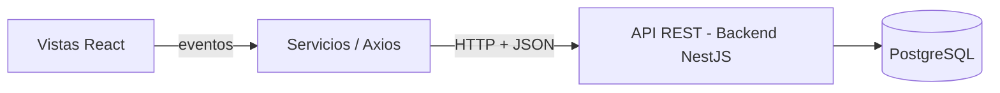

# Frontend

Guía para documentar la aplicación que usan el operador, el administrador, el conductor y la ciudadanía.

## Framework, versión y requisitos de ejecución

- **Framework:** React
- **Herramienta de construcción (Bundler):** Vite
- **Versión de Node.js:** Node.js v18.x o superior recomendado.
- **Gestor de paquetes:** npm o npx.

## Estructura de carpetas y criterio para organizar componentes

La aplicación se organiza bajo una arquitectura modular orientada a componentes dentro de `src/`:

```text
vintra/
├── frontend/
│   ├── package.json
│   ├── vite.config.js
│   ├── index.html
│   ├── Dockerfile.frontend
│   └── src/
│       ├── components/    # Componentes reutilizables globales (botones, modales, tarjetas)
│       ├── views/         # Vistas o pantallas principales por rol
│       ├── context/       # Manejo de estado global (Autenticación, Sesión)
│       ├── services/      # Configuración de Axios y llamadas a la API REST
│       ├── main.jsx       # Punto de entrada de la aplicación
│       └── App.jsx        # Componente principal y enrutador
```

## Comunicación con el backend

El frontend consume la API REST del backend (Node.js + NestJS) mediante **Axios**. La configuración base (URL de la API, cabeceras comunes e interceptores de autenticación) se centraliza en `src/services/`.



## Comandos para instalar, ejecutar y probar

Desde la carpeta `frontend/`:

```bash
npm install       # instala dependencias
npm run dev       # levanta el servidor de desarrollo de Vite
npm run build     # genera la versión de producción
npm run preview   # previsualiza el build de producción
```
