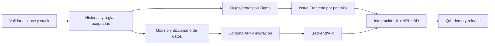

# Gestión del proyecto VINTRA en GitHub

## Propósito

Esta guía propone una forma común de organizar el trabajo de VINTRA en GitHub mediante Issues, Projects, milestones, sprints, Pull Requests y responsables por área. Es una propuesta para revisar con el equipo y el profesor. No aprueba tecnologías ni reemplaza las decisiones académicas pendientes.

GitHub debe ser la fuente de verdad del trabajo técnico. Si el equipo conserva Trello, cada issue debe enlazar la tarjeta de origen y se debe evitar mantener estados o criterios diferentes en ambos tableros.

## Diagnóstico actual

Estado verificado el 2 de noviembre de 2026 en el repositorio `Univalle-P-I/VINTRA` y el Project de la organización `Univalle-P-I`:

- El repositorio tiene `main` y `develop`, 39 Issues y 9 Pull Requests visibles. Las plantillas y documentación que aún no están en la rama base local deben tratarse como cambios en preparación, no como configuración publicada.
- El Project `VINTRA` existe y ya contiene las vistas `Backlog`, `Priority board`, `Team items`, `Roadmap` y `My items`.
- El campo `Status` tiene `Backlog`, `Ready`, `In progress`, `In review` y `Done`. El flujo solicitado existe, pero no hay una opción `Blocked`.
- Los campos visibles del Project son `Sprint`, `Células`, `Área labels`, `Type labels`, `Exceptional Flow`, `Priority` y `Efforts`; el milestone de GitHub aparece aparte. En #56 los valores observados son Sprint 0, DevOps/Github, Área: Platform, Type: Task, P1, esfuerzo 3 y M0.
- `Priority` ofrece P0–P4 y `Efforts` ofrece 1–6. La guía y el backlog previo describían P0–P3 y esfuerzo 1, 2, 3, 5 u 8; esa diferencia requiere acordar semántica antes de cambiar datos en lote. La semántica de P4 no está documentada.
- El repositorio solo tiene las 10 etiquetas estándar de GitHub; faltan las etiquetas `area:*`, `type:*` y de bloqueo propuestas aquí. En #56 tampoco están asignadas etiquetas de repositorio ni el Type nativo, aunque los campos personalizados del Project sí tienen Área y Type.
- Hay 7 milestones abiertos, M0–M6, y ninguno tiene fecha de vencimiento. M0–M5 aparecen en la planificación local; M6 está vacío y no aparece en ella. Los objetivos y fechas aún requieren confirmación del equipo/profesor.
- HU5/HU6 se traslapan en turnos y disponibilidad; HU10 depende de flota, personal y rutas; la regla del segundo recorrido de 7 yd³ sigue pendiente de validación.

Los cambios locales en `CONTRIBUTING.md`, plantillas y `docs/gestion-github/` no deben presentarse como publicados hasta pasar revisión y entrar a `develop` mediante Pull Request.

## Squads y responsabilidades

Las células actuales no necesitan convertirse cada una en una jerarquía independiente. Usen **squads pequeños como grupos de entrega** y roles transversales para integrar y revisar. Los nombres C1–C5 pueden mantenerse temporalmente como alias, pero dejen de ser la única descripción de responsabilidad.

| Squad / rol | Se encarga de | Entregables y límites |
| --- | --- | --- |
| Producto y coordinación | Mantener alcance, prioridades, historias, acuerdos, planificación de sprint y comunicación con el profesor. | Una persona facilitadora de Scrum/PO y líderes de células. No es una célula separada para escribir historias: la responsabilidad de requisitos es continua y compartida con operación, UX y desarrollo. |
| UI/UX | Entender tareas de usuarios, flujos, prototipos, sistema visual y pruebas de uso. | En cada issue de pantalla adjunta enlace a Figma, nombre de página/frame y estados cubiertos. No marca un prototipo como validado sin revisión de producto/usuario. |
| Frontend | Implementar vistas, navegación, formularios, estados y consumo de API de acuerdo con el diseño y contrato aprobados. | Un issue implementable por pantalla o flujo pequeño; enlaza prototipo y API. No define contratos o datos de manera unilateral. |
| Backend/API | Reglas de negocio, autenticación/autorización, endpoints, validación y documentación de API. | Contratos OpenAPI y lógica comprobable. No implementa contra un modelo de datos no revisado. |
| Datos/Base de Datos | Modelo conceptual/lógico, diccionario, restricciones, migraciones, datos semilla y respaldos que correspondan. | Trabaja a partir de historias y reglas aprobadas; acuerda cambios de esquema con Backend. Motor/extensiones dependen del acuerdo de stack. |
| Plataforma, GitHub y DevOps | Repositorio, permisos disponibles, plantillas, etiquetas, workflows, entorno reproducible, secretos, VPS, despliegue y documentación común de contribución. | Mantiene la estructura y las instrucciones generales. Cada squad documenta su propio componente; DevOps no es autor único de toda documentación técnica. |
| Integración y release | Orden de integración entre squads, contratos, ramas, resolución de conflictos, trazabilidad PR–Issue, builds de integración y preparación de demo/release. | Coordina y verifica las condiciones de merge; no sustituye la revisión técnica de quienes conocen el componente. |
| QA | Plan y escenarios de prueba, datos de prueba, regresión, evidencia y verificación independiente de criterios de aceptación. | Emite aprobación de calidad cuando el cambio altera comportamiento o flujo. No debe probar solo al final; participa al redactar criterios y en cada sprint. |

### Decisión técnica sobre el stack

No mantengan una célula “Stack” permanente. Formen un **grupo temporal de arquitectura** con referentes de Frontend, Backend, Datos y Plataforma, más revisión del profesor. Produce una decisión breve y versionada: opciones, criterios, herramientas/versiones, consecuencias, estructura de carpetas y comandos de ejecución. El profesor valida lo que corresponde al curso. Después, los squads implementan la decisión.

### Aprobación de Pull Requests

- Revisión obligatoria de una persona distinta a quien hizo el cambio, idealmente alguien del squad dueño del componente.
- QA revisa criterios y evidencia de comportamiento en funcionalidades, cambios de reglas y flujos críticos; deja aprobación o hallazgos claros.
- Integración verifica que issue, PR, base branch, checks, dependencias y contratos estén alineados; coordina la integración y release.
- Autor no se aprueba a sí mismo. El Integrador no debe ser el único revisor técnico. La protección de ramas se configura por el equipo administrador si el plan/permisos lo permite.
- Si un PR mezcla componentes, se solicita revisión de cada área afectada. No se fusiona con decisiones críticas de stack, API o modelo de datos abiertas.

## Estructura del GitHub Project

### Configuración observada

El Project de la organización es la fuente de verdad para el estado y la planificación. Las vistas actuales son `Backlog`, `Priority board`, `Team items`, `Roadmap` y `My items`. La vista `Backlog` usa el campo `Status`.

| Campo actual | Valores observados / regla |
| --- | --- |
| `Status` | `Backlog`, `Ready`, `In progress`, `In review`, `Done`. Aún no existe `Blocked`. |
| `Sprint` | Iteración del equipo; en #56 se ve `Sprint 0` (30 oct.–12 nov.). |
| `Células` | Grupo responsable principal; el valor de #56 es `DevOps/Github`. |
| `Área labels` | Selector del Project con `Área: Product`, `Ux`, `Frontend`, `Backend`, `DataBase`, `Platform`, `Integration`, `Qa` e `Infrastructure`. |
| `Type labels` | Selector del Project con `Type: Epic`, `Feature`, `Task`, `Bug`, `Spike`, `Design`, `Documentation` y `Chore`. |
| `Exceptional Flow` | Selector presente; #56 no tiene opción seleccionada. Sus opciones deben revisarse antes de normalizarlas. |
| `Priority` | `P0`, `P1`, `P2`, `P3`, `P4`. No asignar semántica a P4 hasta que el equipo la acuerde. |
| `Efforts` | Valores enteros de 1 a 6. No convertirlos a horas sin acuerdo del equipo. |
| Milestone | Milestones nativos de GitHub `M0`–`M6`; los siete están abiertos y ninguno muestra fecha límite. `M6` está vacío. |

En #56, GitHub muestra además `No labels` y `No type` en los campos nativos del Issue. El área y tipo visibles en la tarjeta provienen de los selectores personalizados del Project, no de etiquetas de repositorio. Mantener ambas capas explícitas hasta completar una migración acordada; no borrar ni renombrar campos con datos existentes.

### Vistas que faltan para el alcance de VIN-004

El Issue #56 pide vistas de Backlog, Sprint, bloqueados, QA/revisión y Roadmap. Ya existen `Backlog` y `Roadmap`; faltan vistas dedicadas a Sprint, bloqueados y QA/revisión. Añadirlas sin reemplazar las vistas actuales:

| Vista | Agrupación/filtro | Para qué sirve |
| --- | --- | --- |
| Backlog | Status = Backlog/Ready; ordenar por Priority | Vista existente para refinar trabajo próximo y dependencias. |
| Sprint actual | Filtrar `Sprint` por la iteración vigente; agrupar por `Células` y `Status` | Vista por crear para coordinar el trabajo comprometido. |
| Bloqueados | Status = Blocked | Crear la opción `Blocked` y una vista filtrada; mantener visible responsable y dependencia. |
| QA / revisión | Status = In review | Vista por crear para revisar validación, evidencia y defectos. |
| Roadmap | Agrupar por Milestone | Vista existente para ver entregables por objetivo de producto. |

### Campos recomendados

| Campo de GitHub Project | Tipo | Valores / regla |
| --- | --- | --- |
| `Status` | Single select | Valores actuales de estado; añadir `Blocked` sin reemplazar estados existentes. Usar `In review` para PR y QA. |
| `Type labels` | Single select del Project | `Epic`, `Feature`, `Task`, `Bug`, `Spike`, `Design`, `Documentation`, `Chore`. Asignar también el Issue type nativo cuando esté disponible. |
| `Células` | Single select del Project | Mantener los valores existentes; acordar equivalencias antes de renombrarlos. Una célula principal por Issue. |
| `Sprint` | Iteration field | Iteración corta; no usar el milestone para representar sprints. |
| `Priority` | Single select del Project | `P0`–`P4` existen. P0–P3 tienen definiciones en los documentos; P4 queda sin uso hasta que el equipo acuerde su significado. |
| `Efforts` | Single select del Project | `1`–`6` existen. Estimación relativa; la escala no está normalizada con la propuesta anterior 1, 2, 3, 5, 8. |
| Milestone | Campo nativo de Issue | `M0`–`M6` existen. La planificación local solo define objetivos candidatos para M0–M5; ningún milestone tiene fecha meta registrada. |
| Assignees | Campo nativo | Una persona responsable principal; agregar colaboradores solo si GitHub lo permite y es útil. |
| Figma / pantalla | URL o texto del issue | No duplicar en campo si el enlace ya está visible en el Issue form. Requerido para UX/Frontend de pantalla. |

GitHub permite issue forms para solicitar información estructurada. Los campos del Project no se rellenan automáticamente desde los formularios: una persona de Producto/Integración los completa al hacer triage. Las opciones de formularios y Project deben mantenerse alineadas; no asumir que el campo personalizado `Type labels` asigna el Issue type nativo.

## Taxonomía de tipos y labels

Usen **Type** para la naturaleza de un ticket y labels para el área y la condición del trabajo. No creen etiquetas para cada persona o sprint.

| Familia | Labels propuestos |
| --- | --- |
| Área | `area:product`, `area:ux`, `area:frontend`, `area:backend`, `area:data`, `area:platform`, `area:integration`, `area:qa` |
| Clasificación de respaldo | `type:epic`, `type:feature`, `type:task`, `type:bug`, `type:spike`, `type:design`, `type:documentation`, `type:chore` |
| Flujo excepcional | `needs-triage`, `blocked`, `needs-professor`, `needs-decision` |

Priority y Effort se mantienen como campos del Project para no tener dos fuentes de verdad. El Issue form puede sugerir label de área, pero Producto/Integración confirma etiquetas al triage.

## Estándar de ticket

Todo ticket de trabajo debe describir qué se entregará, por qué, cómo se valida y qué lo bloquea. La plantilla general está en `.github/ISSUE_TEMPLATE/01-feature-or-task.yml`; las de pantalla y bug capturan datos adicionales.

### Campos que se completan en GitHub

- **Title:** `[Área] verbo + resultado concreto` (ejemplo: `[Frontend] Registrar y consultar vehículos`).
- **Type:** `Epic`, `Feature`, `Task`, `Bug`, `Spike`, `Design` o `Documentation`.
- **Labels:** área principal y, si falta Type nativo, tipo. Añadir `needs-professor` o `needs-decision` cuando aplique.
- **Squad:** un principal responsable; reviewers/colaboradores se describen en el issue.
- **Priority:** P0–P4, justificada por impacto/fecha. No usar P4 hasta acordar su significado.
- **Effort:** usar los valores acordados por el squad dentro de la escala vigente 1–6; no mezclar con la escala anterior 1, 2, 3, 5, 8.
- **Sprint / Iteration:** solo cuando esté refinado y listo.
- **Milestone:** objetivo de producto al que aporta.
- **Assignee:** una persona dueña de cerrar el ticket.
- **Dependencies / Relationships:** vincular issue padre, sub-issues y bloqueadores con relaciones de GitHub; incluir los IDs en el cuerpo para que sean legibles.

### Definition of Ready

Mover a `Ready` solo cuando:

1. El objetivo y el alcance caben en un Issue pequeño y verificable.
2. Los criterios de aceptación están en lenguaje observable y no contienen reglas operativas sin validar.
3. Hay squad, responsable, Type, prioridad, esfuerzo, sprint, milestone y dependencias.
4. Los contratos/modelos que condicionan la tarea están acordados o hay un spike explícito que los resuelve.
5. Para pantalla: diseño Figma enlazado y frames/estados identificados.
6. El Issue enlaza historia de usuario/Trello o explica por qué es trabajo técnico transversal.

### Definition of Done

- Cumple todos los criterios de aceptación acordados.
- Código revisado por otra persona y cambios integrados mediante PR hacia la rama base acordada.
- CI y validaciones pertinentes pasan; QA registra resultado para cambios funcionales.
- Documentación, contrato de API, modelo de datos, migración y diseño se actualizan si el cambio los afecta.
- PR enlaza `Closes #<issue>` cuando lo cierra; evidencia apropiada adjunta (captura solo para interfaz, logs/resultados para backend/CI).
- No quedan secretos, errores conocidos críticos ni decisiones sin propietario escondidas en el ticket.

## Tickets de interfaz y prototipos

Crear un Issue por **pantalla o flujo pequeño entregable**, no un Issue genérico llamado “hacer el frontend”. Para cada pantalla registrar:

1. Enlace de Figma y página/frame exactos (nombre e ID si lo tienen).
2. Historia de usuario y tarea que resuelve.
3. Roles autorizados y ruta de navegación.
4. Campos, acciones y datos mostrados.
5. Estados de carga, vacío, error, éxito y permisos insuficientes que aplican.
6. Comportamiento responsive requerido.
7. Endpoints/contratos consumidos o mock explícitamente temporal.
8. Criterios de aceptación, enlaces a dependencias y evidencia de prueba visual.

El prototipo permanece vinculado en el ticket de Frontend que implementa esa pantalla. Si el diseño se modifica tras iniciar desarrollo, dejar versión/link actualizado en el mismo Issue y avisar al squad.

## Milestones y sprints propuestos

Los milestones agrupan un resultado de producto y una fecha meta; los sprints/Iterations son periodos cortos de planificación. La tabla siguiente conserva los objetivos candidatos, no registra una aprobación. Al 2 de noviembre de 2026, M0–M6 están abiertos y no tienen fecha meta en GitHub. Acordar las fechas con el equipo/profesor antes de configurarlas. M6 existe en GitHub pero no tiene objetivo ni issues; conservarlo hasta que el equipo decida su destino.

| Milestone | Objetivo y criterio para cerrarlo | Trabajo candidato |
| --- | --- | --- |
| M0 — Alcance y decisiones aprobadas | Profesor y células dejan por escrito MVP, stack/herramientas, modelo inicial, reglas críticas y exclusiones. Las páginas contradictorias están identificadas con responsable de corrección. | HU de alcance; decisión de arquitectura; glosario; tickets de corrección documental. |
| M1 — Base ejecutable integrada | Clonar/instalar/arrancar desde instrucciones del repo; frontend, backend y BD compatibles con la decisión aprobada; contrato de salud prueba servicio y DB; CI valida cada área. | Tarjetas Stack 8/9 y Docker (revisadas), BD modelo/migración inicial, DevOps CI, tarea de integración vertical. |
| M2 — Catálogos operativos | Flota y personal se registran/consultan; estado y disponibilidad respetan reglas aceptadas; pantallas implementadas desde Figma. | HU1–HU6 priorizadas y deduplicadas; BD, API, frontend y QA enlazados por sub-issues. |
| M3 — Planificación y despacho | Rutas/sectores existen; se asignan recursos sin conflictos definidos; se genera y consulta orden de trabajo. | HU7–HU10 y tickets de orden; revisar HU11/HU12 según decisión de alcance. |
| M4 — MVP integrado para entrega | Camino crítico demostrable en entorno acordado; regresión y criterios de aceptación completados; documentación y demo listas; defectos restantes declarados. | QA integrado, arreglos P0/P1, despliegue solo si fue aprobado, guía de usuario y evidencia. |
| M5 — Evolución | Objetivo candidato para trabajo posterior al MVP; alcance, responsables y fecha requieren acuerdo. | Diferenciales fuera del compromiso de entrega. |
| M6 — Sin definición | Milestone existente sin objetivo ni issues. No asignar trabajo hasta que el equipo lo defina o acuerde su cierre. | Pendiente de triage; no eliminar sin decisión del equipo. |

### Propuesta de sprints de cuatro semanas

| Iteración | Foco | Condición de salida |
| --- | --- | --- |
| Sprint 0 — Alineación (2–3 días como máximo) | Revisar PRs/decisiones existentes; confirmar alcance y stack con el profesor; modelar primer flujo; refinar Issues; asignar apoyo a Backend. | No hay dos stacks en paralelo; primer vertical pequeño tiene issue, dueño, contrato, pantalla/diseño, modelo y aceptación. |
| Sprint 1 — Base y primer catálogo | Entorno aprobado; migración inicial; CI; login solo si el flujo de entrega requiere roles; construir un flujo vertical de flota. | Una persona puede registrar/consultar un vehículo desde UI hasta BD y QA verifica casos válidos e inválidos. |
| Sprint 2 — Recursos y disponibilidad | Personal, turnos/cuadrillas necesarios para el despacho priorizado; evitar duplicar HU5/HU6. | Se puede consultar disponibilidad con reglas aprobadas y pruebas asociadas. |
| Sprint 3 — Rutas y sectores | Macrorutas/microrutas/barrios o el alcance geográfico que se confirme; integrar diseño, API y modelo. | Crear/consultar ruta/sector del caso acordado sin depender de features futuras. |
| Sprint 4 — Asignación, orden y estabilización | HU10, orden de trabajo; decidir HU11/HU12; pruebas integradas, defectos críticos, demo/entrega. | Un flujo administrativo de punta a punta queda aceptado; lo no terminado se marca fuera de alcance o deuda con responsable. |

Las semanas no implican que toda historia HU1–HU12 deba caber en una iteración. Si la estimación supera capacidad, reducir el MVP o alcance de una historia; no saltarse diseño de datos, aceptación o QA.

## Secuencia de trabajo y dependencias

El frontend puede construir wireframes y prototipos en paralelo. La implementación que dependa del stack, el esquema o contratos no aprobados se mantiene en backlog/spike, o usa mocks marcados como provisionales con fecha de retiro.

## Trazabilidad entre Trello, GitHub y Figma

- Migrar/revisar las tarjetas existentes antes de crear nuevas. Un Issue GitHub es el registro del trabajo; conservar URL de Trello como referencia histórica hasta que el equipo acuerde dejarlo.
- Para HU1–HU12, crear una Epic o Feature padre por capacidad y sub-issues por entregables de datos, backend, interfaz, QA e integración cuando realmente haya trabajo separable.
- En PR: título claro, `Closes #<issue>` y enlace a tarjeta Trello si aún es fuente vigente; reportar diseño Figma en el issue frontend.
- El Issue padre no se cierra hasta que los sub-issues requeridos y criterios de extremo a extremo estén aceptados.
- Evitar registrar “Historia de usuario” como squad; es un artefacto de producto asociado a una capacidad y entregado por varias células.

## Tareas iniciales sugeridas para crear en el tablero

1. `M0 / needs-professor`: Validar alcance administrativo MVP y exclusiones con el profesor.
2. `M0 / needs-professor`: Aprobar stack, versiones y herramientas; incluir participantes de Frontend, Backend, Datos y Platform.
3. `M0`: Auditar PRs/tarjetas que adoptan stack no aprobado y definir conservar, adaptar o revertir después de la decisión.
4. `M0`: Confirmar regla de segundo recorrido de 7 yd³ y reglas de disponibilidad/asignación con su fuente.
5. `M1`: Documentar comandos canónicos de instalación y ambiente una vez aprobado el stack.
6. `M1`: Diseñar modelo inicial y migración del primer flujo vertical.
7. `M1`: Completar una integración de extremo a extremo con pantalla Figma, endpoint, persistencia y prueba QA.
8. `M2`: Revisar HU5/HU6 y convertirlas en criterios no duplicados.
9. `M2/M3`: Desglosar HU7–HU10 con dependencias verificables.
10. `M4`: Preparar guion de demo, prueba de aceptación y pendientes conocidos.

No crear los mismos tickets dos veces si esas tarjetas/issues ya están abiertas. En ese caso, actualizarlos con campos, criterios, dependencias y milestone de esta guía.

## Configuración de GitHub: estado y pendientes de administración

El Project de la organización ya existe y está asociado al trabajo de VINTRA. La configuración constatada y sus tareas pendientes son:

1. Conservar las cinco vistas existentes. Crear vistas dedicadas a Sprint actual, bloqueados y QA/revisión; no eliminar `Priority board`, `Team items` ni `My items`.
2. Añadir el estado `Blocked` sin alterar los cinco estados que ya usan Issues.
3. Crear las etiquetas de área/tipo/flujo propuestas tras validar nombres y significado con el equipo; asignar etiquetas a tickets solo después de acordar esa taxonomía.
4. Mantener M0–M6. Completar objetivos acordados para M0–M5 y fechas solo después de validarlas con el equipo/profesor. Revisar M6 sin eliminarlo; los sprints van en `Sprint`.
5. Revisar las plantillas locales y publicarlas mediante PR a la rama por defecto; los campos de Project no se rellenan automáticamente por los Issue forms.
6. Revisar revisores/Code Owners y reglas de protección de `main`/`develop` conforme a permisos y capacidad real del plan.
7. Continuar la depuración HU/tarjetas/issues evitando duplicados y usando números o enlaces de GitHub para cada dependencia.

No asignar fechas, objetivos de M6 ni semántica a P4 sin acuerdo explícito. No cerrar VIN-004 mientras las vistas/estado/labels requeridos y sus criterios de aceptación sigan incompletos.

## Fuentes de referencia

- README y documentación `docs/modelado/`, `docs/scrum/`, `docs/base-de-datos/`, `docs/ui-ux/` y `docs/infraestructura/` del repositorio.
- HU1–HU12 y extracto de tarjetas de Trello proporcionados para este análisis.
- GitHub Docs: [issue forms](https://docs.github.com/en/communities/using-templates-to-encourage-useful-issues-and-pull-requests/configuring-issue-templates-for-your-repository), [campos y sprints de Projects](https://docs.github.com/en/issues/planning-and-tracking-with-projects/understanding-fields), [campos personalizados de Issues](https://docs.github.com/en/issues/tracking-your-work-with-issues/using-issues/adding-and-managing-issue-fields), y [buenas prácticas de Projects](https://docs.github.com/en/issues/planning-and-tracking-with-projects/learning-about-projects/best-practices-for-projects).
