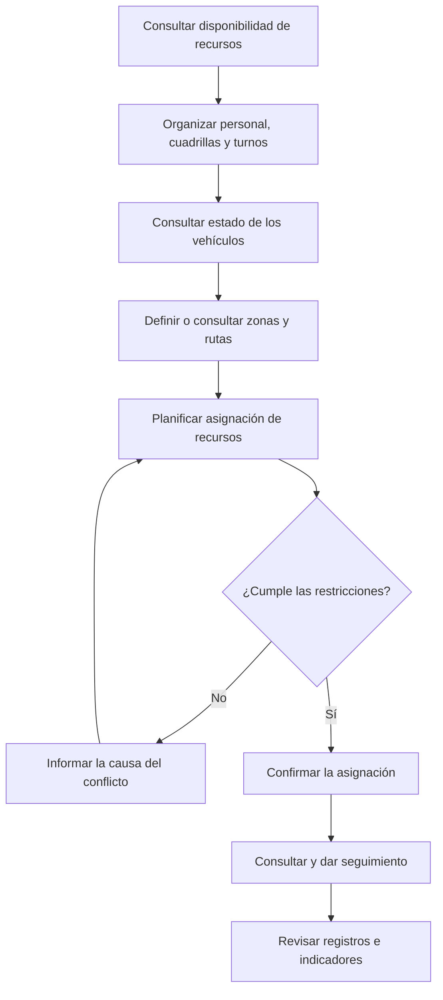
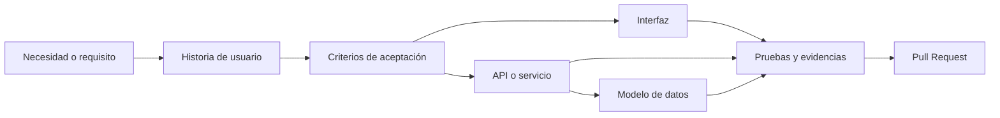

# VINTRA | Modelado del sistema

<p align="center">
  <strong>Modelo funcional y alcance del MVP</strong>
  <br />
  Documentación de requisitos, actores, procesos y reglas de negocio
</p>

---

| Información | Detalle |
| --- | --- |
| **Proyecto** | VINTRA |
| **Documento** | Modelado del sistema |
| **Estado** | Borrador para revisión del equipo |
| **Responsables** | Célula Scrum y responsables funcionales y técnicos |
| **Última actualización** | Por registrar |

> **Propósito:** mantener una visión compartida del sistema, facilitar la trazabilidad de los requisitos y orientar el desarrollo del producto mínimo viable (MVP).

## Índice

1. [Propósito](#1-propósito)
2. [Descripción general](#2-descripción-general)
3. [Alcance del MVP](#3-alcance-del-mvp)
4. [Actores del sistema](#4-actores-del-sistema)
5. [Procesos administrativos y operativos](#5-procesos-administrativos-y-operativos)
6. [Flujo general de trabajo](#6-flujo-general-de-trabajo)
7. [Reglas de negocio](#7-reglas-de-negocio)
8. [Funcionalidades excluidas](#8-funcionalidades-excluidas-del-mvp)
9. [Supuestos y restricciones](#9-supuestos-y-restricciones)
10. [Historias de usuario](#10-historias-de-usuario-relacionadas)
11. [Trazabilidad de requisitos](#11-trazabilidad-de-requisitos)
12. [Decisiones pendientes](#12-decisiones-pendientes)
13. [Criterios de validación](#13-criterios-de-validación)
14. [Estado del documento](#14-estado-del-documento)

---

## 1. Propósito

Este documento define el alcance funcional de VINTRA, sus actores, los procesos administrativos y operativos contemplados en el MVP, las reglas de negocio conocidas y las restricciones que orientan su desarrollo.

Su objetivo es conectar las necesidades del proyecto con las historias de usuario, las interfaces, los servicios, los datos y las pruebas correspondientes.

## 2. Descripción general

VINTRA es una propuesta de sistema de información orientada a apoyar la gestión administrativa y operativa de la recolección de residuos sólidos.

La plataforma busca centralizar y organizar la información relacionada con:

- Vehículos y su disponibilidad.
- Personal operativo, cuadrillas y turnos.
- Zonas de servicio, macrorrutas, microrrutas y barrios.
- Asignaciones de recursos.
- Restricciones operativas y conflictos.
- Registros de cambios e indicadores administrativos.

El MVP se centra inicialmente en una **aplicación web para la administración y planificación**. Las aplicaciones móviles para conductores, cuadrillas y ciudadanía se consideran posibles extensiones futuras.

## 3. Alcance del MVP

### 3.1. Funcionalidades contempladas

| Área funcional | Capacidades previstas |
| --- | --- |
| **Acceso y seguridad** | Autenticación y control de acceso según roles y permisos. |
| **Vehículos** | Registro, consulta, características, estados y disponibilidad. |
| **Personal** | Registro y consulta del personal operativo. |
| **Cuadrillas y turnos** | Organización de equipos, turnos y disponibilidad del personal. |
| **Organización territorial** | Administración de zonas, macrorrutas, microrrutas y barrios. |
| **Asignaciones** | Asociación de vehículos, conductores, cuadrillas y turnos con las microrrutas. |
| **Validaciones** | Comprobación de disponibilidad, compatibilidad y conflictos. |
| **Recorridos adicionales** | Aplicación de las condiciones operativas correspondientes. |
| **Trazabilidad** | Consulta de asignaciones y registro de sus cambios relevantes. |
| **Indicadores** | Consulta de métricas administrativas según los datos disponibles y el alcance aprobado. |

La generación de órdenes de trabajo, los estados de ejecución y los indicadores detallados deberán alinearse con las historias de usuario aprobadas y la capacidad de implementación acordada.

### 3.2. Resultado esperado

El MVP debe facilitar la consulta de los recursos, apoyar la planificación de las operaciones y ayudar a detectar incompatibilidades antes de confirmar una asignación.

## 4. Actores del sistema

### 4.1. Administrador del sistema

**Responsabilidades previstas:**

- Administrar usuarios y roles.
- Gestionar configuraciones generales.
- Controlar los permisos de acceso.
- Apoyar la administración de recursos y parámetros generales.

Los permisos específicos deberán definirse en el modelo de roles y en los criterios de aceptación correspondientes.

### 4.2. Personal administrativo y operativo

Representa a las personas autorizadas para gestionar la operación desde la aplicación web.

**Responsabilidades previstas:**

- Consultar y actualizar la información de los recursos.
- Gestionar disponibilidad, turnos y cuadrillas.
- Organizar zonas y rutas.
- Planificar asignaciones.
- Consultar estados, restricciones y conflictos.
- Revisar los registros de cambios.
- Consultar los indicadores habilitados.

### 4.3. Personal de campo (queda fuera del alcance de este semestre)

Incluye conductores y demás integrantes del personal operativo.

En el MVP se contempla administrar su información y disponibilidad desde la aplicación web. La interacción directa mediante una aplicación móvil queda fuera del alcance inicial.

### 4.4. Ciudadanía (queda fuera del alcance de este semestre)

Se reconoce como posible actor de futuras etapas. La aplicación móvil ciudadana y las funcionalidades de interacción directa no forman parte del MVP actual.

## 5. Procesos administrativos y operativos

### 5.1. Gestión de disponibilidad

Permite registrar y consultar la disponibilidad de vehículos, conductores y demás integrantes del personal operativo, considerando turnos y restricciones aplicables.

### 5.2. Organización del personal

Comprende el registro del personal, la conformación de cuadrillas y su asociación con turnos. Las asignaciones deben respetar las reglas de disponibilidad acordadas.

### 5.3. Gestión de vehículos

Comprende el registro y consulta de identificación, características, capacidad y estado operativo de cada vehículo.

Un vehículo fuera de servicio por una condición mecánica deberá considerarse no disponible para nuevas asignaciones, de acuerdo con las reglas implementadas.

### 5.4. Organización territorial y de rutas

Como estructura de trabajo se considera:

```text
Zona
 └── Macrorruta
      └── Microrruta
           └── Recorrido operativo (cuando corresponda)
```

La jerarquía definitiva, las relaciones entre los niveles y la diferencia entre una ruta planificada y un recorrido ejecutado se validan con el equipo.

### 5.5. Planificación y asignación de recursos

Consiste en relacionar una microrruta con los recursos necesarios para su operación: vehículo, conductor, cuadrilla y turno, cuando corresponda.

Antes de confirmar una asignación, el sistema deberá validar:

- Estado y disponibilidad del vehículo.
- Disponibilidad del conductor y de los integrantes de la cuadrilla.
- Compatibilidad de los recursos con el turno.
- Conflictos con otras asignaciones.
- Restricciones operativas de la ruta.
- Existencia de la información obligatoria.

Si una asignación no puede realizarse, el sistema deberá informar la causa según los criterios de aceptación definidos.

### 5.6. Seguimiento y trazabilidad

Se contempla consultar las asignaciones y conservar información sobre sus cambios relevantes.

Según el alcance aprobado, los registros deberán permitir identificar:

- Usuario que realizó el cambio.
- Fecha y hora.
- Estado anterior.
- Estado nuevo.
- Motivo del cambio, cuando corresponda.

### 5.7. Evaluación administrativa

Los datos registrados podrán utilizarse para consultar indicadores como:

- Cobertura de la planificación.
- Disponibilidad de vehículos y personal.
- Efectividad de las asignaciones.
- Tiempo promedio de planificación.
- Rutas planificadas que no se ejecutaron, si existen datos confiables de ejecución.
- Incidencias y reasignaciones, si se incorporan al alcance aprobado.

Cada indicador deberá contar con una fuente de datos, una fórmula y un método de cálculo documentados antes de considerarse verificable.

## 6. Flujo general de trabajo

El siguiente diagrama representa el proceso administrativo de referencia:



Este flujo es una referencia funcional. La secuencia definitiva y la inclusión de órdenes de trabajo o estados de ejecución deberán corresponder a los requisitos aprobados.

## 7. Reglas de negocio

Las siguientes reglas deben orientar el diseño funcional y la implementación.

| ID | Regla | Aplicación |
| --- | --- | --- |
| **RN-01** | Acceso por rol | Las funcionalidades disponibles deben corresponder al rol y los permisos del usuario autenticado. |
| **RN-02** | Disponibilidad de vehículos | Antes de crear o confirmar una asignación, el sistema debe comprobar que el vehículo esté habilitado para operar. Los vehículos fuera de servicio no podrán recibir nuevas asignaciones. Deben definirse los estados que impiden asignar un vehículo y cómo se gestionan las asignaciones existentes cuando cambia su estado. |
| **RN-03** | Disponibilidad del personal | Antes de confirmar una asignación, el sistema debe verificar que el personal requerido esté disponible y cumpla las condiciones de turno aplicables. Deben precisarse los horarios, las ausencias, las restricciones de disponibilidad y si una persona puede participar en más de una asignación durante el mismo periodo. |
| **RN-04** | Prevención de conflictos | El sistema debe detectar incompatibilidades antes de confirmar una asignación, como la reutilización de un recurso en actividades que se superponen. Deben definirse las restricciones aplicables a vehículos, personal, rutas, horarios y demás recursos, así como las excepciones autorizadas. |
| **RN-05** | Segundo recorrido | El sistema debe contemplar la posibilidad de asignar un segundo recorrido a los vehículos cuando las condiciones operativas lo permitan. Esta posibilidad se contempla para vehículos de 7 yardas cúbicas y puede aplicarse ocasionalmente a vehículos de otras capacidades, según las necesidades operativas y las condiciones autorizadas por el equipo funcional. La asignación no debe ser automática ni asumirse como permitida para todos los vehículos en todas las jornadas. |
| **RN-06** | Límite operativo conocido | La cantidad máxima de recorridos por vehículo en una jornada está pendiente de validación. Deben definirse el origen del límite, el significado de «recorrido», el periodo que constituye una «jornada» y las excepciones aplicables. No debe implementarse un máximo definitivo hasta confirmar estos aspectos. |
| **RN-07** | Trazabilidad | El sistema debe conservar información consultable sobre los cambios relevantes de las asignaciones, incluyendo qué cambió, cuándo ocurrió y qué usuario realizó la operación, cuando corresponda. Deben definirse los eventos que se registrarán, los datos que se conservarán y quién podrá consultarlos. |
| **RN-08** | Integridad de datos | El sistema debe impedir que se registren relaciones inválidas entre zonas, rutas, recursos y asignaciones. Las operaciones deben respetar las relaciones, las restricciones y las referencias definidas en el modelo de datos. Deben precisarse las reglas de eliminación, modificación y tratamiento de registros relacionados. |

> **Regla operativa importante:** el segundo recorrido se contempla para vehículos de 7 yardas cúbicas y para los otros vehículos cuando corresponda. Las condiciones exactas para permitirlo y las excepciones deben validarse con el equipo funcional.

Los estados permitidos, las excepciones y las condiciones exactas de cada regla deben especificarse en las historias de usuario y sus criterios de aceptación.

## 8. Funcionalidades excluidas del MVP

Salvo que el equipo apruebe formalmente un cambio de alcance, se consideran fuera de la versión inicial:

- Aplicación móvil nativa para conductores y cuadrillas.
- Aplicación móvil para la ciudadanía.
- Seguimiento GPS individual en tiempo real desde teléfonos.
- Navegación GPS giro a giro.
- Reportes ciudadanos desde una aplicación móvil.
- Comunicación, carga de evidencias o actualización de operaciones en campo desde aplicaciones móviles.
- Automatizaciones avanzadas no necesarias para cumplir los objetivos del MVP.
- Integraciones externas cuya disponibilidad, acceso o alcance no estén confirmados.

Estas exclusiones no impiden evaluar las funcionalidades en versiones futuras.

## 9. Supuestos y restricciones

- El personal autorizado será responsable de la planificación administrativa y operativa.
- La información de vehículos, personal, zonas y rutas deberá estar disponible para su registro o consulta.
- La disponibilidad de los recursos podrá cambiar y deberá actualizarse según los procesos definidos.
- La planificación podrá requerir intervención humana ante excepciones o cambios operativos.
- Las fuentes de información geográfica deberán definirse con el equipo.
- El MVP se centra en la gestión web.
- Las integraciones externas dependerán de la disponibilidad de servicios, permisos y datos.
- El modelo funcional deberá mantenerse alineado con las historias de usuario aprobadas y la capacidad del equipo.

## 10. Historias de usuario relacionadas

La siguiente tabla representa la planificación de referencia del alcance inicial.

| ID | Historia de usuario | Sprint previsto |
| --- | --- | --- |
| HU1 | Acceso según rol | Sprint 1 |
| HU2 | Gestionar vehículos | Sprint 1 |
| HU3 | Gestionar estado de vehículos | Sprint 1 |
| HU4 | Gestionar personal operativo | Sprint 1 |
| HU5 | Gestionar cuadrillas y turnos | Sprint 1 |
| HU6 | Gestionar disponibilidad del personal | Sprint 1 |
| HU7 | Gestionar macrorrutas | Sprint 2 |
| HU8 | Crear microrrutas | Sprint 2 |
| HU9 | Asociar barrios a una microrruta | Sprint 2 |
| HU10 | Asignar recursos a una microrruta | Sprint 2 |
| HU11 | Gestionar segundo recorrido de vehículo de 7 yd³ | Sprint 2 |
| HU12 | Trazabilidad de asignaciones | Sprint 2 |

La distribución es una referencia y no implica que todas las historias estén aprobadas o completadas. Los criterios de aceptación, las dependencias y el alcance definitivo deberán mantenerse en la ubicación oficial acordada por el equipo.

## 11. Trazabilidad de requisitos

La documentación facilita la relación entre los elementos que realmente existan en el proyecto.



La trazabilidad podrá relacionar:

- Necesidad o requisito del proyecto.
- Historia de usuario y criterios de aceptación.
- Tarjeta de Trello e issue de GitHub, cuando corresponda.
- Pantalla o componente del frontend.
- Endpoint o servicio del backend.
- Entidades y relaciones de la base de datos.
- Pruebas y evidencias de validación.
- Pull Request que incorpora la implementación.

No todos los requisitos necesitan generar un elemento independiente en cada categoría. La trazabilidad debe reflejar las relaciones reales.

## 12. Decisiones pendientes

| Decisión | Responsable previsto | Estado |
| --- | --- | --- |
| Precisar la jerarquía y las definiciones de zona, macrorruta, microrruta y recorrido | Célula Scrum y responsables funcionales | Pendiente |
| Confirmar estados y restricciones de disponibilidad de vehículos y personal | Responsables funcionales | Pendiente |
| Precisar las condiciones operativas del segundo recorrido | Responsables funcionales | Pendiente |
| Definir el alcance de las órdenes de trabajo y los estados de ejecución | Célula Scrum | Pendiente |
| Especificar fuentes y fórmulas de los indicadores del MVP | Responsables funcionales y técnicos | Pendiente |
| Confirmar el alcance de las integraciones geográficas | Responsables técnicos | Pendiente |

Cuando una decisión se resuelva, debe actualizarse con su resultado y la fecha correspondiente.

## 13. Criterios de validación

El modelado podrá considerarse validado cuando:

- [ ] El alcance del MVP esté revisado y aprobado.
- [ ] Los actores y sus responsabilidades estén definidos.
- [ ] Los procesos principales estén documentados.
- [ ] Las reglas de negocio sean verificables y no se contradigan.
- [ ] Las funcionalidades incluidas y excluidas estén identificadas.
- [ ] Las historias de usuario tengan criterios de aceptación revisados.
- [ ] Las decisiones pendientes tengan responsables y fechas de revisión.
- [ ] La documentación esté vinculada con la planificación del proyecto.

## 14. Estado del documento

| Campo | Valor |
| --- | --- |
| **Estado** | Borrador para revisión del equipo |
| **Responsables** | Célula Scrum, con revisión de responsables funcionales |
| **Última actualización** | Por registrar |
| **Próximo paso** | Validar reglas de negocio, decisiones abiertas y trazabilidad de requisitos |

---

*Este documento debe actualizarse a medida que el equipo valide el alcance funcional y formalice las decisiones de diseño del MVP.*
