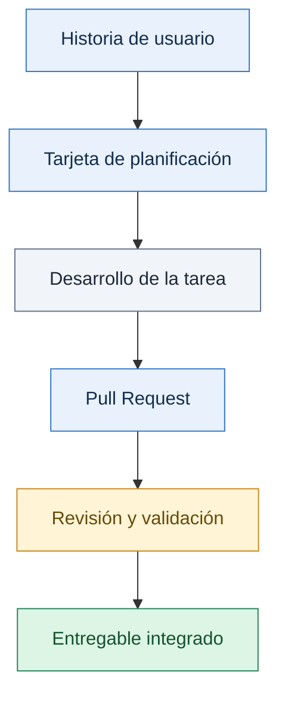

# VINTRA | Gestión Scrum

  <strong>Planificación · Coordinación · Seguimiento · Trazabilidad</strong>
   
  Documento de referencia para organizar y dar seguimiento al trabajo del equipo VINTRA.

  
  
  

---

## Contenido

- [1. Propósito](#1--propósito)
- [2. Documentación relacionada](#2-documentación-relacionada)
- [3. Historias de usuario](#3-historias-de-usuario-y-planificación-inicial)
- [4. Reglas de priorización](#4--reglas-de-priorización)
- [5. Planificación por sprints](#5--planificación-inicial-por-sprints)
- [6. Definition of Done](#6--definition-of-done-dod)
- [7. Acuerdos de las reuniones](#7--acuerdos-de-las-reuniones)
- [8. Trazabilidad de entregables](#8--relación-entre-issues-entregables-y-pull-requests)
- [9. Decisiones pendientes](#9--decisiones-pendientes)
- [10. Estado del documento](#10--estado-del-documento)

## 1.  Propósito

Este documento establece los acuerdos de trabajo bajo el enfoque Scrum para el proyecto VINTRA. Define cómo se organizan las historias de usuario, cómo se priorizan las actividades, qué condiciones debe cumplir un entregable para considerarse terminado y cómo se mantiene la trazabilidad entre la planificación y los resultados del desarrollo.

Su finalidad es facilitar la coordinación del equipo, mantener acuerdos verificables y favorecer una gestión organizada del alcance y de los avances del proyecto.

## 2. Documentación relacionada

La documentación de VINTRA se organiza por áreas para facilitar la colaboración entre las células de trabajo y evitar duplicar información.

| Documento o directorio | Propósito |
|---|---|
| [`../modelado/README.md`](../modelado/README.md) | Alcance funcional, actores, procesos, historias de usuario y reglas de negocio. |
| [`../arquitectura/`](../arquitectura/) | Arquitectura y organización de los componentes del sistema. |
| [`../frontend/`](../frontend/) | Documentación de la aplicación frontend. |
| [`../backend/`](../backend/) | Servicios, responsabilidades y contratos del backend. |
| [`../base-de-datos/`](../base-de-datos/) | Modelo de datos, relaciones y restricciones. |
| [`../ui-ux/`](../ui-ux/) | Diseño de interfaces y criterios de experiencia de usuario. |
| [`../infraestructura/`](../infraestructura/) | Entorno de desarrollo, configuración y despliegue. |

> Los enlaces podrán ampliarse con referencias a documentos específicos a medida que avance el proyecto.

## 3. Historias de usuario y planificación inicial

Las historias de usuario representan necesidades funcionales de VINTRA. Cada historia deberá contar con un identificador estable, una descripción comprensible, criterios de aceptación verificables y una prioridad acordada.

Las historias y sus criterios de aceptación deberán mantenerse en una ubicación oficial definida por el equipo. La planificación deberá conservar la correspondencia entre esa documentación y las tarjetas utilizadas para organizar el trabajo.

### 3.1. Historias previstas

La siguiente tabla representa la planificación inicial del proyecto. La distribución definitiva deberá confirmarse con el equipo.

| ID | Historia de usuario | Prioridad | Sprint previsto |
|---|---|---|---|
| HU1 | Acceso según rol | Alta | Sprint 1 |
| HU2 | Gestionar vehículos | Alta | Sprint 1 |
| HU3 | Gestionar estado de vehículos | Alta | Sprint 1 |
| HU4 | Gestionar personal operativo | Alta | Sprint 1 |
| HU5 | Gestionar cuadrillas y turnos | Alta | Sprint 1 |
| HU6 | Gestionar disponibilidad del personal | Alta | Sprint 1 |
| HU7 | Gestionar macrorrutas | Alta | Sprint 2 |
| HU8 | Crear microrrutas | Alta | Sprint 2 |
| HU9 | Asociar barrios a una microrruta | Alta | Sprint 2 |
| HU10 | Asignar recursos a una microrruta | Alta | Sprint 2 |
| HU11 | Gestionar doble recorrido de vehículo de 7 yd³ | Media | Sprint 2 |
| HU12 | Trazabilidad de asignaciones | Media | Sprint 2 |

### 3.2. Información mínima de cada historia

Cada historia deberá documentarse con la información que corresponda:

- Identificador y título.
- Actor o rol involucrado.
- Descripción de la necesidad.
- Contexto y precondiciones.
- Criterios de aceptación verificables.
- Prioridad y sprint previsto o asignado.
- Dependencias funcionales o técnicas conocidas.
- Responsable y estado actual.
- Enlace a la tarjeta de planificación y al issue de GitHub, cuando corresponda.

La información deberá mantenerse actualizada en la ubicación oficial acordada por el equipo.

## 4.  Reglas de priorización

La priorización permite ordenar el trabajo según las necesidades del proyecto y las condiciones de desarrollo.

Para tomar decisiones, el equipo considerará:

- **Valor funcional:** contribución de la historia a los objetivos del MVP.
- **Dependencias:** funcionalidades que deben existir previamente.
- **Riesgo:** incertidumbres técnicas u operativas que conviene resolver.
- **Impacto:** consecuencias de aplazar una funcionalidad.
- **Capacidad:** trabajo que el equipo puede asumir durante el sprint.
- **Verificabilidad:** claridad de los criterios de aceptación y posibilidad de comprobarlos.

Las prioridades registradas deberán mantenerse alineadas con los acuerdos de planificación. Cualquier cambio deberá responder a una decisión del equipo y reflejarse en las herramientas y documentos correspondientes.

La prioridad de una historia no determina, por sí sola, el sprint en el que se implementará.

## 5.  Planificación inicial por sprints

La distribución presentada constituye una propuesta inicial y deberá revisarse según la capacidad del equipo, las dependencias y los acuerdos de planificación.

### Sprint 1. Acceso, flota y personal

**Historias previstas:** HU1, HU2, HU3, HU4, HU5 y HU6.

**Objetivo funcional propuesto:** establecer las capacidades iniciales de acceso al sistema y administración de vehículos y personal, incluyendo la gestión de estados, cuadrillas, turnos y disponibilidad necesarios para la planificación operativa.

### Sprint 2. Rutas, asignaciones y trazabilidad

**Historias previstas:** HU7, HU8, HU9, HU10, HU11 y HU12.

**Objetivo funcional propuesto:** organizar las macrorrutas y microrrutas, asociar barrios, asignar recursos de acuerdo con las reglas operativas y consultar la trazabilidad de las asignaciones.

> La inclusión de una historia en un sprint no garantiza que se complete durante este. Los objetivos y la distribución deberán ajustarse a los acuerdos reales del equipo.

## 6.  Definition of Done (DoD)

La *Definition of Done* establece las condiciones comunes que debe cumplir un trabajo para considerarse terminado.

**Estado de esta propuesta:** pendiente de revisión y aprobación por parte del equipo.

Una historia o tarea se considerará terminada cuando, según corresponda:

- Cumpla los criterios de aceptación acordados.
- Respete la estructura y las convenciones del proyecto.
- Se hayan ejecutado las pruebas y validaciones pertinentes y se conozcan sus resultados.
- No presente defectos conocidos que impidan cumplir el objetivo de la historia.
- Se hayan verificado los permisos y las restricciones aplicables.
- La documentación afectada se encuentre actualizada.
- Los cambios estén vinculados a la tarea correspondiente.
- Se hayan adjuntado las evidencias de validación requeridas.
- El Pull Request haya recibido las revisiones y aprobaciones exigidas.
- Los comentarios relevantes de revisión se hayan resuelto antes de integrar los cambios.
- La integración se haya realizado conforme al flujo de trabajo acordado.

La DoD no sustituye los criterios de aceptación específicos de cada historia. Para considerar terminado el trabajo deberán cumplirse ambos conjuntos de condiciones.

Las casillas representan los criterios propuestos; no indican que el equipo ya los haya aprobado ni que una tarea concreta esté terminada.

## 7.  Acuerdos de las reuniones

En esta sección se registrarán los acuerdos de las reuniones que modifiquen el alcance funcional, la priorización, los criterios de aceptación o la forma de organizar el trabajo.

Cada registro deberá incluir:

- **Fecha:** día en que se tomó la decisión.
- **Tema:** asunto tratado.
- **Decisión:** acuerdo alcanzado.
- **Contexto:** justificación, cuando corresponda.
- **Elementos afectados:** historias o documentos relacionados.
- **Responsable:** persona encargada de aplicar el cambio.
- **Referencias:** enlaces a tarjetas, issues o Pull Requests relacionados, cuando existan.

Los temas que todavía no tengan una decisión definitiva deberán registrarse como pendientes, sin presentarlos como acuerdos aprobados.

## 8.  Relación entre issues, entregables y Pull Requests

El trabajo planificado deberá mantener trazabilidad entre la necesidad funcional, la tarea registrada en las herramientas del equipo y el resultado obtenido.

| Elemento | Información que debe relacionarse |
|---|---|
| Historia de usuario | Identificador, descripción y criterios de aceptación. |
| Tarjeta de planificación | Enlace, responsable, prioridad y estado. |
| Issue de GitHub | Referencia al trabajo, cuando se utilice. |
| Entregable | Resultado obtenido y ubicación en el repositorio. |
| Pull Request | Cambios asociados, revisiones, validaciones y evidencias. |

### Flujo de trazabilidad

Cuando corresponda, estos elementos deberán vincularse para identificar qué necesidad atiende cada cambio, dónde se encuentra su implementación y cómo se verificó el resultado.

Las evidencias de validación deberán adjuntarse según los acuerdos del equipo. No será necesario crear un issue independiente para cada tarjeta si el equipo no ha establecido esa regla.

Las convenciones de ramas, commits, revisión e integración se consultarán en la documentación de Git y GitHub del proyecto, evitando duplicar aquí sus procedimientos.

## 9.  Decisiones pendientes

Las decisiones que puedan afectar el alcance, la planificación, las reglas de negocio o los criterios de aceptación deberán registrarse con una persona responsable y una fecha de revisión.

| Decisión o actividad | Responsable | Fecha de revisión | Estado |
|---|---|---|---|
| Validar los criterios de aceptación de HU1–HU12 | Célula Scrum y responsables funcionales | Por acordar | Pendiente |
| Revisar y aprobar la Definition of Done | Equipo del proyecto | Por acordar | Pendiente |
| Confirmar los objetivos y la capacidad de cada sprint | Equipo del proyecto | Por acordar | Pendiente |
| Confirmar las reglas relacionadas con disponibilidad, asignaciones y doble recorrido | Responsables funcionales | Por acordar | Pendiente |
| Verificar la trazabilidad entre la planificación, GitHub y los entregables | Célula Scrum y responsables de desarrollo | Por acordar | Pendiente |

Los responsables y las fechas deberán completarse con los acuerdos reales del equipo. Una vez resuelta una decisión, se registrará el resultado y se actualizará la documentación afectada.

## 10.  Estado del documento

  

| Campo | Descripción |
|---|---|
| **Responsable** | Célula Scrum |
| **Última actualización** | Por registrar |
| **Estado** | Borrador para revisión del equipo |
| **Pendientes principales** | Validar los criterios de aceptación, aprobar la DoD, confirmar la ubicación oficial de las historias y completar responsables y fechas de revisión. |

Este documento deberá actualizarse cuando existan acuerdos que modifiquen la organización del trabajo o la planificación del proyecto.

---

  VINTRA · Documentación de gestión y seguimiento del proyecto

